# Tutors Architecture

**This file is the authority on the shape of Tutors, the intent behind it and its boundaries.** When code and this document disagree, one of them is wrong and the pull request that fixes it changes both. The structural statements in it are executable: Rules 0340 to 0355 in [`tests/bdd/features/developer/hexagonal-architecture.feature`](tests/bdd/features/developer/hexagonal-architecture.feature) check the repository against them on every pull request, and [`.dependency-cruiser.cjs`](.dependency-cruiser.cjs) enforces the dependency rules they state. The decision itself is recorded in [ADR 0001](docs/adr/0001-hexagonal-architecture.md).

Three companion pages go deeper, and none of them repeats this one:

- [`HOW-TO-CONTRIBUTE.md`](HOW-TO-CONTRIBUTE.md): where a change goes, by what you want to do and what you know. Start there if you are new.
- [`docs/DOMAIN-MODEL.md`](docs/DOMAIN-MODEL.md): the domain model, context by context, with its language, value rules, policies and events.
- [`docs/BOUNDARIES.md`](docs/BOUNDARIES.md): each boundary (security, database, UX, UI, testing, operations) with what it owns, what may cross it and what holds the line.

Diagrams are Mermaid and render on GitHub. The C4 diagrams go from the system in its world (Context) to its deployable units (Containers) to the parts inside the reader (Components); the sequence diagrams show each core part doing its job through the rings.

## Contents

1. [Intent](#1-intent)
2. [System context (C4 level 1)](#2-system-context-c4-level-1)
3. [Containers (C4 level 2)](#3-containers-c4-level-2)
4. [The rings](#4-the-rings)
5. [The domain model](#5-the-domain-model)
6. [The ports](#6-the-ports)
7. [The adapters](#7-the-adapters)
8. [Composition roots](#8-composition-roots)
9. [Components of the reader (C4 level 3)](#9-components-of-the-reader-c4-level-3)
10. [Core parts, each as a sequence](#10-core-parts-each-as-a-sequence)
11. [The boundary map](#11-the-boundary-map)
12. [Ownership: who may know what](#12-ownership-who-may-know-what)
13. [Data ownership](#13-data-ownership)
14. [Dependency rules](#14-dependency-rules)
15. [Requirements (EARS)](#15-requirements-ears)
16. [Testing the architecture](#16-testing-the-architecture)
17. [Authoring toolchain and the published packages](#17-authoring-toolchain-and-the-published-packages)
18. [Deployment](#18-deployment)
19. [How to change things](#19-how-to-change-things)
20. [Glossary](#20-glossary)

---

## 1. Intent

Tutors is an open learning platform: a lecturer writes a course as a folder of markdown, the generator turns it into `tutors.json`, and the reader presents it to students, recording what they read, showing who else is present and letting a lecturer see engagement over time. The platform runs on Supabase (Postgres, Realtime), signs students in with GitHub through Better Auth, renders markdown with markdown-it, Shiki and KaTeX, and reads assignments from Moodle.

The architecture is **hexagonal** (ports and adapters), with a domain model at its centre in the domain-driven sense. The rules of a course, of learning records, of presence, of access and of the catalogue live in a **domain** ring that imports nothing. The **application** ring says what the product needs from the outside world as **ports** (interfaces) and holds the **use cases** that drive the domain through them. Everything that touches a technology is an **adapter** around those two rings: Supabase, Better Auth, markdown, localStorage, Moodle, the Svelte state and the UI. Each **app** is a composition root that reads its environment once and decides which adapter sits behind each port.

The intent is not to replace any technology. Supabase, Better Auth and the markdown toolchain stay. The intent is that:

- every rule of the product can be tested without a database, a browser or a network, through the in-memory adapters that ship with the application ring;
- each technology has exactly one home, so a dependency bump, a vendor advisory or a change in how a technology is used is made in one package;
- each concern has exactly one boundary (section 11), so a security question, a schema question and a visual question each have one place to ask and one set of files to read;
- the anonymous reader (`PUBLIC_ANON_MODE=TRUE`) is the same product composed with different adapters, not a second code path;
- the shape is enforced, not described: a pull request that crosses a ring or a boundary fails before review.

---

## 2. System context (C4 level 1)

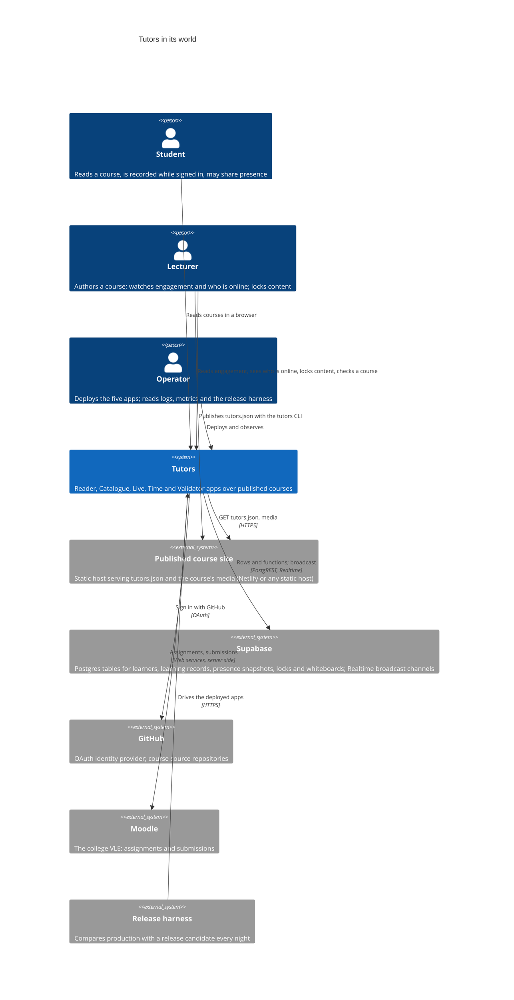

**Boundary of the system.** Tutors owns the five apps and the packages in this repository. It does not own the course content (the lecturer's repository and static host), the identity (GitHub), the store (Supabase's service) or the VLE. Everything it does not own is reached through a port, and every port has an in-memory adapter.

---

## 3. Containers (C4 level 2)

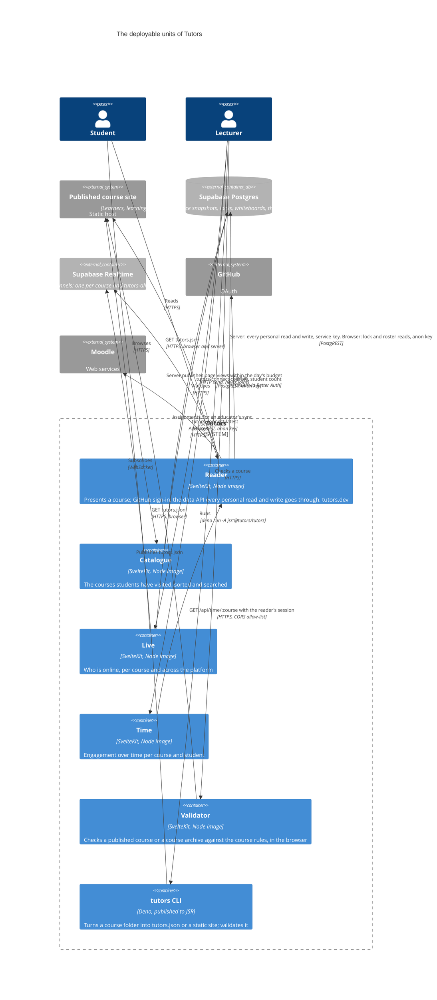

Each app is a SvelteKit application built into a Node container image on quay.io/tutors-sdk (signed with cosign, with an SBOM) and deployed from the kustomize overlays under `deploy/k8s`. The CLI is a Deno program published to JSR. The apps share one Supabase project. Only the reader has a server that holds secrets: the session secret, the GitHub OAuth pair, the Supabase service key and the Moodle token.

---

## 4. The rings

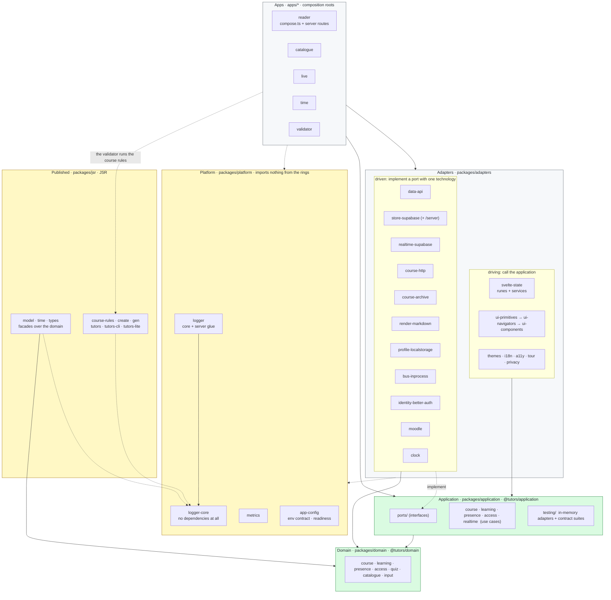

Solid arrows are dependencies between rings and always point inward. Dotted arrows are the two things beside the rings: the platform, which every adapter and app may use and which uses nothing back, and the published packages, which reach the domain only through their facades.

| Ring | Directory | Package | May import | Owns |
|---|---|---|---|---|
| Domain | `packages/domain` | `@tutors/domain` (`/course`, `/course/vocabulary`, `/course/address`, `/learning`, `/presence`, `/access`, `/quiz`, `/catalogue`, `/input`) | Nothing outside itself | The model of section 5: what a course, a learning event, a present learner, a role, a lock, a quiz score and a catalogue order are, and what a well-formed input is |
| Application | `packages/application` | `@tutors/application` (`/ports`, `/testing`) | The domain | The ports, the use cases, the realtime gateway and its budget, the in-memory adapters and the contract suite each adapter of a port must pass |
| Driven adapters | `packages/adapters/driven/*` | `@tutors/<name>` | Ports, domain, one technology, `@tutors/logger` | One technology each, behind a port |
| Driving adapters | `packages/adapters/driving/*` | `@tutors/<name>` | Ports, domain, `svelte-state`, `@tutors/logger`; never a driven adapter | The Svelte state (the only home of runes), the UI, themes, i18n, a11y, tours, consent |
| Apps | `apps/*` | `tutors-reader`, `tutors-catalogue`, `tutors-live`, `tutors-time`, `tutors-validator` | Everything; never another app, never a database client | Composition, routes, server hooks, environment |
| Platform | `packages/platform/*` | `@tutors/logger-core`, `@tutors/logger`, `@tutors/metrics`, `@tutors/app-config` | Nothing in the rings | Logging, metrics, build configuration, the environment contract and the readiness answer; used by every adapter and app. `@tutors/logger-core` has no dependencies at all, so the static generator, the time library and the command-line tools log through the same logger and transports as the apps (Rules 0290 to 0292, `developer/shared-logger.feature`); `@tutors/logger` adds the SvelteKit server glue |
| Published | `packages/jsr/*` | `@tutors/tutors-model-lib`, `@tutors/tutors-time-lib`, `@tutors/tutors-types`, `@tutors/course-rules`, `@tutors/tutors-create`, `@tutors/tutors-gen-lib`, `@tutors/tutors`, `@tutors/tutors-cli`, `@tutors/tutors-lite` | The facades import the rings; the authoring toolchain is self-contained | Published packages: facades over the domain for one major, the course rules, and the authoring toolchain |

---

## 5. The domain model

`@tutors/domain` is plain TypeScript with no dependency. It is organised as **bounded contexts**, one directory and one import path each. A context owns its language: a word means one thing inside it, and other code uses the context's functions instead of restating its rules. The full model, with every value rule and the reasoning, is in [`docs/DOMAIN-MODEL.md`](docs/DOMAIN-MODEL.md).

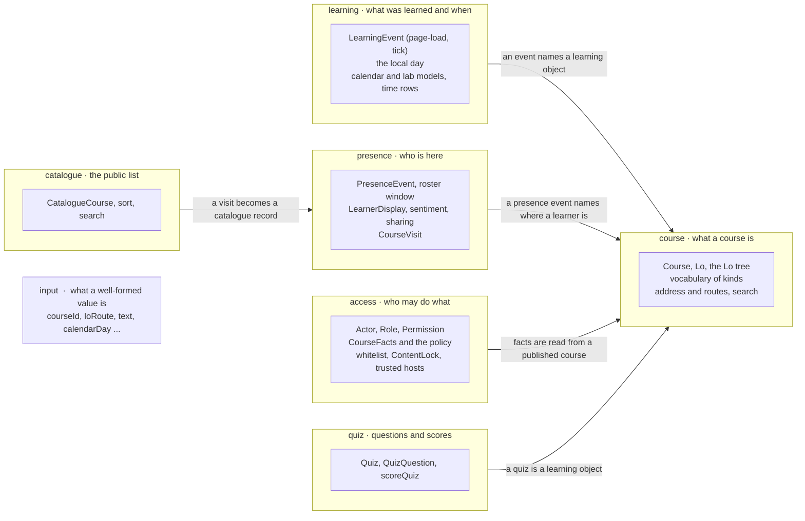

| Context | Import | Language (the words it owns) | Key rules and policies | Raises or shapes |
|---|---|---|---|---|
| Course | `@tutors/domain/course`, `/course/vocabulary`, `/course/address` | Course, learning object (Lo), topic, unit, lab, talk, panel, wall, companion, route, breadcrumb | `decorateCourseTree` builds the tree, routes, walls and table of contents from `tutors.json`; `LO_TYPES` is the closed vocabulary of kinds; `courseAddress` and `tutorsJsonUrl` say where a course is published; `searchHits` | The `Course` every other context refers to |
| Learning | `@tutors/domain/learning` | Learning event, page load, tick, calendar day, learning record, lab step | `pageLoadEvent`, `tickEvent` (one tick is thirty seconds); `localYyyyMmDd` cuts the day in the learner's zone; `BaseCalendarModel`, `BaseLabModel`; `pseudonymise` removes other learners' names from time rows | `LearningEvent`; the row shapes the store keeps |
| Presence | `@tutors/domain/presence` | Present, roster, roster window, sharing, sentiment, online status, course visit, favourite | `presentLearners` and `keepOnRoster` decide who counts as present (`ROSTER_WINDOW_MS`); `onlineStatusFor`, `parseSharing`; `recordCourseVisit`, `favouriteCourseVisit` | `PresenceEvent`, `CourseVisit` |
| Access | `@tutors/domain/access` | Actor, login, role (student, educator), permission, administrator, enrolment, whitelist, content lock, trusted host | `permits(asker, action, facts, admins)` is the one policy; `roleInCourse`; `sameLogin` (logins differ only by capitals are one account, Rule 0353); `whitelistAdmits`, `requiresSignIn`; `isLoLocked`; `courseJsonUrl` admits only an allowed host | `CourseFacts`, `ContentLock`, `Permission` |
| Quiz | `@tutors/domain/quiz` | Quiz, question, answer, score | `scoreQuiz`, `isQuizComplete` | `QuizScore` |
| Catalogue | `@tutors/domain/catalogue` | Catalogue course, sort, search term | `arrangeCatalogue`, `matchesCatalogueSearch`, `CATALOGUE_SORTS` | The order the catalogue shows |
| Input | `@tutors/domain/input` | Well-formed course id, route, text, day, sentiment, status, image URL | One function per value: it returns the accepted value or nothing, so a route cannot half-validate | Values the server will accept |

The contexts meet in three ways only. A context may **name** another's type (a learning event names a learning object). The application ring **sequences** them in a use case (`visitCourse` records a visit and counts it). And one part of the product tells another that something happened through an **application event** (`learning`, `presence`, `course-visit`) on the `EventPublisher` port, so the catalogue hears about a visit without the reader's services importing it.

---

## 6. The ports

A port is an interface in `packages/application/src/ports/`. It is named for what the application needs, not for the technology that provides it. Every port has an in-memory adapter in `@tutors/application/testing`, and the ones with behaviour worth contracting have a contract suite there that every adapter of the port runs.

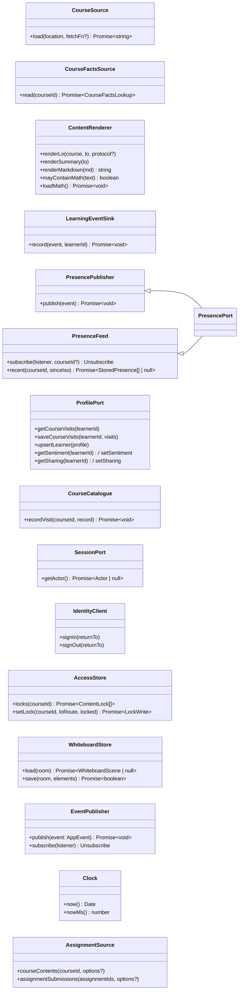

| Port | What the application needs | Driven adapters | In-memory adapter | Contract suite |
|---|---|---|---|---|
| `CourseSource` | The text of a published `tutors.json` | `course-http` (`httpCourseSource`) | `InMemoryCourseSource` | none |
| `CourseFactsSource` | Who teaches a published course and who may read it, read by the server from a trusted host | `course-http` (`publishedCourseFacts`) | `InMemoryCourseFacts` | none |
| `ContentRenderer` | Markdown to HTML, maths on demand | `render-markdown` | `PassThroughRenderer` | none |
| `LearningEventSink` | Record a page load or a 30-second tick for a learner | `data-api` (`dataApiLearningEventSink`) | `InMemoryLearningEventSink` | `learningEventSinkContract` |
| `PresencePublisher` | Share where a learner is | `data-api` (`dataApiPresencePublisher`) | `InMemoryPresence` | `presenceContract` |
| `PresenceFeed` | Watch a course; read who was active since | `realtime-supabase` (`supabasePresence`) | `InMemoryPresence` | `presenceContract` |
| `PresencePort` | Both halves, as the services see them | Composed in the app from the two above | `InMemoryPresence` | `presenceContract` |
| `ProfilePort` | A learner's visit history, sentiment and sharing | `data-api` (`dataApiProfile`, signed in), `profile-localstorage` (not signed in) | `InMemoryProfile` | `profileContract` |
| `CourseCatalogue` | Count a course visit for the public catalogue | `data-api` (`dataApiCourseCatalogue`) | `InMemoryCourseCatalogue` | none |
| `SessionPort` | The verified actor of a request | `identity-better-auth/server` | `FixedSession` | none |
| `IdentityClient` | Sign in and out from the browser | `identity-better-auth/client` | `RecordingIdentityClient` | none |
| `AccessStore` | The content locks lecturers set | `store-supabase` (`supabaseLockReader`, reads) and `data-api` (`dataApiLockWriter`, writes) | `InMemoryAccessStore` | `accessStoreContract` |
| `WhiteboardStore` | Keep and load a whiteboard's drawing | `data-api` (`dataApiWhiteboard`) | `InMemoryWhiteboard` | none |
| `EventPublisher` | Tell the rest of the application something happened | `bus-inprocess` | `RecordingPublisher` | `eventPublisherContract` |
| `Clock` | The instant, so time can be frozen | `clock` | `FixedClock` | none |
| `AssignmentSource` | Assignments and submissions from the VLE | `moodle` | `InMemoryAssignmentSource` | none |

Two more interfaces sit beside the ports in `packages/application/src/realtime`: `RealtimeAdapter` (and its `AdapterChannel`) is what the realtime gateway needs from a broker, implemented by `realtime-supabase` (`supabaseRealtimeAdapter`) and by `offlineAdapter`. The gateway owns topics, the per-tab budget and reconnection, so no package joins a channel by itself.

Application events (`AppEvent`) are `learning` (a learner's page load or tick), `presence` (a sharing learner moved) and `course-visit` (a learner opened a course; the catalogue counts it). They are how one part of the product reacts to another without importing it.

---

## 7. The adapters

### Driven adapters (`packages/adapters/driven/`)

| Package | Technology (the only package that imports it) | Ports | Also exports |
|---|---|---|---|
| `@tutors/data-api` | The reader's own `/api` routes over `fetch` | `LearningEventSink`, `PresencePublisher`, `ProfilePort`, `CourseCatalogue`, `WhiteboardStore`, `AccessStore` (writes) | The typed contract of the routes and the one client (`dataApi`) |
| `@tutors/store-supabase` | `@supabase/supabase-js` (shared with realtime-supabase), anon key | `AccessStore` (reads) | The client seam (`createSupabaseClient`, `configureSupabase`), the catalogue reads, presence rows, the error transport, the health check |
| `@tutors/store-supabase/server` | The same client with the service key; server only | none: the reader's routes call its functions after they have authorised the request | `createServiceClient`, the learner store, `readTimeRows`, the Moodle cache writes, enrolment reads, `useServerClock` |
| `@tutors/realtime-supabase` | `@supabase/supabase-js` Realtime | `PresenceFeed`, `RealtimeAdapter` | `watchLiveFeed`; `/live-activity.server` publishes a learner's activity within the day's budget |
| `@tutors/course-http` | `fetch` | `CourseSource`, `CourseFactsSource` | `CourseNotFoundError`, `CourseUnreachableError`, `CourseTimedOutError` are defined in the port |
| `@tutors/course-archive` | `fflate` (zip), over `@tutors/course-rules` | none: the validator and the reader's course check call it | `checkZip`, `checkGeneratedFiles`, `courseFromZip` |
| `@tutors/render-markdown` | `markdown-it` and plugins, `shiki`, `katex` | `ContentRenderer` | The conversions the model facade re-exports (`convertLoToHtml`, ...) |
| `@tutors/profile-localstorage` | `localStorage` | `ProfilePort` | none |
| `@tutors/bus-inprocess` | none | `EventPublisher` | none |
| `@tutors/identity-better-auth` | `better-auth` | `SessionPort` (`/server`), `IdentityClient` (`/client`) | `createIdentityHandle` |
| `@tutors/moodle` | Moodle web services over `fetch` | `AssignmentSource` | none |
| `@tutors/clock` | `HARNESS_NOW` | `Clock` | The `/version` endpoint |

### Driving adapters (`packages/adapters/driving/`)

| Package | Role | Reaches the outside world through |
|---|---|---|
| `@tutors/svelte-state` | The reader's state (`currentCourse`, `currentLo`, `tutorsId`, ...) and services (`courseService`, `analyticsService`, `presenceService`, `liveService`, `tutorsConnectService`, `rbacService`, `markdownService`). The only package in which `$state`, `$derived` and `$effect` appear in `.ts` modules. | `adapters()`, the port set the app installed with `configureAdapters` |
| `@tutors/ui-primitives` → `@tutors/ui-navigators` → `@tutors/ui-components` | The UI, in a strict one-directional layering | `svelte-state` |
| `@tutors/themes`, `@tutors/i18n`, `@tutors/a11y`, `@tutors/tour`, `@tutors/privacy` | Cross-cutting: theme and icons, language, reduced motion, guided tours, consent | `svelte-state`; none imports a UI package |

A driving adapter never imports a driven adapter (`svelte-state-imports-no-adapter`, `ui-imports-no-driven-adapter`). It asks `adapters()` for the port and the app has already decided what is behind it.

---

## 8. Composition roots

Each app that talks to the outside world has one file that reads the environment and composes the adapters, called once from `hooks.server.ts` and `hooks.client.ts` so the server and the browser run the same wiring. Composition roots are the only files that decide whether an app is anonymous (Rule 0345), and with the state adapter's defaults the only files that may use the in-memory adapters outside tests (`test-doubles-only-in-composition`).

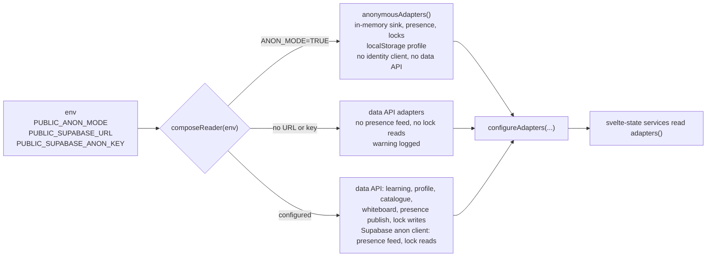

| App | Root | Composes |
|---|---|---|
| reader | `apps/reader/src/lib/compose.ts` `composeReader(env, { identityClient })` | Clock, `markdownRenderer`, `httpCourseSource()`, `localStorageProfile()`, `inProcessPublisher()`; in a served deployment the data API adapters for everything personal, `supabasePresence(client)` for the feed and `supabaseLockReader()` for lock reads; subscribes `countCourseVisit` to `course-visit` events |
| live | `apps/live/src/lib/compose.ts` `composeLive(env)` | Clock and `supabasePresence(client)`; Live only listens, so its publisher does nothing |
| catalogue | `apps/catalogue/src/lib/compose.ts` `composeCatalogue(env)` | The Supabase anon client behind the catalogue reads |
| time | `apps/time/src/lib/compose.ts` `composeTime(env)` | The Supabase anon client for the health check and error transport; `apps/time/src/lib/time-source.ts` points the time library at the reader's `/api/time` |
| validator | none: it reaches no port | `@tutors/course-rules` and `@tutors/course-archive`, run in a worker in the browser |

The reader's **server** is composed in `apps/reader/src/hooks.server.ts` and `apps/reader/src/lib/server/`: the auth mode from `PUBLIC_ANON_MODE` and `PRIVATE_AUTH_SECRET` (`enabled`, `anonymous`, `unconfigured`), the identity handle, the service client (`PRIVATE_SUPABASE_SERVICE_ROLE_KEY`), the server clock, and the authorization service (`createAuthorization` over `publishedCourseFacts`, with `PRIVATE_COURSE_HOSTS` and `PRIVATE_TUTORS_ADMINS`). A misconfigured deployment serves courses anonymously and logs the misconfiguration once at startup.

Tests compose the same roots: `anonymousReader()` in `tests/support/reader-adapters.ts` is `configureAdapters(composeReader({ PUBLIC_ANON_MODE: "TRUE" }))`, and the BDD features that record Supabase traffic run `composeReader(publicEnv, { identityClient })` against a recording client.

---

## 9. Components of the reader (C4 level 3)

```mermaid
C4Component
  title Inside the reader container

  Container_Boundary(reader, "Reader") {
    Component(routes, "Pages", "SvelteKit +page / +layout", "course, topic, lab, note, talk, video, quiz, wall, search, time, whiteboard, auth, create")
    Component(api, "Data API", "SvelteKit +server", "/api/analytics, /api/presence, /api/live/activity, /api/profile, /api/me, /api/courses/visit, /api/locks, /api/whiteboard, /api/time/:course, /api/courses/:course/enrollment, locks and moodle-sync")
    Component(hooks, "hooks.server.ts", "SvelteKit", "Request log, metrics, locale, security headers, identity handle; composes the adapters")
    Component(serverLib, "lib/server", "TypeScript", "The session user, the service client, the authorization service, the educator check")
    Component(compose, "compose.ts", "Composition root", "Reads PUBLIC_ANON_MODE and the Supabase env once; picks the adapter behind each port")

    Component(uiComponents, "ui-components", "Svelte", "Learning-object views, cards, time views")
    Component(uiNavigators, "ui-navigators", "Svelte", "Shell, navigators, footer")
    Component(uiPrimitives, "ui-primitives", "Svelte", "Icon, Image, Menu, Sidebar, toasts")
    Component(crossCutting, "themes · i18n · a11y · tour · privacy", "Svelte", "Theme, locale, reduced motion, tours, consent")

    Component(svelteState, "svelte-state", "Svelte 5 runes", "The state the UI reads and the services that call the use cases")
    Component(application, "@tutors/application", "TypeScript", "loadCourse, recordLearningEvent, sharePresence, courseRoster, visitCourse, countCourseVisit, courseAdmission, loadContentLocks, setContentLock, createAuthorization")
    Component(domain, "@tutors/domain", "TypeScript", "course, learning, presence, access, quiz, catalogue, input")

    Component(dataApi, "data-api", "LearningEventSink, ProfilePort, PresencePublisher, CourseCatalogue, WhiteboardStore, lock writes", "fetch to the reader's own /api")
    Component(courseHttp, "course-http", "CourseSource, CourseFactsSource", "GET tutors.json")
    Component(renderMarkdown, "render-markdown", "ContentRenderer", "markdown-it, Shiki, KaTeX")
    Component(storeSupabase, "store-supabase", "Lock reads, presence rows", "PostgREST, anon key")
    Component(storeServer, "store-supabase/server", "Learner store, time rows, Moodle cache", "PostgREST, service key")
    Component(realtimeSupabase, "realtime-supabase", "PresenceFeed; live activity publisher", "Broadcast channels + tutors-connect-latest")
    Component(profileLocal, "profile-localstorage", "ProfilePort", "Browser localStorage")
    Component(busInprocess, "bus-inprocess", "EventPublisher", "In-process listeners")
    Component(identityAdapter, "identity-better-auth", "SessionPort, IdentityClient", "Better Auth, GitHub")
    Component(moodleAdapter, "moodle", "AssignmentSource", "Moodle web services")
  }

  System_Ext(courseSite, "Published course site")
  ContainerDb_Ext(postgres, "Supabase Postgres")
  Container_Ext(realtime, "Supabase Realtime")
  System_Ext(github, "GitHub")

  Rel(hooks, compose, "configureAdapters(composeReader(env))")
  Rel(routes, uiComponents, "renders")
  Rel(uiComponents, uiNavigators, "")
  Rel(uiNavigators, uiPrimitives, "")
  Rel(routes, svelteState, "courseService.readCourse, analyticsService, presenceService")
  Rel(uiComponents, svelteState, "reads runes")
  Rel(crossCutting, svelteState, "reads runes")
  Rel(svelteState, application, "calls use cases with adapters()")
  Rel(application, domain, "")
  Rel(compose, dataApi, "composes")
  Rel(dataApi, api, "same-origin fetch with the session cookie")
  Rel(api, serverLib, "who is asking; may they")
  Rel(serverLib, application, "createAuthorization")
  Rel(serverLib, courseHttp, "publishedCourseFacts")
  Rel(api, domain, "input rules, policy, pseudonymise")
  Rel(api, storeServer, "after the check")
  Rel(api, realtimeSupabase, "receiveLiveActivity")
  Rel(api, moodleAdapter, "an educator's sync")
  Rel(hooks, identityAdapter, "createIdentityHandle")
  Rel(courseHttp, courseSite, "HTTPS")
  Rel(storeSupabase, postgres, "PostgREST")
  Rel(storeServer, postgres, "PostgREST")
  Rel(realtimeSupabase, realtime, "httpSend; subscribe")
  Rel(identityAdapter, github, "OAuth")
```

The other apps are smaller instances of the same shape: Live composes `realtime-supabase` behind `PresenceFeed` and subscribes; Catalogue reads the course list through `store-supabase` and orders it with `@tutors/domain/catalogue`; Time reads through the reader's `/api/time` and builds its models with `@tutors/domain/learning`; Validator runs the course rules on a published `tutors.json` or an archive.

---

## 10. Core parts, each as a sequence

### 10.1 Loading a course

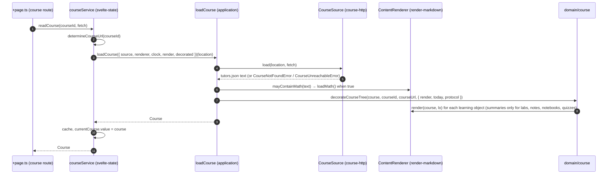

The reader renders labs, notes, notebooks and quizzes on demand, so `readerDecoration` hands the use case a `render` that converts only their summaries; `readLab` and friends render the body when opened. A 404 becomes `CourseNotFoundError`, an unreachable host `CourseUnreachableError`; the route maps them to a page.

### 10.2 Recording learning

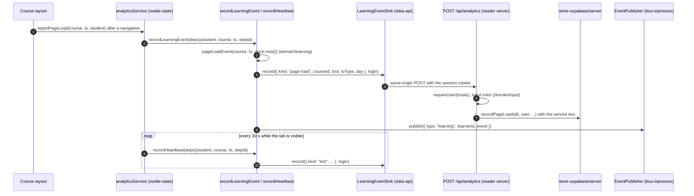

Nothing is recorded for a visitor who is not signed in: the use case returns before touching the port. The learner in a stored row is the session's actor, never a value from the request body. In anonymous mode the sink is in memory, so the same code runs and records nothing durable.

### 10.3 Presence: sharing where a learner is, and who is online

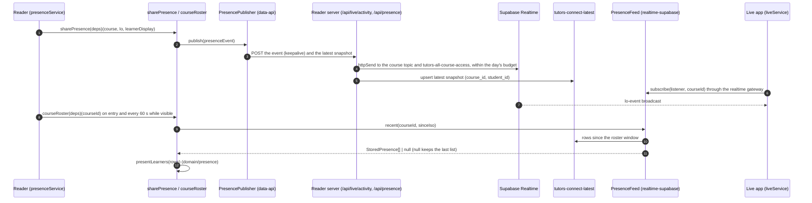

The browser **broadcasts nothing itself**: the reader's server publishes, and a reader tab reads the roster from stored rows. A course channel delivers every student's page view to every other student, so joining it grows with the square of the class. Live's course page is the only subscriber to a course channel and its landing page the only subscriber to the platform-wide feed, both through the realtime gateway and its budget.

### 10.4 Signing in and the actor

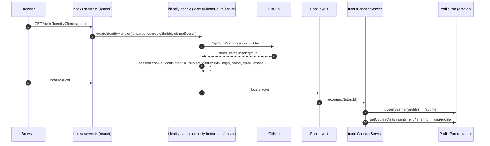

`Actor` is a domain type (`@tutors/domain/access`); `SessionPort` and `IdentityClient` are ports. Only `identity-better-auth` imports Better Auth, and browser entry points cannot reach its server module (`identity-no-server-in-browser`).

### 10.5 Visiting a course: admission, locks, the catalogue

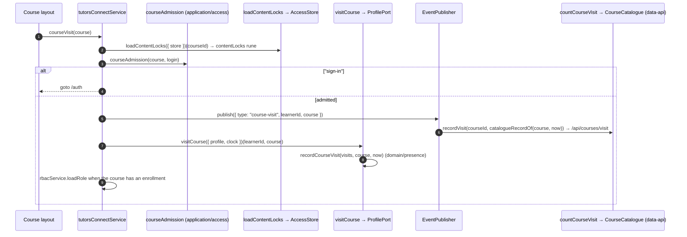

The catalogue is not called by the reader's services; it listens. Removing the catalogue would remove one `subscribe` in `composeReader` and nothing in the services.

### 10.6 A protected action: who is asking, and may they

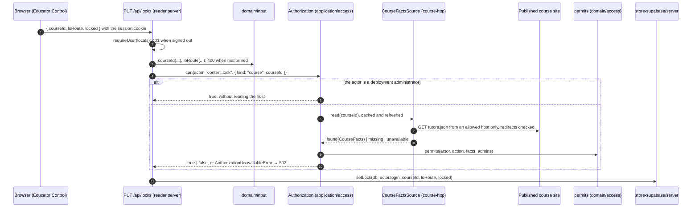

Every protected route has this shape: identify, validate, authorise, then touch the store. The policy is a pure function in the domain, the order of operations and the cache are a use case, and the route only maps outcomes to status codes. "Could not find out" is never treated as "no": an unreachable host is a 503, not a 403 (Rule 0073).

### 10.7 Tutors Time: engagement over time

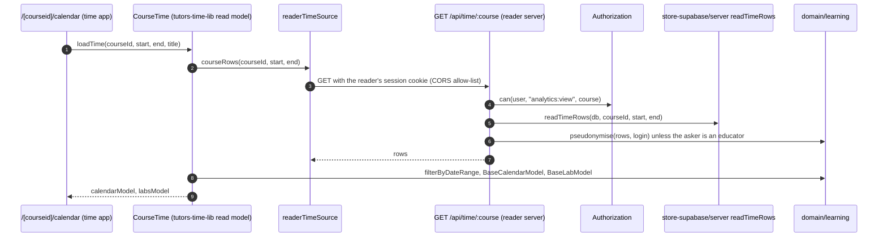

A student sees their own name and everyone else as a pseudonym; an educator of the course sees the class. The published time library still carries a Supabase source of its own for consumers outside this repository; that edge is the one database line in the baseline (section 14).

### 10.8 Generating a course

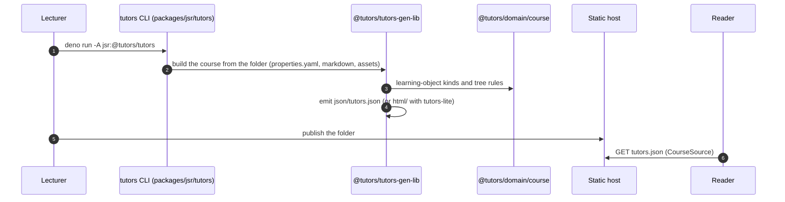

The authoring toolchain is deliberately outside the vendor rule. `tutors validate` runs `@tutors/course-rules` over the same folder, so a lecturer can check a course before publishing it.

---

## 11. The boundary map

The rings say which way dependencies point. The boundaries say **whose concern a thing is**. Every workspace package belongs to exactly one boundary (Rule 0354), so a question about security, the schema or the look of a page has one set of files to read and one guide. Each boundary is described in full, with what may cross it and what must not, in [`docs/BOUNDARIES.md`](docs/BOUNDARIES.md).

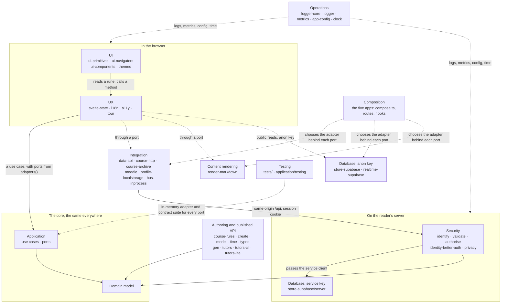

The picture shows the twelve boundaries and the form in which each crossing is allowed. The table is the authority on which package is in which boundary.

<!-- boundary-map:start -->

| Boundary | The question it answers | Packages | Also owns | Held by |
|---|---|---|---|---|
| **Domain model** | What is true about courses, learning, presence, access, quizzes and the catalogue, whatever the technology? | `@tutors/domain` | [`docs/DOMAIN-MODEL.md`](docs/DOMAIN-MODEL.md) | `domain-self-contained`; unit and property tests with no doubles |
| **Application** | What does the product do, in what order, and what does it need from outside? | `@tutors/application` | The ports, the use cases, the realtime gateway | `application-imports-domain-only`; use-case tests over in-memory adapters |
| **Security** | Who is asking, may they, and is what they sent well formed? | `@tutors/identity-better-auth`, `@tutors/privacy` | `@tutors/domain/access` and `@tutors/domain/input` (the rules), `createAuthorization` (the use case), `apps/reader/src/lib/server` and `hooks.server.ts` (the enforcement point), `tests/security`, [`SECURITY.md`](SECURITY.md) | `identity-provider-only-in-adapter`, `identity-no-server-in-browser`; the authorisation matrix (`developer/authorisation-matrix.feature`) and the header, cookie and CSRF contracts in `tests/security` |
| **Database** | Where is it kept, in which table, behind which key? | `@tutors/store-supabase`, `@tutors/realtime-supabase` | `supabase/migrations`, [`guides/MIGRATIONS.md`](guides/MIGRATIONS.md), [`guides/SERVER-WRITES.md`](guides/SERVER-WRITES.md) | `vendor-only-in-its-adapter`, `no-database-client-in-apps`, Rule 0355 (`tests/architecture/database-boundary.test.ts`), `pnpm check:migrations` |
| **Integration** | How does Tutors talk to something that is not a database: its own data API, a course host, Moodle, the browser's storage, an archive? | `@tutors/data-api`, `@tutors/course-http`, `@tutors/course-archive`, `@tutors/moodle`, `@tutors/profile-localstorage`, `@tutors/bus-inprocess` | The typed contract of the reader's `/api` routes | `no-adapter-to-adapter`; the port contract suites |
| **Content rendering** | How does markdown become what a student reads? | `@tutors/render-markdown` | Shiki, KaTeX, Marp and Mermaid use | `vendor-only-in-its-adapter` |
| **UX** | What does the learner experience: state, flow, language, accessibility, guidance? | `@tutors/svelte-state`, `@tutors/i18n`, `@tutors/a11y`, `@tutors/tour` | [`guides/PERSONAS.md`](guides/PERSONAS.md), the journeys in `tests/bdd/features/ui` and `student` | `svelte-state-imports-no-adapter`, `runes-only-in-svelte-state` (Rule 0344) |
| **UI** | What does it look like: components, layout, themes, tokens? | `@tutors/ui-primitives`, `@tutors/ui-navigators`, `@tutors/ui-components`, `@tutors/themes` | [`DESIGN.md`](DESIGN.md) | `ui-layering`, `ui-primitives-no-data-features`, `ui-imports-no-driven-adapter` |
| **Operations** | How is it built, configured, observed, released and deployed? | `@tutors/logger-core`, `@tutors/logger`, `@tutors/metrics`, `@tutors/app-config`, `@tutors/clock` | `Dockerfile`, `deploy/k8s`, `.github/workflows`, `release/`, the environment contract | `platform-self-contained`; `tests/conformance`, `tests/observability`, `pnpm check:k8s` |
| **Composition** | Which adapter is behind each port in this deployment, and which routes exist? | `tutors-reader`, `tutors-catalogue`, `tutors-live`, `tutors-time`, `tutors-validator` | `apps/*/src/lib/compose.ts`, routes and hooks | `no-app-to-app`, `adapters-import-no-app`, Rule 0345 |
| **Authoring and published API** | What does a lecturer run, and what do packages outside this repository import? | `@tutors/course-rules`, `@tutors/tutors-create`, `@tutors/tutors-model-lib`, `@tutors/tutors-time-lib`, `@tutors/tutors-types` | `@tutors/tutors-gen-lib`, `@tutors/tutors`, `@tutors/tutors-cli`, `@tutors/tutors-lite`; `etc/*.api.md` | `facades-import-rings-only`, `tutors-types-self-contained`, `course-rules-no-file-system`; the API surface reports |
| **Testing** | How do we know? | none: tests are not a package | `tests/`, `@tutors/application/testing` (the in-memory adapters and contract suites), [`guides/testing/TESTING-OVERVIEW.md`](guides/testing/TESTING-OVERVIEW.md) | `test-doubles-only-in-composition`; the coverage, mutation and completeness ratchets |

<!-- boundary-map:end -->

Three lines are worth saying outright, because they are where the concerns used to blur:

- **Security is decided in the domain and enforced on the server.** The browser's role checks (`rbacService`) decide what to show. They are never the control: every protected route asks `Authorization.can` again with the session's actor (section 10.6).
- **The database is behind two packages and two keys.** Browser code sees the anon client for public reads only (locks, the roster, the catalogue). Anything personal goes through the reader's data API and the service key, which exists only in `@tutors/store-supabase/server` and only on the reader's server.
- **UX is behaviour; UI is appearance.** A change to what happens when a learner does something is in `svelte-state` and a use case. A change to how it looks is in a UI package and DESIGN.md. A UI package holds no rule, makes no request and knows no adapter.

---

## 12. Ownership: who may know what

Ownership here means: which package is allowed to know a thing, and therefore which package a change goes in. People ownership is in [`.github/CODEOWNERS`](.github/CODEOWNERS) (today, `@tutors-sdk/maintainers` for every path); the lines below are what a reviewer holds a pull request to.

| Concern | Owner | Nobody else may |
|---|---|---|
| What a course is: learning-object kinds, the tree, routes, the vocabulary | `@tutors/domain/course` | Define a learning-object kind, or walk the tree with rules of its own |
| Where a course is published and how its address is formed | `@tutors/domain/course/address` | Build a `tutors.json` URL by hand |
| What a learning event is and how a day is cut | `@tutors/domain/learning` (`pageLoadEvent`, `tickEvent`, `localYyyyMmDd`) | Compute a day or an event shape |
| Who counts as present and for how long | `@tutors/domain/presence` (`ROSTER_REFRESH_MS`, `keepOnRoster`, `presentLearners`) | Decide roster membership |
| Who may do what in a course | `@tutors/domain/access` (`permits`, `roleInCourse`, `sameLogin`) | Compare logins, check an educator list or a whitelist inline |
| What a well-formed request value is | `@tutors/domain/input` | Validate a course id, a route or a day with a pattern of its own |
| Which hosts a course may be read from on the server | `@tutors/domain/access` (`courseJsonUrl`, `redirectTarget`) | Fetch a caller-supplied URL from the server |
| The order of an authorisation decision, its cache and its failure | `@tutors/application` `createAuthorization` | Treat "could not find out" as "no" |
| What the application needs from the world | `@tutors/application/ports` | Add a method a technology happens to offer; a port grows only when a use case needs it |
| The order of operations in a feature | `@tutors/application` use cases | Sequence port calls in a Svelte service or a route |
| Realtime topics, the per-tab budget and reconnection | `@tutors/application` realtime gateway | Join a channel directly |
| The Supabase client, every table and every database function | `@tutors/store-supabase`, `@tutors/realtime-supabase` | Import `@supabase/supabase-js` or name a table (baseline exception: `packages/jsr/time`) |
| The service key and every write of personal data | `@tutors/store-supabase/server`, called by the reader's server routes | Write a learner's row from a browser |
| The contract of the reader's data API | `@tutors/data-api` | Call `/api/...` with `fetch` from a service or a component |
| Markdown, syntax highlighting, maths, Marp, Mermaid | `@tutors/render-markdown` | Import `markdown-it`, `shiki`, `katex`, `mermaid`, `@marp-team/*` (baseline exception: `svelte-state/src/markdown`, moving) |
| Better Auth, the session cookie, the actor | `@tutors/identity-better-auth` | Import `better-auth`; read the session another way |
| What a course must satisfy to be published, and the words for each finding | `@tutors/course-rules` | Write a second message for the same finding |
| Runes and the reader's shared state | `@tutors/svelte-state` | Hold `$state` in a `.ts` module of another package |
| Which adapter is behind a port, and anonymous mode | `apps/*/src/lib/compose.ts` | Decide for itself whether it is anonymous; construct a driven adapter |
| UI layering | `ui-primitives` → `ui-navigators` → `ui-components` | Import upward, import a UI package from a cross-cutting package, or import a driven adapter |
| Colours, spacing, type and icons | `@tutors/themes` and [`DESIGN.md`](DESIGN.md) | Hard-code a colour or a size in a component |
| Logging, metrics, build options, the environment contract | `packages/platform` | Depend on the rings from a platform package |
| The published API of the JSR packages and of the ports | `etc/*.api.md` (API surface reports) | Change an export without the report changing with it |
| What a release intends to change | `release/claims.yaml`, judged by the release harness | Ship an observable difference no claim covers |

Boundaries between the apps: an app never imports another app (`no-app-to-app`). What two apps share lives in a package.

---

## 13. Data ownership

Every Supabase table, database function and channel is named in exactly one of the two database adapters, and nowhere else (Rule 0355). The "Key" column says which client reaches it: **anon** is the public key every page ships and is limited to public reads; **service** is the reader's server, after the route has identified and authorised the caller.

| Table or channel | Adapter | Reached through | Key | Written by | Read by |
|---|---|---|---|---|---|
| `tutors-connect-users` | `store-supabase/server` (learner store, enrolment, time rows) | `ProfilePort` → `/api/me` | service | Reader server on sign-in, sentiment and sharing changes | Reader server: the learner's own status; educators' enrolment export; Time rows |
| `tutors-connect-profiles` | `store-supabase/server` (learner store) | `ProfilePort` → `/api/profile` | service | Reader server (course visits of a signed-in learner) | Reader server, for that learner |
| `learning_records` | `store-supabase/server` (learner store, time rows) | `LearningEventSink` → `/api/analytics`; `/api/time` | service | Reader server (page loads, ticks) | Reader server for Time |
| `calendar` | `store-supabase/server` (learner store, enrolment, time rows) | `LearningEventSink` → `/api/analytics`; `/api/time` | service | Reader server (one row per learner per day, `increment_calendar`) | Reader server for Time and the enrolment export |
| `tutors-connect-latest` | `store-supabase/server` (write), `realtime-supabase` and `store-supabase` presence rows (read) | `PresencePublisher` → `/api/presence`; `PresenceFeed` | service to write, anon to read | Reader server (latest snapshot per sharing learner per course) | Reader (roster), Live |
| `tutors_content_locks` | `store-supabase/server` (write), `store-supabase` access store (read) | `AccessStore` | service to write, anon to read | Reader server, for an educator of the course | Reader |
| `tutors-connect-courses` | `store-supabase/server` (write), `store-supabase` catalogue (read) | `CourseCatalogue` → `/api/courses/visit` | service to write, anon to read | Reader server, on a course visit (through the `course-visit` event) | Catalogue; the health check; Time rows |
| `whiteboard_scenes` | `store-supabase/server` (learner store) | `WhiteboardStore` → `/api/whiteboard` | service | Reader server, for the room's owner or an educator of a shared room | Reader server |
| `assignments` | `store-supabase/server` (Moodle submissions, time rows) | the Moodle sync route; `/api/time` | service | Reader server, when an educator syncs Moodle | Reader server for Time |
| `assignments_submissions` | `store-supabase/server` (Moodle submissions, time rows) | the Moodle sync route; `/api/time` | service | Reader server, when an educator syncs Moodle | Reader server for Time |
| `app_errors` | `store-supabase` (error transport, health check) | the logger's transport | anon (insert only) | Every app's logger | Operators; `get_error_counts` |
| Realtime channel `<courseId>` | `realtime-supabase` | `PresencePublisher` → `/api/live/activity`; `PresenceFeed` | service to send, anon to subscribe | Reader server (HTTP send within the day's budget, never joined) | Live course page |
| Realtime channel `tutors-all-course-access` | `realtime-supabase` | `PresencePublisher` → `/api/live/activity`; `PresenceFeed` | service to send, anon to subscribe | Reader server (HTTP send) | Live landing page |

Database functions follow the same rule: `get_student_count` and `get_error_counts` in `store-supabase`; `get_count_learning_records` and `increment_calendar` in `store-supabase/server`; `realtime_watch` and `realtime_claim_live_publish` (the watcher count and the day's publishing budget) in `realtime-supabase`.

The published time library (`packages/jsr/time/src/services/source.ts`) names `calendar`, `learning_records`, `tutors-connect-courses` and `tutors-connect-users` in its Supabase source for consumers outside this repository. The time app does not use it: it reads through `/api/time`.

Migrations are expand-only and live under `supabase/migrations/`; `pnpm check:migrations` holds the rule. A migration ships before or after the code that uses it, never in the same deploy as a contraction.

---

## 14. Dependency rules

All in [`.dependency-cruiser.cjs`](.dependency-cruiser.cjs), run by `tests/architecture/dependency-rules.test.ts` over a negative fixture workspace (every rule must catch its planted violation) and over the repository (no violation beyond the baseline). `pnpm architecture-report` draws the graph.

| Rule | Statement | Boundary it holds |
|---|---|---|
| `domain-self-contained` | `packages/domain` imports nothing outside itself | Domain model |
| `application-imports-domain-only` | `packages/application` imports only `packages/domain` and its own files | Application |
| `vendor-only-in-its-adapter` | `@supabase/*` only from store-supabase and realtime-supabase; markdown-it, katex, shiki, mermaid and `@marp-team/*` only from render-markdown; better-auth only from identity-better-auth. The authoring toolchain is exempt | Database, Content rendering, Security |
| `no-database-client-in-apps` | No app imports a database client; an app reaches stored data through `@tutors/store-supabase`, its `/server` entry or `@tutors/realtime-supabase` | Database |
| `no-adapter-to-adapter` | A driven adapter imports no other adapter | Integration |
| `svelte-state-imports-no-adapter` | `svelte-state` imports no adapter; it reads `adapters()` | UX |
| `ui-imports-no-driven-adapter` | No driving adapter (state, UI, themes, i18n, a11y, tour, privacy) imports a driven adapter | UI, UX |
| `ui-layering` | `ui-primitives` → `ui-navigators` → `ui-components`; cross-cutting packages import no UI package | UI |
| `ui-primitives-no-data-features` | `ui-primitives` imports nothing from `svelte-state/community`, `/connect` or `/rbac` (a source scan catches type imports too) | UI |
| `test-doubles-only-in-composition` | `@tutors/application/testing` is imported only by the state adapter's defaults and an app's `compose.ts`; product code never reaches for an in-memory adapter | Testing |
| `adapters-import-no-app` | No package imports an app | Composition |
| `no-app-to-app` | An app imports no other app | Composition |
| `platform-self-contained` | `packages/platform` imports nothing from apps or the rings | Operations |
| `logger-core-self-contained` | `packages/platform/logger-core` imports nothing outside its own files: no workspace, no npm package, no Node built-in (Rule 0290) | Operations |
| `identity-provider-only-in-adapter` | Apps do not import an identity provider | Security |
| `identity-no-server-in-browser` | Browser entry points cannot reach a server adapter or a private environment module, even through a shared barrel | Security |
| `facades-import-rings-only` | `tutors-model-lib`, `tutors-time-lib` and `tutors-types` import only the rings, render-markdown and the dependency-free logger core | Authoring and published API |
| `tutors-types-self-contained` | `packages/jsr/types` imports only the domain | Authoring and published API |
| `course-rules-no-file-system` | The course rules read a course only through their file-system port, so the CLI, Studio and the browser run the same rules | Authoring and published API |
| `no-cross-workspace-relative-import` | A package reaches another only by its package name | All |
| `no-cross-package-cycle` | No cycle between packages | All |
| `runes-only-in-svelte-state` | `$state`, `$derived`, `$effect` in a `.ts` module only under `svelte-state` (a source scan: a rune is not an import) | UX |

**The baseline.** [`tests/architecture/known-violations.txt`](tests/architecture/known-violations.txt) lists the edges that predate the rules, as `rule: from -> to` with vendor paths normalised so a version bump changes no line. It may only shrink: a new line fails the test, a stale line (fixed but not deleted) fails the test. It holds two debts: the svelte-state markdown service's Shiki, Marp and Mermaid imports, and the published time library's Supabase client.

---

## 15. Requirements (EARS)

Tutors writes requirements in EARS (Easy Approach to Requirements Syntax) as `Rule:` blocks in Gherkin features under `tests/bdd/features/`, each tagged with a stable id (`@rule-NNNN`) and its EARS pattern (`@ears-ubiquitous`, `@ears-event-driven`, `@ears-state-driven`, `@ears-unwanted`, `@ears-optional`). Every Rule is bound to a step file and runs in `pnpm test`; `pnpm test:ears:audit` checks the wording, the tags and the binding. The methodology is in [`guides/testing/EARS-METHODOLOGY.md`](guides/testing/EARS-METHODOLOGY.md).

### 15.1 The architecture's own requirements

These are the rules this document rests on. They live in [`hexagonal-architecture.feature`](tests/bdd/features/developer/hexagonal-architecture.feature) and are bound in [`hexagonal-architecture.steps.ts`](tests/bdd/steps/developer/hexagonal-architecture.steps.ts).

| Id | Pattern | Requirement |
|---|---|---|
| 0340 | ubiquitous | Tutors shall keep the domain ring self-contained, with every import inside `packages/domain`. |
| 0341 | ubiquitous | Tutors shall keep the application ring importing only the domain ring and its own files, never an adapter or a vendor library. |
| 0342 | ubiquitous | Tutors shall import a vendor library (the Supabase client, the markdown renderers, Better Auth) only from the adapter that wraps it, outside the authoring toolchain. |
| 0343 | ubiquitous | Tutors shall keep a driven adapter from importing another adapter, so each wraps its one technology behind a port. |
| 0344 | ubiquitous | Tutors shall keep Svelte rune state in package modules to the svelte-state adapter, so the rings and the other adapters know no framework. |
| 0345 | ubiquitous | Tutors shall read `PUBLIC_ANON_MODE` only in an app's composition root, which picks the adapters, so no package decides for itself whether it is anonymous. |
| 0346 | event-driven | When a change adds an edge the ring rules forbid, tutors shall fail the architecture check naming the rule, the importing file and the import, with the known-violations baseline accepting no new line. |
| 0347 | ubiquitous | Tutors shall name every workspace package in ARCHITECTURE.md, so a package that this document does not describe cannot exist. |
| 0348 | ubiquitous | Tutors shall name every port of the application ring in ARCHITECTURE.md, with the adapter that implements it. |
| 0349 | ubiquitous | Tutors shall cite every dependency rule of `.dependency-cruiser.cjs` in ARCHITECTURE.md by name. |
| 0350 | ubiquitous | Tutors shall name in ARCHITECTURE.md every Supabase table and channel a package reads or writes, with the adapter that owns it. |
| 0351 | ubiquitous | Tutors shall keep the requirements table of ARCHITECTURE.md and the hexagonal-architecture feature in agreement, citing every Rule of the feature and no Rule id that exists in no feature. |
| 0352 | unwanted | If a package, port, rule or table is added without its line in ARCHITECTURE.md, then tutors shall fail the architecture check naming what is missing. |
| 0354 | ubiquitous | Tutors shall place every workspace package in exactly one boundary of the boundary map in ARCHITECTURE.md, so each package has one concern. |
| 0355 | ubiquitous | Tutors shall name database tables and database functions only in the database adapters, so the schema can change in one boundary. |
| 0356 | ubiquitous | Tutors shall name each kind of learning object once, in the domain's vocabulary, and take the model library's kind lists and build order from it. |
| 0357 | ubiquitous | Tutors shall keep the domain ring from reading a clock, a random source or the console, so every domain rule gives the same answer for the same arguments. |
| 0358 | ubiquitous | Tutors shall make a course id, a login key and a request route only where a rule has checked the value, so the compiler keeps one from standing in for another. |

Rule 0353 (logins that differ only in capital letters are one account) is the access context's and lives in `instructor/whitelist-management.feature`.

### 15.2 Requirements per boundary

The product's behaviour is specified the same way. The features that govern each part of the shape above:

| Part | Features (under `tests/bdd/features/`) |
|---|---|
| Course loading, navigation, course JSON and its history | `course/course-loading`, `course/course-navigation`, `course/course-json-history`, `generator/course-json`, `course/llm-exports` |
| Learning records and progress | `student/learning-progress`, `instructor/analytics-calendar`, `instructor/analytics-lab`, `time/lab-analytics` |
| Presence and live views | `student/live-presence`, `live/presence-tracking`, `shared/realtime-usage`, `instructor/student-engagement` |
| Sign-in, sessions, admission and the server's checks | `shared/authentication`, `shared/sign-in-session`, `shared/server-data-access`, `instructor/whitelist-management`, `ui/content-locks` |
| Catalogue and discovery | `student/course-discovery`, `ui/catalogue` |
| Reading, search, labs, quizzes, resources | `ui/reading`, `ui/search`, `student/search-content`, `student/lab-interaction`, `ui/learning-activities`, `ui/resource-cards`, `ui/course-tools` |
| Shell, themes, accessibility, i18n, tours | `ui/shell-and-navigation`, `ui/preferences-and-themes`, `shared/theming`, `ui/accessibility`, `developer/theme-customisation`, `developer/i18n-localisation`, `developer/guided-tour` |
| Resilience and errors | `shared/offline-resilience`, `shared/error-handling` |
| Shared types and the rings | `developer/shared-types`, `developer/hexagonal-architecture` |
| Release and quality | `developer/release-candidate`, `developer/release-changelog`, `developer/release-claims-lifetime`, `developer/release-openvex`, `developer/release-quality`, `developer/runtime-image`, `developer/service-level-objectives`, `developer/test-quality-ratchets` |

### 15.3 Writing a new requirement against this shape

1. Decide which boundary owns the rule (sections 11 and 12). A rule about what a course *is* goes in the domain and its feature drives domain functions; a rule about what happens *when* a learner does something is a use case and its feature drives the use case with in-memory adapters; a rule about a technology drives the adapter with a scripted or recorded client.
2. Reserve a Rule id (`pnpm test:ears:audit --next-id` sees only merged features; the project tracks reservations for open pull requests).
3. Write the `Rule:` in EARS form, tag it, bind it, and run `pnpm test:ears:audit`.
4. If the rule constrains the shape (a new port, package or table), add its line to this document; Rules 0347 to 0358 will insist.

---

## 16. Testing the architecture

Testing is a boundary of its own (section 11): product code never imports a test double, and a test reaches the product through the same seams the product uses.

| What | Where | How it is checked |
|---|---|---|
| The domain's rules | `tests/unit/domain/*`, `tests/unit/course`, `tests/unit/quiz`, `tests/fuzz` | Plain function calls and property tests; no double of any kind |
| The use cases | `tests/unit/application/*` | Driven with in-memory adapters and `FixedClock` |
| Every adapter of a port | `tests/unit/application/port-contracts.test.ts`, `tests/unit/adapters/*`, `tests/contract/supabase/*` | The contract suites in `@tutors/application/testing` run against the in-memory adapters, the localStorage profile, the in-process bus and a scripted or recorded Supabase client |
| The services over the ports | `tests/unit/community/*`, `tests/unit/connect/*`, `tests/unit/course/*` | `configureAdapters(anonymousAdapters({ ...spies }))` |
| The product through its composition root | `tests/bdd/steps/**` | `composeReader(...)` and the real route handlers, with only the session, the database and the course host stood in |
| The rings and vendor rules | `tests/architecture/dependency-rules.test.ts` | Planted violations in `tests/architecture/fixtures/workspace`, each caught by its rule; the repository against the baseline |
| The database boundary | `tests/architecture/database-boundary.test.ts`, `browser-data-access.test.ts`, `realtime-boundary.test.ts` | Source scans: where a table is named, what the anon client is used for, who joins a channel |
| The security boundary | `tests/security/*`, `tests/bdd/features/developer/authorisation-matrix.feature` | The response-header contract, cookie flags, the CSRF origin check, the inventory of mutating routes, the dependency audit allow-list; the authorisation matrix over the routes |
| This document as the authority | `tests/bdd/steps/developer/hexagonal-architecture.steps.ts` | Rules 0347 to 0358 read the workspace, the ports, the cruiser config, the adapters' table names and this file |
| Operations | `tests/conformance/*`, `tests/observability/*` | Image, kustomize, migration and release rules; log and metric shapes |
| Coverage, mutation and API surface ratchets | `tests/suite-health/coverage-floors.json`, `tests/mutation/*.json`, `etc/*.api.md` | Floors per module that only rise |

The test tiers A to O and what runs where are in [`guides/testing/TESTING-OVERVIEW.md`](guides/testing/TESTING-OVERVIEW.md).

---

## 17. Authoring toolchain and the published packages

`packages/jsr/` holds the Deno packages published to JSR. Inside `packages/jsr/` you are in Deno-land (`deno.json`, `npm:` specifiers); everywhere else is pnpm.

| Package | Role |
|---|---|
| `@tutors/tutors-model-lib` (`packages/jsr/model`) | Facade for one major: re-exports `@tutors/domain/course` and the markdown conversions of `@tutors/render-markdown`; `decorateCourseTree` renders as it always did |
| `@tutors/tutors-time-lib` (`packages/jsr/time`) | Facade over `@tutors/domain/learning`, plus the time read models (`CourseTime`, `TutorsTime`) and their sources: `readerTimeSource` (the reader's `/api/time`) and a Supabase source for consumers outside the repository (baseline) |
| `@tutors/tutors-types` (`packages/jsr/types`) | Facade over the domain's shared types and vocabulary |
| `@tutors/course-rules` (`packages/jsr/course-rules`) | What a course must satisfy to publish, and the lecturer's words for each finding. Reads a course only through its file-system port, so the CLI, Tutors Studio, the validator app and the reader's wizard run the same rules |
| `@tutors/tutors-gen-lib`, `@tutors/tutors`, `@tutors/tutors-cli`, `@tutors/tutors-lite`, `@tutors/tutors-create` | The authoring toolchain: course builder, emitters, Marp rendering, templates, the CLIs and the scaffolder. Exempt from the vendor rule |

The facades exist so that published courses and tools built on them keep working through one major version. New code in the repository imports the rings.

---

## 18. Deployment

- **Images**: one per app, built from the pinned Node runtime image (no package manager in the runtime layer, Rule 0220), pushed to quay.io/tutors-sdk with a cosign signature and an SBOM.
- **Kubernetes**: `deploy/k8s/base`, `components`, `variants` and one overlay per app under `deploy/k8s/overlays/`; `deploy/k8s/next` reuses production images for the next hosts. `pnpm check:k8s` and the platform-conformance tests hold the restricted-SCC, arbitrary-UID and read-only-root policies.
- **Environment, public**: `PUBLIC_ANON_MODE`, `PUBLIC_SUPABASE_URL` and `PUBLIC_SUPABASE_ANON_KEY` are read by the composition roots; the `PUBLIC_*_ORIGIN` and `PUBLIC_READER_URL` values tell the apps where each other live.
- **Environment, private (the reader's server only)**: `PRIVATE_AUTH_SECRET`, `PRIVATE_AUTH_GITHUB_ID` and `PRIVATE_AUTH_GITHUB_SECRET` for the identity handle; `PRIVATE_SUPABASE_SERVICE_ROLE_KEY` for the service client; `PRIVATE_COURSE_HOSTS` (hosts the server may read a course from), `PRIVATE_TUTORS_ADMINS` (deployment administrators) and `PRIVATE_API_ALLOWED_ORIGINS` (the apps that may read `/api/time`) for authorisation; `MOODLE_WS_URL` and `MOODLE_WS_TOKEN` for the Moodle sync. `HARNESS_NOW` freezes the clock for the release harness. `@tutors/app-config` holds the contract of which app reads which name.
- **Observability**: every server line is one JSON object with a request id (`@tutors/logger`), `/metrics` is Prometheus (`@tutors/metrics`), `/version` and `/healthz` are served by every app, and `/healthz` is decided by one function, `readinessReport` in `@tutors/app-config/readiness` (misconfigured is 503, a dependency that did not answer is degraded and 200); the error transport writes to `app_errors`.
- **Release**: `release/claims.yaml`, `deployed.json`, `openvex.json`, `slo.yaml` and `SOP.md` are what the [release harness](https://github.com/tutors-sdk/tutors-release-harness) reads when it compares production with a release candidate. Main is the release candidate; students only see a release.

---

## 19. How to change things

[`HOW-TO-CONTRIBUTE.md`](HOW-TO-CONTRIBUTE.md) is the long form of this table, organised by what you want to do and what you know. [`guides/contributors/`](guides/contributors/README.md) has one guide per boundary, each leading from a skill to its ports and the files behind them.

| You want to | Do this | Not this |
|---|---|---|
| Add a rule about courses, learning, presence, access or the catalogue | A function in `@tutors/domain/<context>` with a unit or property test; a Rule in a feature | Logic in a Svelte service or a route |
| Add something the product does | A use case in `@tutors/application/<context>` taking its ports as deps; call it from a svelte-state service with `adapters()` | A service that calls the database or `fetch` |
| Need something new from a technology | Add a method to the port the use case needs, implement it in the adapter, add the case to the contract suite and the in-memory adapter | Reach past the port |
| Store or read something personal | A route in the reader's `/api` (identify, validate, authorise, store), a function in `@tutors/store-supabase/server`, a line in the `@tutors/data-api` contract and its port adapter | A query from the browser |
| Protect an action | A `Permission` in `@tutors/domain/access`, `permits` extended and tested, the route asking `authorize(...)` | A login comparison in a route, or a check only in the UI |
| Use a technology in a new way | Change its adapter | Import the vendor somewhere else (the vendor rule will refuse) |
| Add a table, function or channel | Give it an owner adapter and a port, add the migration (expand-only), add its row to section 13 | Query it from two packages |
| Change how something looks | A UI package and DESIGN.md tokens | A rule or a request in a component |
| Change what happens when a learner does something | `svelte-state` and a use case | A component that decides |
| Add a package | Decide its ring (section 4) and its boundary (section 11), add it to the workspace, to this document, to the vitest aliases if tests import it, and to knip | A package that imports another adapter, or one with two concerns |
| Change how an app is wired | `apps/<app>/src/lib/compose.ts` | A conditional on `PUBLIC_ANON_MODE` anywhere else |
| Fix a baseline debt | Make the change, delete the line from `known-violations.txt` | Add a line |
| Change a published API or a port | Change the code, run `pnpm api-report`, commit `etc/*.api.md` | Hand-edit the report |

---

## 20. Glossary

- **Ring**: a layer of the hexagon. Dependencies point inwards: apps → adapters → application → domain.
- **Boundary**: a concern with one owner: security, database, UX, UI, operations and the rest of section 11. A package is in exactly one.
- **Bounded context**: a part of the domain with its own language: course, learning, presence, access, quiz, catalogue.
- **Port**: an interface in `@tutors/application/ports` saying what the application needs from outside.
- **Use case**: a function in `@tutors/application` that takes its ports as dependencies and sequences the domain.
- **Policy**: a pure domain function that answers a yes-or-no question about the model, such as `permits` or `whitelistAdmits`.
- **Driven adapter**: implements a port with one technology; the application calls it.
- **Driving adapter**: calls the application; the Svelte state and the UI.
- **Composition root**: `apps/<app>/src/lib/compose.ts`, where the environment decides which adapter is behind each port.
- **`adapters()`**: the port set `svelte-state` reads, installed by `configureAdapters`.
- **Data API**: the reader's `/api` routes and their typed contract in `@tutors/data-api`; the only way a browser reads or writes anything personal.
- **Actor**: the verified person behind a request, from the session and never from the request body.
- **Course facts**: who teaches a published course and who may read it, as the server read them from a trusted host.
- **Anonymous mode**: `PUBLIC_ANON_MODE=TRUE`; the in-memory, localStorage and no-op adapters. Same code, nothing recorded, nobody present, no sign-in.
- **Baseline**: `tests/architecture/known-violations.txt`; pre-existing rule violations that may only be removed.
- **Facade**: a JSR package that re-exports the rings under its old names for one major version.
- **Contract suite**: cases in `@tutors/application/testing` that every adapter of a port must pass.
- **EARS**: the requirements syntax of the `Rule:` blocks; see section 15.
- **Learning object (Lo)**: a node of the course tree: topic, lab, note, talk, video, quiz, and the rest of the vocabulary in `@tutors/domain/course/vocabulary`.
