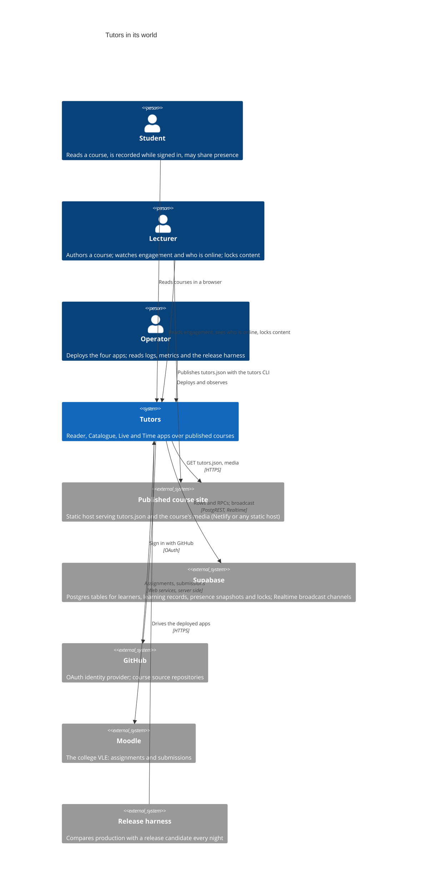
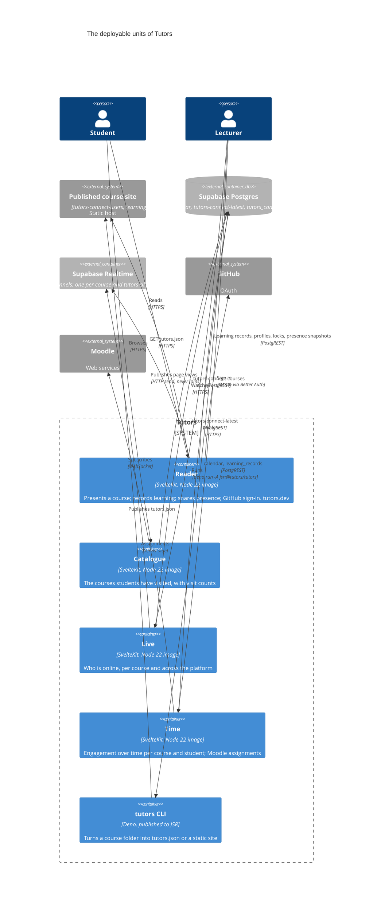
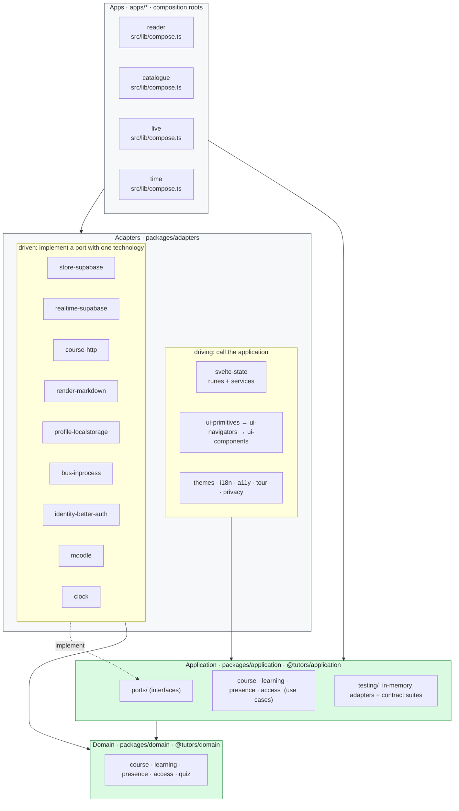
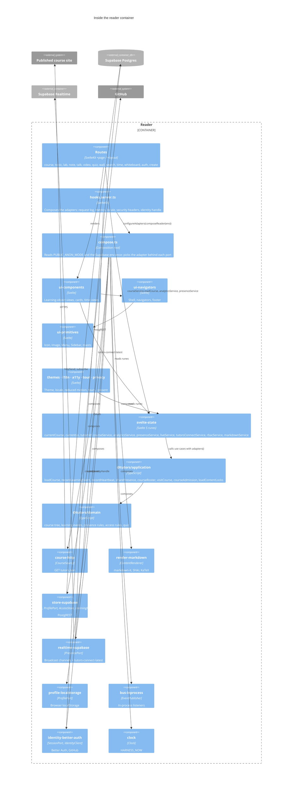
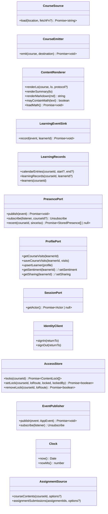
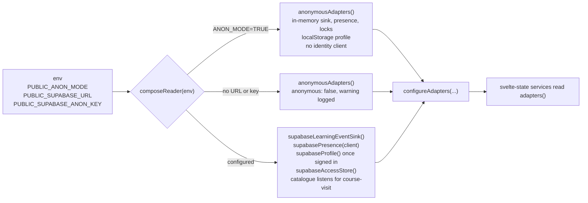
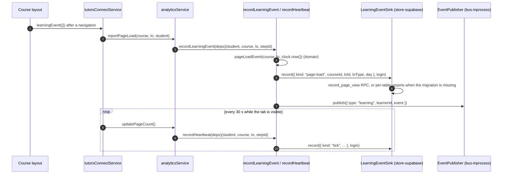
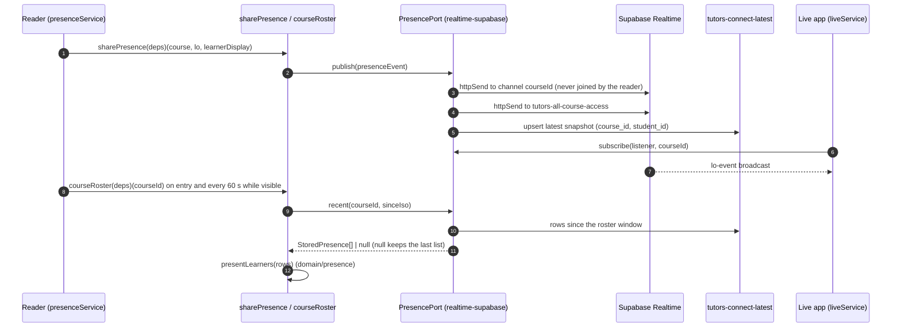
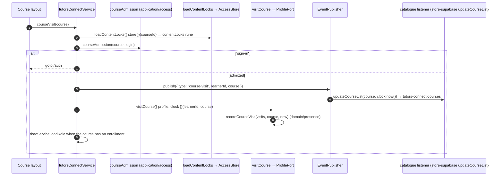
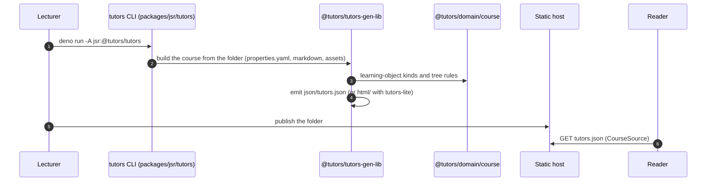

# Tutors Architecture

**This file is the authority on the shape of Tutors, the intent behind it and its ownership boundaries.** When code and this document disagree, one of them is wrong and the pull request that fixes it changes both. The structural statements in it are executable: Rules 0340 to 0352 in [`tests/bdd/features/developer/hexagonal-architecture.feature`](tests/bdd/features/developer/hexagonal-architecture.feature) check the repository against them on every pull request, and [`.dependency-cruiser.cjs`](.dependency-cruiser.cjs) enforces the dependency rules they state. The decision itself is recorded in [ADR 0001](docs/adr/0001-hexagonal-architecture.md).

Diagrams are Mermaid and render on GitHub. The C4 diagrams go from the system in its world (Context) to its deployable units (Containers) to the parts inside the reader (Components); the sequence diagrams show each core part doing its job through the rings.

## Contents

1. [Intent](#1-intent)
2. [System context (C4 level 1)](#2-system-context-c4-level-1)
3. [Containers (C4 level 2)](#3-containers-c4-level-2)
4. [The rings](#4-the-rings)
5. [Components of the reader (C4 level 3)](#5-components-of-the-reader-c4-level-3)
6. [The ports](#6-the-ports)
7. [The adapters](#7-the-adapters)
8. [Composition roots](#8-composition-roots)
9. [Core parts, each as a sequence](#9-core-parts-each-as-a-sequence)
10. [Ownership boundaries](#10-ownership-boundaries)
11. [Data ownership](#11-data-ownership)
12. [Dependency rules](#12-dependency-rules)
13. [Requirements (EARS)](#13-requirements-ears)
14. [Testing the architecture](#14-testing-the-architecture)
15. [Authoring toolchain and the JSR facades](#15-authoring-toolchain-and-the-jsr-facades)
16. [Deployment](#16-deployment)
17. [How to change things](#17-how-to-change-things)
18. [Glossary](#18-glossary)

---

## 1. Intent

Tutors is an open learning platform: a lecturer writes a course as a folder of markdown, the generator turns it into `tutors.json`, and the reader presents it to students, recording what they read, showing who else is present and letting a lecturer see engagement over time. The platform runs on Supabase (Postgres, Realtime), signs students in with GitHub through Better Auth, renders markdown with markdown-it, Shiki and KaTeX, and reads assignments from Moodle.

The architecture is **hexagonal** (ports and adapters). The rules of a course, of learning records, of presence and of access live in a **domain** ring that imports nothing. The **application** ring says what the product needs from the outside world as **ports** (interfaces) and holds the **use cases** that drive the domain through them. Everything that touches a technology is an **adapter** around those two rings: Supabase, Better Auth, markdown, localStorage, Moodle, the Svelte state and the UI. Each **app** is a composition root that reads its environment once and decides which adapter sits behind each port.

The intent is not to replace any technology. Supabase, Better Auth and the markdown toolchain stay. The intent is that:

- every rule of the product can be tested without a database, a browser or a network, through the in-memory adapters that ship with the application ring;
- each technology has exactly one home, so a dependency bump, a vendor advisory or a change in how a technology is used is made in one package;
- the anonymous reader (`PUBLIC_ANON_MODE=TRUE`) is the same product composed with different adapters, not a second code path;
- the shape is enforced, not described: a pull request that crosses a ring fails before review.

---

## 2. System context (C4 level 1)



**Boundary of the system.** Tutors owns the four apps and the packages in this repository. It does not own the course content (the lecturer's repository and static host), the identity (GitHub), the store (Supabase's service) or the VLE. Everything it does not own is reached through a port, and every port has an in-memory adapter.

---

## 3. Containers (C4 level 2)



Each app is a SvelteKit application built into a Node 22 container image on quay.io/tutors-sdk (signed with cosign, with an SBOM) and deployed from the kustomize overlays under `deploy/k8s`. The CLI is a Deno program published to JSR. The four apps share one Supabase project.

---

## 4. The rings



| Ring | Directory | Package | May import | Owns |
|---|---|---|---|---|
| Domain | `packages/domain` | `@tutors/domain` (`/course`, `/learning`, `/presence`, `/access`, `/quiz`) | Nothing outside itself | The course tree and its vocabulary, learning events and records, presence rules and the roster, admission, roles and locks, quiz parsing and scoring |
| Application | `packages/application` | `@tutors/application` (`/ports`, `/testing`) | The domain | The twelve ports, the use cases, the in-memory adapters and the contract suite each adapter of a port must pass |
| Driven adapters | `packages/adapters/driven/*` | `@tutors/<name>` | Ports, domain, one technology, `@tutors/logger` | One technology each, behind a port |
| Driving adapters | `packages/adapters/driving/*` | `@tutors/<name>` | Ports, domain, `svelte-state`, `@tutors/logger` | The Svelte state (the only home of runes), the UI, themes, i18n, a11y, tours, consent |
| Apps | `apps/*` | `tutors-reader`, `tutors-catalogue`, `tutors-live`, `tutors-time` | Everything; never another app | Composition, routes, server hooks, environment |
| Platform | `packages/platform/*` | `@tutors/logger`, `@tutors/metrics`, `@tutors/app-config` | Nothing in the rings | Logging, metrics, build configuration; used by every ring that runs on a server |
| JSR | `packages/jsr/*` | `@tutors/tutors-model-lib`, `@tutors/tutors-time-lib`, `@tutors/tutors-types`, `@tutors/identity`, `@tutors/tutors-gen-lib`, `@tutors/tutors`, `@tutors/tutors-lite`, `@tutors/tutors-create` | The facades import the rings; the authoring toolchain is self-contained | Published packages: facades over the domain for one major, and the authoring toolchain |

---

## 5. Components of the reader (C4 level 3)



The other three apps are smaller instances of the same shape: Live composes `realtime-supabase` behind `PresencePort` and subscribes; Catalogue composes `store-supabase` for the course list; Time composes `store-supabase` for its health check and error transport, the time library's read model for calendar and lab analytics, and `moodle` on the server behind `AssignmentSource`.

---

## 6. The ports

A port is an interface in `packages/application/src/ports/`. It is named for what the application needs, not for the technology that provides it. Every port has an in-memory adapter in `@tutors/application/testing`, and the ones with behaviour worth contracting have a contract suite there that every adapter of the port runs.



| Port | What the application needs | Driven adapters | In-memory adapter | Contract suite |
|---|---|---|---|---|
| `CourseSource` | The text of a published `tutors.json` | `course-http` | `InMemoryCourseSource` | — |
| `CourseEmitter` | Write a built course out | (the generator's own emitter, until authoring is extracted) | `InMemoryCourseEmitter` | — |
| `ContentRenderer` | Markdown to HTML, maths on demand | `render-markdown` | `PassThroughRenderer` | — |
| `LearningEventSink` | Record a page load or a 30-second tick for a learner | `store-supabase` | `InMemoryLearningEventSink` | `learningEventSinkContract` |
| `LearningRecords` | Read what was recorded about a course | `store-supabase` | `InMemoryLearningRecords` | — |
| `PresencePort` | Share where a learner is; watch a course; read who was active since | `realtime-supabase` | `InMemoryPresence` | `presenceContract` |
| `ProfilePort` | A learner's visit history, sentiment and sharing | `store-supabase` (signed in), `profile-localstorage` (not signed in) | `InMemoryProfile` | `profileContract` |
| `SessionPort` | The verified actor of a request | `identity-better-auth/server` | `FixedSession` | — |
| `IdentityClient` | Sign in and out from the browser | `identity-better-auth/client` | `RecordingIdentityClient` | — |
| `AccessStore` | The content locks lecturers set | `store-supabase` | `InMemoryAccessStore` | `accessStoreContract` |
| `EventPublisher` | Tell the rest of the application something happened | `bus-inprocess` | `RecordingPublisher` | `eventPublisherContract` |
| `Clock` | The instant, so time can be frozen | `clock` | `FixedClock` | — |
| `AssignmentSource` | Assignments and submissions from the VLE | `moodle` | `InMemoryAssignmentSource` | — |

Application events (`AppEvent`) are `learning` (a learner's page load or tick), `presence` (a sharing learner moved) and `course-visit` (a learner opened a course; the catalogue counts it). They are how one part of the product reacts to another without importing it.

---

## 7. The adapters

### Driven adapters (`packages/adapters/driven/`)

| Package | Technology (the only package that imports it) | Ports | Also exports |
|---|---|---|---|
| `@tutors/store-supabase` | `@supabase/supabase-js` (shared with realtime-supabase) | `LearningEventSink`, `LearningRecords`, `ProfilePort`, `AccessStore` | The client seam (`createSupabaseClient`, `configureSupabase`), the catalogue (`catalogueService`, `updateCourseList`), the error transport, the health check |
| `@tutors/realtime-supabase` | `@supabase/supabase-js` Realtime | `PresencePort` | `ALL_COURSES_CHANNEL` |
| `@tutors/course-http` | `fetch` | `CourseSource` | `CourseNotFoundError`, `CourseUnreachableError` (defined in the port) |
| `@tutors/render-markdown` | `markdown-it` and plugins, `shiki`, `katex` | `ContentRenderer` | The conversions the model facade re-exports (`convertLoToHtml`, ...) |
| `@tutors/profile-localstorage` | `localStorage` | `ProfilePort` | — |
| `@tutors/bus-inprocess` | none | `EventPublisher` | — |
| `@tutors/identity-better-auth` | `better-auth` | `SessionPort` (`/server`), `IdentityClient` (`/client`) | `createIdentityHandle` |
| `@tutors/moodle` | Moodle web services over `fetch` | `AssignmentSource` | — |
| `@tutors/clock` | `HARNESS_NOW` | `Clock` | The `/version` endpoint |

### Driving adapters (`packages/adapters/driving/`)

| Package | Role | Reaches the outside world through |
|---|---|---|
| `@tutors/svelte-state` | The reader's state (`currentCourse`, `currentLo`, `tutorsId`, ...) and services (`courseService`, `analyticsService`, `presenceService`, `liveService`, `tutorsConnectService`, `rbacService`, `markdownService`). The only package in which `$state`, `$derived` and `$effect` appear in `.ts` modules. | `adapters()`, the port set the app installed with `configureAdapters` |
| `@tutors/ui-primitives` → `@tutors/ui-navigators` → `@tutors/ui-components` | The UI, in a strict one-directional layering | `svelte-state` |
| `@tutors/themes`, `@tutors/i18n`, `@tutors/a11y`, `@tutors/tour`, `@tutors/privacy` | Cross-cutting | `svelte-state`; none imports a UI package |

A driving adapter never imports a driven adapter (`svelte-state-imports-no-adapter`). It asks `adapters()` for the port and the app has already decided what is behind it.

---

## 8. Composition roots

Each app has one file that reads the environment and composes the adapters, called once from `hooks.server.ts` and `hooks.client.ts` so the server and the browser run the same wiring. It is the only place in the repository that reads `PUBLIC_ANON_MODE` (Rule 0345).



| App | Root | Composes |
|---|---|---|
| reader | `apps/reader/src/lib/compose.ts` `composeReader(env, { identityClient })` | Clock, `markdownRenderer`, `httpCourseSource()`, `localStorageProfile()`, `inProcessPublisher()`, and in a signed-in deployment the Supabase sink, presence, profile and access store; subscribes the catalogue's `updateCourseList` to `course-visit` events |
| live | `apps/live/src/lib/compose.ts` `composeLive(env)` | Clock and `supabasePresence(client)`; Live only listens |
| catalogue | `apps/catalogue/src/lib/compose.ts` `composeCatalogue(env)` | The Supabase client behind the catalogue reads |
| time | `apps/time/src/lib/compose.ts` `composeTime(env)` | The Supabase client for the health check and error transport, and the time library's client; `moodleAssignmentSource` is composed on the server from private environment |

The reader's `hooks.server.ts` also decides the **auth mode** from `PUBLIC_ANON_MODE` and `PRIVATE_AUTH_SECRET` (`enabled`, `anonymous`, `unconfigured`) and installs the identity handle; a misconfigured deployment serves courses anonymously and logs the misconfiguration once at startup.

Tests compose the same roots: `anonymousReader()` in `tests/support/reader-adapters.ts` is `configureAdapters(composeReader({ PUBLIC_ANON_MODE: "TRUE" }))`, and the BDD features that record Supabase traffic run `composeReader(publicEnv, { identityClient })` against a recording client.

---

## 9. Core parts, each as a sequence

### 9.1 Loading a course

```mermaid
sequenceDiagram
  autonumber
  participant Route as +page.ts (course route)
  participant CS as courseService (svelte-state)
  participant UC as loadCourse (application)
  participant Src as CourseSource (course-http)
  participant R as ContentRenderer (render-markdown)
  participant D as domain/course
  Route->>CS: readCourse(courseId, fetch)
  CS->>CS: determineCourseUrl(courseId)
  CS->>UC: loadCourse({ source, renderer, clock, render, decorated })(location)
  UC->>Src: load(location, fetch)
  Src-->>UC: tutors.json text (or CourseNotFoundError / CourseUnreachableError)
  UC->>R: mayContainMath(text) → loadMath() when true
  UC->>D: decorateCourseTree(course, courseId, courseUrl, { render, today, protocol })
  D->>R: render(course, lo) for each learning object (summaries only for labs, notes, notebooks, quizzes)
  UC-->>CS: Course
  CS->>CS: cache; currentCourse.value = course
  CS-->>Route: Course
```

The reader renders labs, notes, notebooks and quizzes on demand, so `readerDecoration` hands the use case a `render` that converts only their summaries; `readLab` and friends render the body when opened. A 404 becomes `CourseNotFoundError`, an unreachable host `CourseUnreachableError`; the route maps them to a page.

### 9.2 Recording learning



Nothing is recorded for a visitor who is not signed in: the use case returns before touching the port. In anonymous mode the sink is in memory, so the same code runs and records nothing durable.

### 9.3 Presence: sharing where a learner is, and who is online



The reader **publishes only** and reads the roster from stored rows; a course channel delivers every student's page view to every other student, so joining it grows with the square of the class. Live's course page is the only subscriber to a course channel and its landing page the only subscriber to the platform-wide feed.

### 9.4 Signing in and the actor

```mermaid
sequenceDiagram
  autonumber
  participant B as Browser
  participant H as hooks.server.ts (reader)
  participant I as identity handle (identity-better-auth/server)
  participant GH as GitHub
  participant L as Root layout
  participant TC as tutorsConnectService
  participant Prof as ProfilePort (store-supabase)
  B->>H: GET /auth (IdentityClient.signIn)
  H->>I: createIdentityHandle({ enabled, secret, githubId, githubSecret })
  I->>GH: /api/auth/sign-in/social → OAuth
  GH-->>I: /api/auth/callback/github
  I->>I: session cookie; locals.actor = { subject: github:<id>, login, name, email, image }
  B->>H: next request
  I-->>L: locals.actor
  L->>TC: reconnect(tutorsId)
  TC->>Prof: upsertLearner(profile) (signed-in profile)
  TC->>Prof: getCourseVisits / sentiment / sharing
```

`@tutors/identity` (JSR) re-exports `Actor`, `SessionPort` and `IdentityClient` so a consumer outside the mono-repo sees the contracts without the provider. Only `identity-better-auth` imports Better Auth; browser entry points cannot reach its server module (`identity-no-server-in-browser`).

### 9.5 Visiting a course: admission, locks, the catalogue



The catalogue is not called by the reader; it listens. Removing the catalogue would remove one `subscribe` in `composeReader` and nothing in the services.

### 9.6 Tutors Time: engagement over time

```mermaid
sequenceDiagram
  autonumber
  participant Page as /[courseid]/calendar (time app)
  participant CT as CourseTime (tutors-time-lib read model)
  participant DB as Supabase (calendar, learning_records, tutors-connect-users)
  participant D as domain/learning
  participant Srv as +server.ts (time app, server)
  participant M as AssignmentSource (moodle)
  Page->>CT: loadTime(courseId, start, end, title)
  CT->>DB: calendar rows for the course, in id order
  CT->>DB: full names for the learners seen
  CT->>D: filterByDateRange; BaseCalendarModel; BaseLabModel
  CT->>DB: learning_records for the course
  CT-->>Page: calendarModel, labsModel, pin
  Page->>Srv: /api/moodle/...
  Srv->>M: courseContents(courseId) / assignmentSubmissions(ids)
  M-->>Srv: Moodle shapes, unchanged
```

The time library keeps its own Supabase client for these reads; that edge is listed in the baseline and is the next read model to move behind `LearningRecords`.

### 9.7 Generating a course



The authoring toolchain is deliberately outside the vendor rule and unchanged by the retrofit; its `course-emitter.ts` moves behind the `CourseEmitter` port when authoring is extracted, independently.

---

## 10. Ownership boundaries

Ownership here means: which package is allowed to know a thing, and therefore which package a change goes in. People ownership is in [`.github/CODEOWNERS`](.github/CODEOWNERS) (today, `@tutors-sdk/maintainers` for every path); the boundaries below are what a reviewer holds a pull request to.

| Concern | Owner | Nobody else may |
|---|---|---|
| What a course is: learning-object kinds, the tree, routes, the vocabulary | `@tutors/domain/course` | Define a learning-object kind, or walk the tree with rules of its own |
| What a learning event is and how a day is cut | `@tutors/domain/learning` (`pageLoadEvent`, `tickEvent`, `localYyyyMmDd`) | Compute a day or an event shape |
| Who counts as present and for how long | `@tutors/domain/presence` (`ROSTER_REFRESH_MS`, `keepOnRoster`, `presentLearners`) | Decide roster membership |
| Who may enter a course and what is locked | `@tutors/domain/access` and `courseAdmission` | Check a whitelist or a lock inline |
| What the application needs from the world | `@tutors/application/ports` | Add a method a technology happens to offer; a port grows only when a use case needs it |
| The order of operations in a feature | `@tutors/application` use cases | Sequence port calls in a Svelte service or a route |
| The Supabase client and every table it touches | `@tutors/store-supabase`, `@tutors/realtime-supabase` | Import `@supabase/supabase-js` (baseline exception: `packages/jsr/time`) |
| Markdown, syntax highlighting, maths, Marp, Mermaid | `@tutors/render-markdown` | Import `markdown-it`, `shiki`, `katex`, `mermaid`, `@marp-team/*` (baseline exception: `svelte-state/src/markdown`, moving) |
| Better Auth, the session cookie, the actor | `@tutors/identity-better-auth` | Import `better-auth`; read the session another way |
| Runes and the reader's shared state | `@tutors/svelte-state` | Hold `$state` in a `.ts` module of another package |
| Which adapter is behind a port, and anonymous mode | `apps/*/src/lib/compose.ts` | Read `PUBLIC_ANON_MODE`; construct a driven adapter |
| UI layering | `ui-primitives` → `ui-navigators` → `ui-components` | Import upward, or import a UI package from a cross-cutting package |
| Logging, metrics, build options | `packages/platform` | Depend on the rings from a platform package |
| The published API of the JSR packages | `etc/*.api.md` (API surface reports) | Change an export without the report changing with it |
| What a release intends to change | `release/claims.yaml`, judged by the release harness | Ship an observable difference no claim covers |

Boundaries between the apps: an app never imports another app (`no-app-to-app`). What two apps share lives in a package.

---

## 11. Data ownership

Every Supabase table and channel has exactly one adapter that reads or writes it, and one port that the application knows it through.

| Table or channel | Adapter | Port | Written by | Read by |
|---|---|---|---|---|
| `tutors-connect-users` | `store-supabase` (profile), `tutors-time-lib` read model (names) | `ProfilePort`, `LearningRecords` | Reader on sign-in (`upsertLearner`), sentiment and sharing changes | Reader (profile), Time (full names) |
| `tutors-connect-profiles` | `store-supabase` (profile, catalogue count) | `ProfilePort` | Reader (course visits of a signed-in learner) | Reader, Catalogue (count) |
| `learning_records` | `store-supabase` (learning-events, learning-records), `tutors-time-lib` read model | `LearningEventSink`, `LearningRecords` | Reader (page loads, ticks: `record_page_view` / `record_heartbeat` RPCs or per-table upserts) | Time |
| `calendar` | `store-supabase` (learning-events, learning-records), `tutors-time-lib` read model | `LearningEventSink`, `LearningRecords` | Reader (one row per learner per day) | Time |
| `tutors-connect-latest` | `realtime-supabase`, `store-supabase` (presence-rows) | `PresencePort` | Reader (latest snapshot per learner per course) | Reader (roster), Live |
| `tutors_content_locks` | `store-supabase` (access-store) | `AccessStore` | Reader, by a lecturer | Reader |
| `tutors-connect-courses` | `store-supabase` (catalogue, course-catalogue) | the catalogue service | Reader, on a course visit (through the `course-visit` event) | Catalogue |
| `app_errors` | `store-supabase` (error-transport) | the logger's transport | Every app's logger | Operators |
| `assignments` | Time app server (`lib/server/db`) | — (Time's own cache of Moodle assignments) | Time | Time |
| `assignments_submissions` | Time app server (`lib/server/db`) | — (Time's own cache of Moodle submissions) | Time | Time |
| Realtime channel `<courseId>` | `realtime-supabase` | `PresencePort` | Reader (HTTP send, never joined) | Live course page |
| Realtime channel `tutors-all-course-access` | `realtime-supabase` | `PresencePort` | Reader (HTTP send) | Live landing page |

Migrations are expand-only and live under `supabase/migrations/`; `pnpm check:migrations` holds the rule. A migration ships before or after the code that uses it, never in the same deploy as a contraction.

---

## 12. Dependency rules

All in [`.dependency-cruiser.cjs`](.dependency-cruiser.cjs), run by `tests/architecture/dependency-rules.test.ts` over a negative fixture workspace (every rule must catch its planted violation) and over the repository (no violation beyond the baseline). `pnpm architecture-report` draws the graph.

| Rule | Statement |
|---|---|
| `domain-self-contained` | `packages/domain` imports nothing outside itself |
| `application-imports-domain-only` | `packages/application` imports only `packages/domain` and its own files |
| `vendor-only-in-its-adapter` | `@supabase/*` only from store-supabase and realtime-supabase; markdown-it, katex, shiki, mermaid and `@marp-team/*` only from render-markdown; better-auth only from identity-better-auth. The authoring toolchain (`packages/jsr/gen`, `tutors`, `tutors-lite`, `create`) is exempt |
| `no-adapter-to-adapter` | A driven adapter imports no other adapter |
| `svelte-state-imports-no-adapter` | `svelte-state` imports no adapter; it reads `adapters()` |
| `adapters-import-no-app` | No package imports an app |
| `ui-layering` | `ui-primitives` → `ui-navigators` → `ui-components`; cross-cutting packages import no UI package |
| `ui-primitives-no-data-features` | `ui-primitives` imports nothing from `svelte-state/community`, `/connect` or `/rbac` (a source scan catches type imports too) |
| `platform-self-contained` | `packages/platform` imports nothing from apps or the rings |
| `facades-import-rings-only` | `tutors-model-lib`, `tutors-time-lib` and `tutors-types` import only the rings and render-markdown |
| `tutors-types-self-contained` | `packages/jsr/types` imports only the domain |
| `identity-provider-only-in-adapter` | Apps do not import an identity provider |
| `identity-contracts-self-contained` | `packages/jsr/identity` imports only the domain and the application |
| `identity-no-server-in-browser` | Browser entry points cannot reach the identity adapter's server module |
| `no-app-to-app` | An app imports no other app |
| `no-cross-workspace-relative-import` | A package reaches another only by its package name |
| `no-cross-package-cycle` | No cycle between packages |
| `runes-only-in-svelte-state` | `$state`, `$derived`, `$effect` in a `.ts` module only under `svelte-state` (a source scan: a rune is not an import) |

**The baseline.** [`tests/architecture/known-violations.txt`](tests/architecture/known-violations.txt) lists the edges that predate the rules, as `rule: from -> to` with vendor paths normalised so a version bump changes no line. It may only shrink: a new line fails the test, a stale line (fixed but not deleted) fails the test. At the time of writing it holds the svelte-state markdown service's Shiki, Marp and Mermaid imports, the time library's Supabase client and two `rbacService` imports in `ui-primitives`' context tree.

---

## 13. Requirements (EARS)

Tutors writes requirements in EARS (Easy Approach to Requirements Syntax) as `Rule:` blocks in Gherkin features under `tests/bdd/features/`, each tagged with a stable id (`@rule-NNNN`) and its EARS pattern (`@ears-ubiquitous`, `@ears-event-driven`, `@ears-state-driven`, `@ears-unwanted`, `@ears-optional`). Every Rule is bound to a step file and runs in `pnpm test`; `pnpm test:ears:audit` checks the wording, the tags and the binding. The methodology is in [`guides/testing/EARS-METHODOLOGY.md`](guides/testing/EARS-METHODOLOGY.md).

### 13.1 The architecture's own requirements

These are the rules this document rests on. They live in [`hexagonal-architecture.feature`](tests/bdd/features/developer/hexagonal-architecture.feature) and are bound in [`hexagonal-architecture.steps.ts`](tests/bdd/steps/developer/hexagonal-architecture.steps.ts).

| Id | Pattern | Requirement |
|---|---|---|
| 0340 | ubiquitous | Tutors shall keep the domain ring self-contained, with every import inside `packages/domain`. |
| 0341 | ubiquitous | Tutors shall keep the application ring importing only the domain ring and its own files, never an adapter or a vendor library. |
| 0342 | ubiquitous | Tutors shall import a vendor library (the Supabase client, the markdown renderers, Better Auth) only from the adapter that wraps it, outside the authoring toolchain. |
| 0343 | ubiquitous | Tutors shall keep a driven adapter from importing another adapter, so each wraps its one technology behind a port. |
| 0344 | ubiquitous | Tutors shall keep Svelte rune state in package modules to the svelte-state adapter, so the rings and the other adapters know no framework. |
| 0345 | ubiquitous | Tutors shall read `PUBLIC_ANON_MODE` only in an app's composition root, which picks the adapters, so no package decides for itself whether it is anonymous. |
| 0346 | event-driven | When a change adds an edge the ring rules forbid, tutors shall fail the architecture check naming the rule, the importing file and the import, with the known-violations baseline accepting no new line. |
| 0347 | ubiquitous | Tutors shall name every workspace package in ARCHITECTURE.md, so a package that this document does not describe cannot exist. |
| 0348 | ubiquitous | Tutors shall name every port of the application ring in ARCHITECTURE.md, with the adapter that implements it. |
| 0349 | ubiquitous | Tutors shall cite every dependency rule of `.dependency-cruiser.cjs` in ARCHITECTURE.md by name. |
| 0350 | ubiquitous | Tutors shall name in ARCHITECTURE.md every Supabase table and channel a package reads or writes, with the adapter that owns it. |
| 0351 | ubiquitous | Tutors shall keep the requirements table of ARCHITECTURE.md and the hexagonal-architecture feature in agreement, citing every Rule of the feature and no Rule id that exists in no feature. |
| 0352 | unwanted | If a package, port, rule or table is added without its line in ARCHITECTURE.md, then tutors shall fail the architecture check naming what is missing. |

### 13.2 Requirements per boundary

The product's behaviour is specified the same way. The features that govern each part of the shape above:

| Part | Features (under `tests/bdd/features/`) |
|---|---|
| Course loading, navigation, course JSON and its history | `course/course-loading`, `course/course-navigation`, `course/course-json-history`, `generator/course-json`, `course/llm-exports` |
| Learning records and progress | `student/learning-progress`, `instructor/analytics-calendar`, `instructor/analytics-lab`, `time/lab-analytics` |
| Presence and live views | `student/live-presence`, `live/presence-tracking`, `shared/realtime-usage`, `instructor/student-engagement` |
| Sign-in, sessions and admission | `shared/authentication`, `shared/sign-in-session`, `instructor/whitelist-management`, `ui/content-locks` |
| Catalogue and discovery | `student/course-discovery`, `ui/catalogue` |
| Reading, search, labs, quizzes, resources | `ui/reading`, `ui/search`, `student/search-content`, `student/lab-interaction`, `ui/learning-activities`, `ui/resource-cards`, `ui/course-tools` |
| Shell, themes, accessibility, i18n, tours | `ui/shell-and-navigation`, `ui/preferences-and-themes`, `shared/theming`, `ui/accessibility`, `developer/theme-customisation`, `developer/i18n-localisation`, `developer/guided-tour` |
| Resilience and errors | `shared/offline-resilience`, `shared/error-handling` |
| Shared types and the rings | `developer/shared-types`, `developer/hexagonal-architecture` |
| Release and quality | `developer/release-candidate`, `developer/release-changelog`, `developer/release-claims-lifetime`, `developer/release-openvex`, `developer/release-quality`, `developer/runtime-image`, `developer/service-level-objectives`, `developer/test-quality-ratchets` |

### 13.3 Writing a new requirement against this shape

1. Decide which ring owns the rule (section 10). A rule about what a course *is* goes in the domain and its feature drives domain functions; a rule about what happens *when* a learner does something is a use case and its feature drives the use case with in-memory adapters; a rule about a technology drives the adapter with a scripted or recorded client.
2. Reserve a Rule id (`pnpm test:ears:audit --next-id` sees only merged features; the project tracks reservations for open pull requests).
3. Write the `Rule:` in EARS form, tag it, bind it, and run `pnpm test:ears:audit`.
4. If the rule constrains the shape (a new port, package or table), add its line to this document; Rules 0347 to 0352 will insist.

---

## 14. Testing the architecture

| What | Where | How it is checked |
|---|---|---|
| The rings and vendor rules | `tests/architecture/dependency-rules.test.ts` | 31 planted violations in `tests/architecture/fixtures/workspace`, each caught by its rule; the repository against the baseline |
| Runes outside svelte-state, type imports in ui-primitives | same file | Source scans with their own baseline prefixes |
| This document as the authority | `tests/bdd/steps/developer/hexagonal-architecture.steps.ts` | Rules 0347 to 0352 read the workspace, the ports, the cruiser config, the adapters' table names and this file |
| Every adapter of a port | `tests/unit/application/port-contracts.test.ts`, `tests/contract/supabase/*` | The contract suites in `@tutors/application/testing` run against the in-memory adapters, the localStorage profile, the in-process bus and the recorded Supabase client |
| The use cases | `tests/unit/application/*` | Driven with in-memory adapters and `FixedClock` |
| The services over the ports | `tests/unit/community/*`, `tests/unit/connect/*`, `tests/unit/course/*` | `configureAdapters(anonymousAdapters({ ...spies }))` |
| The product through its composition root | `tests/bdd/steps/**` | `composeReader(...)` against a recording Supabase client and a stubbed identity client |
| Coverage, mutation and API surface ratchets | `tests/suite-health/coverage-floors.json`, `tests/mutation/*.json`, `etc/*.api.md` | Floors per ring scope (`packages/domain/src/**`, `packages/application/src/**`, `packages/adapters/driven/**`) that only rise |

The test tiers A to O and what runs where are in [`guides/testing/TESTING-OVERVIEW.md`](guides/testing/TESTING-OVERVIEW.md).

---

## 15. Authoring toolchain and the JSR facades

`packages/jsr/` holds the Deno packages published to JSR. Inside `packages/jsr/` you are in Deno-land (`deno.json`, `npm:` specifiers); everywhere else is pnpm.

| Package | Role after the retrofit |
|---|---|
| `@tutors/tutors-model-lib` (`packages/jsr/model`) | Facade for one major: re-exports `@tutors/domain/course` and the markdown conversions of `@tutors/render-markdown`; `decorateCourseTree` renders as it always did |
| `@tutors/tutors-time-lib` (`packages/jsr/time`) | Facade over `@tutors/domain/learning`, plus the time app's read models (`CourseTime`, `TutorsTime`) and their Supabase client (baseline) |
| `@tutors/tutors-types` (`packages/jsr/types`) | Facade over the domain's shared types and vocabulary |
| `@tutors/identity` (`packages/jsr/identity`) | `Actor`, `SessionPort`, `IdentityClient` for consumers outside the repository |
| `@tutors/tutors-gen-lib`, `@tutors/tutors`, `@tutors/tutors-lite`, `@tutors/tutors-create` | The authoring toolchain: course builder, emitters, Marp rendering, templates, the CLIs and the scaffolder. Unchanged by the retrofit, exempt from the vendor rule, and extracted independently |

The facades exist so that published courses and tools built on them keep working through one major version. New code in the repository imports the rings.

---

## 16. Deployment

- **Images**: one per app, built from the Node 22 runtime image (no package manager in the runtime layer, Rule 0220), pushed to quay.io/tutors-sdk with a cosign signature and an SBOM.
- **Kubernetes**: `deploy/k8s/base`, `components`, `variants` and one overlay per app under `deploy/k8s/overlays/`; `deploy/k8s/next` reuses production images for the next hosts. `pnpm check:k8s` and the platform-conformance tests hold the restricted-SCC, arbitrary-UID and read-only-root policies.
- **Environment**: `PUBLIC_ANON_MODE`, `PUBLIC_SUPABASE_URL`, `PUBLIC_SUPABASE_ANON_KEY` are read by the composition roots; `PRIVATE_AUTH_SECRET`, `PRIVATE_AUTH_GITHUB_ID`, `PRIVATE_AUTH_GITHUB_SECRET` by the reader's identity handle; `MOODLE_WS_URL` and its token by the time app's server; `HARNESS_NOW` freezes the clock for the release harness.
- **Observability**: every server line is one JSON object with a request id (`@tutors/logger`), `/metrics` is Prometheus (`@tutors/metrics`), `/version` and `/healthz` are served by every app; the error transport writes to `app_errors`.
- **Release**: `release/claims.yaml`, `deployed.json`, `openvex.json`, `slo.yaml` and `SOP.md` are what the [release harness](https://github.com/tutors-sdk/tutors-release-harness) reads when it compares production with a release candidate. Main is the release candidate; students only see a release.

---

## 17. How to change things

| You want to | Do this | Not this |
|---|---|---|
| Add a rule about courses, learning, presence or access | A function in `@tutors/domain/<context>` with a unit or property test; a Rule in a feature | Logic in a Svelte service or a route |
| Add something the product does | A use case in `@tutors/application/<context>` taking its ports as deps; call it from a svelte-state service with `adapters()` | A service that calls Supabase |
| Need something new from a technology | Add a method to the port the use case needs, implement it in the adapter, add the case to the contract suite and the in-memory adapter | Reach past the port |
| Use a technology in a new way | Change its adapter | Import the vendor somewhere else (the vendor rule will refuse) |
| Add a table or channel | Give it an owner adapter and a port, add the migration (expand-only), add its row to section 11 | Query it from two packages |
| Add a package | Decide its ring (section 4), `packages/adapters/driven|driving/<name>` or `packages/platform/<name>`, add it to the workspace, to section 4 or 7 here, to the vitest aliases if tests import it, and to knip | A package that imports another adapter |
| Change how an app is wired | `apps/<app>/src/lib/compose.ts` | A conditional on `PUBLIC_ANON_MODE` anywhere else |
| Fix a baseline debt | Make the change, delete the line from `known-violations.txt` | Add a line |
| Change a published API | Change the code, run `pnpm api-report`, commit `etc/*.api.md` | Hand-edit the report |

---

## 18. Glossary

- **Ring**: a layer of the hexagon. Dependencies point inwards: apps → adapters → application → domain.
- **Port**: an interface in `@tutors/application/ports` saying what the application needs from outside.
- **Driven adapter**: implements a port with one technology; the application calls it.
- **Driving adapter**: calls the application; the Svelte state and the UI.
- **Composition root**: `apps/<app>/src/lib/compose.ts`, where the environment decides which adapter is behind each port.
- **`adapters()`**: the port set `svelte-state` reads, installed by `configureAdapters`.
- **Anonymous mode**: `PUBLIC_ANON_MODE=TRUE`; the in-memory, localStorage and no-op adapters. Same code, nothing recorded, nobody present, no sign-in.
- **Baseline**: `tests/architecture/known-violations.txt`; pre-existing rule violations that may only be removed.
- **Facade**: a JSR package that re-exports the rings under its old names for one major version.
- **Contract suite**: cases in `@tutors/application/testing` that every adapter of a port must pass.
- **EARS**: the requirements syntax of the `Rule:` blocks; see section 13.
- **Learning object (Lo)**: a node of the course tree: topic, lab, note, talk, video, quiz, and the rest of the vocabulary in `@tutors/domain/course/vocabulary`.
