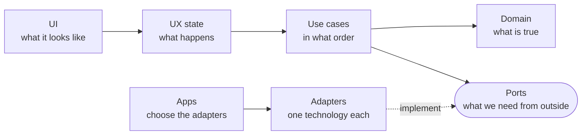

# How to contribute to Tutors, by what you know and what you want to change

You do not need to understand the whole codebase to contribute. Tutors is built so that each concern lives in one place behind one interface. This page tells you which place is yours, what you can ignore, and how to prove your change works.

- [`CONTRIBUTING.md`](CONTRIBUTING.md) covers setup, branches, commits and the pull request process.
- [`ARCHITECTURE.md`](ARCHITECTURE.md) is the authority on the shape. You can contribute without reading it, and look things up in it when this page points there.

## The model in one minute



- The **domain** (`packages/domain`) holds the rules: what a course is, who may do what, who counts as present. Plain functions, no dependencies.
- A **port** (`packages/application/src/ports`) is an interface that says what the product needs from the outside world, such as "the text of a published course" or "record this learning event".
- An **adapter** (`packages/adapters`) implements a port with one technology. Swap the adapter and the product does not notice.
- Every port has an **in-memory adapter** in `@tutors/application/testing`, so anything can be tested with no database, no network and no browser.
- An **app** (`apps/*`) picks the adapters in one file, `src/lib/compose.ts`.

The consequence for you: **find your port or your boundary, and everything on the other side of it is somebody else's problem.**

## Start from who you are

| If you are | Your boundary | You work in | You can ignore | Good first changes |
|---|---|---|---|---|
| A **designer or front-end developer** | UI | `packages/adapters/driving/ui-primitives`, `ui-navigators`, `ui-components`, `themes`; [`DESIGN.md`](DESIGN.md) | The database, sign-in, the server. Components receive props and read state; they never fetch | A card layout, an icon set, a theme, a visual bug |
| A **UX or accessibility specialist** | UX | `packages/adapters/driving/svelte-state` (state and services), `a11y`, `tour`; the journeys in `tests/bdd/features/ui` | How data is stored. Services call a port and do not know what is behind it | A keyboard path, reduced motion, a tour step, an empty or error state |
| A **translator** | UX | `packages/adapters/driving/i18n/src/messages/<locale>.ts` | Everything else | A new locale, a missing string |
| A **teacher or learning designer** | Domain model, Authoring | `packages/domain/src/course`, `quiz`, `learning`; `packages/jsr/course-rules` | Every technology. Domain functions take values and return values | A course rule, a quiz question type, how engagement is summarised |
| A **back-end developer** | Application, Integration | `packages/application/src` (use cases, ports); `packages/adapters/driven/*`; `apps/reader/src/routes/api` | Svelte. Use cases are plain TypeScript | A use case, an adapter for a new service, a data API route |
| A **database engineer** | Database | `packages/adapters/driven/store-supabase`, `realtime-supabase`; `supabase/migrations`; [`guides/MIGRATIONS.md`](guides/MIGRATIONS.md) | The UI and the use cases. Tables are named only in these two packages | An index, a slow query, a migration, a second store behind the same ports |
| A **security engineer** | Security | `packages/domain/src/access`, `packages/domain/src/input.ts`; `packages/application/src/access`; `apps/reader/src/lib/server`; `packages/adapters/driven/identity-better-auth`; `tests/security` | The UI's role checks: they decide what to show, never what is allowed | A policy case, a stricter input rule, a header, an identity provider |
| An **operator or SRE** | Operations | `packages/platform/*`, `packages/adapters/driven/clock`; `Dockerfile`, `deploy/k8s`, `.github/workflows`, `release/` | Product behaviour | A metric, a log field, an overlay, a pipeline step |
| A **tester** | Testing | `tests/`; `packages/application/src/testing` | Nothing, but you never need a real database | A contract case, a property test, an EARS Rule for unspecified behaviour |
| An **integrator** (Moodle, another VLE, another host) | Integration | `packages/adapters/driven/moodle`, `course-http`, or a new adapter | Everything inside the port | A second `AssignmentSource`, a `CourseSource` for another host |
| A **course tooling author** | Authoring and published API | `packages/jsr/*` (Deno) | The apps | A generator option, a CLI command, a template |

The boundaries are defined in [`docs/BOUNDARIES.md`](docs/BOUNDARIES.md), each with what may and may not cross it.

## Start from what you want to change

Each row is a capability of the product, traced from the rule to the screen. Change the column that matches your change, and leave the others.

| Capability | The rule (domain) | The use case (application) | The port | The adapter today | State and UI | Specified in (`tests/bdd/features/`) |
|---|---|---|---|---|---|---|
| Load and show a course | `course`: `decorateCourseTree`, the vocabulary | `loadCourse` | `CourseSource`, `ContentRenderer` | `course-http`, `render-markdown` | `svelte-state/course`; `ui-components/learning-objects` | `course/course-loading`, `course/course-navigation`, `ui/reading` |
| Record what a learner read | `learning`: `pageLoadEvent`, `tickEvent`, `localYyyyMmDd` | `recordLearningEvent`, `recordHeartbeat` | `LearningEventSink` | `data-api` → `/api/analytics` → `store-supabase/server` | `svelte-state/connect` | `student/learning-progress` |
| Show engagement over time | `learning`: calendar and lab models, `pseudonymise` | (the time read models) | none: `/api/time` | `store-supabase/server` `readTimeRows` | `apps/time`, `ui-components/time` | `instructor/analytics-calendar`, `instructor/analytics-lab`, `time/lab-analytics` |
| Share presence, see who is online | `presence`: `presenceEvent`, `presentLearners` | `sharePresence`, `courseRoster` | `PresencePublisher`, `PresenceFeed` | `data-api` → `/api/presence`, `/api/live/activity`; `realtime-supabase` | `svelte-state/community`; `apps/live` | `student/live-presence`, `live/presence-tracking`, `shared/realtime-usage` |
| A learner's profile, history, mood | `presence`: `recordCourseVisit`, `parseSentiment`, `parseSharing` | `visitCourse`, `setFavouriteCourse`, `forgetCourseVisit` | `ProfilePort` | `data-api` → `/api/me`, `/api/profile`; `profile-localstorage` when signed out | `svelte-state/connect` | `student/course-discovery` |
| The public catalogue | `catalogue`: `arrangeCatalogue`; `presence`: `catalogueRecordOf` | `countCourseVisit` | `CourseCatalogue` | `data-api` → `/api/courses/visit`; `store-supabase` catalogue reads | `apps/catalogue` | `ui/catalogue` |
| Sign in | `access`: `Actor` | none | `SessionPort`, `IdentityClient` | `identity-better-auth` | `svelte-state/connect` | `shared/authentication`, `shared/sign-in-session` |
| Who may read a private course | `access`: `whitelistAdmits`, `requiresSignIn` | `courseAdmission` | none: the course itself says | none | `svelte-state/connect` | `instructor/whitelist-management` |
| Who may do an educator's action | `access`: `permits`, `roleInCourse`, `sameLogin` | `createAuthorization` | `CourseFactsSource` | `course-http` `publishedCourseFacts` | `svelte-state/rbac` (what to show only) | `shared/server-data-access`, `developer/authorisation-matrix` |
| Lock content | `access`: `isLoLocked`, `ContentLock` | `loadContentLocks`, `setContentLock` | `AccessStore` | `store-supabase` (read), `data-api` → `/api/locks` (write) | `svelte-state/rbac`; the context tree in `ui-primitives` | `ui/content-locks` |
| Whiteboards | none | none | `WhiteboardStore` | `data-api` → `/api/whiteboard` | the whiteboard route in `apps/reader` | [`guides/WHITEBOARD.md`](guides/WHITEBOARD.md) |
| Quizzes | `quiz`: `scoreQuiz` | none | none | none | `ui-components/quiz` | `ui/learning-activities` |
| Moodle assignments | none | none | `AssignmentSource` | `moodle`; cached by `store-supabase/server` | `apps/reader` moodle-sync route; `apps/time` | `instructor/student-engagement` |
| Check a course before publishing | `@tutors/course-rules` | none | none | `course-archive` | `apps/validator`; `ui-components/validation` | [`docs/VALIDATOR-COURSE-CHECKS.md`](docs/VALIDATOR-COURSE-CHECKS.md) |
| Search a course | `course`: `searchHits` | none | none | none | `apps/reader` search route | `ui/search`, `student/search-content` |
| Themes, language, tours | none | none | none | none | `themes`, `i18n`, `tour` | `ui/preferences-and-themes`, `developer/i18n-localisation`, `developer/guided-tour` |
| One part reacting to another | none | publishes `learning`, `presence`, `course-visit` | `EventPublisher` | `bus-inprocess` | subscribed in `compose.ts` | (unit tests) |
| Time, frozen for tests and the harness | none | every use case that needs "now" | `Clock` | `clock` (`HARNESS_NOW`) | none | `developer/release-candidate` |

## Port by port

A port is the smallest unit you can own. For each one: what it promises, who typically works on it, and where its pieces are. All ports are in `packages/application/src/ports/`; all in-memory adapters are in `packages/application/src/testing/in-memory.ts`.

| Port | The promise | You would touch it if you are | Adapter(s) | In-memory double | Proves it |
|---|---|---|---|---|---|
| `CourseSource` | Give me the text of a published `tutors.json`, or tell me it is missing, unreachable or timed out | Hosting courses somewhere new; working on offline or caching | `packages/adapters/driven/course-http` | `InMemoryCourseSource` | `tests/unit/course`, `tests/unit/resilience` |
| `CourseFactsSource` | Tell the server who teaches a course and whether it is private, from a host it trusts | A security engineer; anyone changing where enrolment is declared | `course-http/src/published-facts.ts` | `InMemoryCourseFacts` | `tests/unit/application/authorization.test.ts` |
| `ContentRenderer` | Turn markdown into HTML; load maths only when needed | Working on rendering, code highlighting, maths, new markdown syntax | `packages/adapters/driven/render-markdown` | `PassThroughRenderer` | `tests/unit/markdown` |
| `LearningEventSink` | Record this page load or tick for this learner | Changing analytics storage; adding an xAPI or LRS sink | `data-api` (`dataApiLearningEventSink`) | `InMemoryLearningEventSink` | `learningEventSinkContract` |
| `PresencePublisher` | Say where this learner is now | Working on live classroom features | `data-api` (`dataApiPresencePublisher`) | `InMemoryPresence` | `presenceContract`, `tests/unit/community` |
| `PresenceFeed` | Let me watch a course, and tell me who was active since a time | Replacing the realtime broker; working on Tutors Live | `packages/adapters/driven/realtime-supabase` | `InMemoryPresence` | `presenceContract`, `tests/unit/adapters/realtime-supabase-presence.test.ts` |
| `PresencePort` | Both halves together, as the services use them | (composed in the app; you rarely touch it) | `compose.ts` | `InMemoryPresence` | `presenceContract` |
| `ProfilePort` | Keep a learner's visits, sentiment and sharing | Working on the learner's home, favourites, privacy of history | `data-api` (`dataApiProfile`), `profile-localstorage` | `InMemoryProfile` | `profileContract` |
| `CourseCatalogue` | Count this course visit for the public list | Working on discovery | `data-api` (`dataApiCourseCatalogue`) | `InMemoryCourseCatalogue` | `tests/unit/application/use-cases.test.ts` |
| `SessionPort` | Give me the verified actor of this request, or nobody | Adding an identity provider; hardening sessions | `identity-better-auth` (`/server`) | `FixedSession` | `tests/unit/identity`, `pnpm test:identity:built` |
| `IdentityClient` | Start sign-in and sign-out from the browser | The same | `identity-better-auth` (`/client`) | `RecordingIdentityClient` | `tests/unit/identity` |
| `AccessStore` | Give me a course's locks; save a lock change and tell me what became of it | Working on educator controls | `store-supabase/src/access-store.ts` (read), `data-api` (`dataApiLockWriter`) | `InMemoryAccessStore` | `accessStoreContract` |
| `WhiteboardStore` | Load and save a whiteboard's drawing | Working on whiteboards | `data-api` (`dataApiWhiteboard`) | `InMemoryWhiteboard` | `tests/unit/application/in-memory-adapters.test.ts` |
| `EventPublisher` | Tell whoever is listening that something happened | Decoupling a feature; adding a listener | `packages/adapters/driven/bus-inprocess` | `RecordingPublisher` | `eventPublisherContract` |
| `Clock` | Tell me the instant | Anything time-dependent; never call `Date.now()` in a rule | `packages/adapters/driven/clock` | `FixedClock` | every use-case test |
| `AssignmentSource` | Give me a VLE course's contents and submissions | Integrating a VLE | `packages/adapters/driven/moodle` | `InMemoryAssignmentSource` | `tests/unit/adapters/moodle-assignment-source.test.ts` |

Contract suites (`...Contract`) are in `packages/application/src/testing/contracts.ts` and run from `tests/unit/application/port-contracts.test.ts`. A new adapter for a port is correct when it passes the port's contract; you do not need to read the code that calls the port.

## Recipes

### Change how something looks

1. Find the component: [`docs/COURSE-PAGE-WALKTHROUGH.md`](docs/COURSE-PAGE-WALKTHROUGH.md) follows one page from the URL to the cards and names every file.
2. Change it in `ui-primitives`, `ui-navigators` or `ui-components`. Use tokens from `packages/adapters/driving/themes/src/styles` and [`DESIGN.md`](DESIGN.md); no hard-coded colours or sizes.
3. Rebuild the UI packages (`pnpm dev` does this) and look at it in the reader.
4. If you need data the component does not have, stop: that is a state change (next recipe), not a fetch in the component.

### Change what happens when a learner does something

1. Is there a rule in it ("a learner is present for five minutes")? Put the rule in `packages/domain/src/<context>` as a function, with a unit test.
2. Is there an order of operations ("record the visit, then count it")? That is a use case in `packages/application/src/<context>`, taking its ports as an argument. Test it with the in-memory adapters.
3. Call the use case from a service in `packages/adapters/driving/svelte-state`, passing ports from `adapters()`.
4. Write an EARS `Rule:` in the feature that covers the area (table above) and bind it. `pnpm test:ears:audit --next-id` gives the next free id; `CONTRIBUTING.md` explains the syntax.

### Add an adapter for an existing port

Example: a `CourseSource` that reads from object storage.

1. Create `packages/adapters/driven/<name>` with a `package.json` named `@tutors/<name>`. It may import `@tutors/application`, `@tutors/domain`, `@tutors/logger` and its one technology. It may not import another adapter.
2. Implement the port's interface. Return the port's own errors (`CourseNotFoundError`, ...), not the technology's.
3. If the port has a contract suite, run it against your adapter in `tests/unit/application/port-contracts.test.ts`.
4. Wire it in the app's `compose.ts`. Nothing else changes.
5. Add the package to [`ARCHITECTURE.md`](ARCHITECTURE.md): the adapters table (section 7), the ports table (section 6) and one row of the boundary map (section 11). The architecture tests name whatever you missed.

### Add a new port

Only when a use case needs something from outside that no port provides.

1. Write the interface in `packages/application/src/ports/<name>.ts`, named for the need, not the technology. Export it from `ports/index.ts`.
2. Add its in-memory adapter to `testing/in-memory.ts`, and a contract suite if it has behaviour worth pinning.
3. Add it to the `Adapters` type in `packages/adapters/driving/svelte-state/src/adapters.ts` if the browser needs it.
4. Implement an adapter and wire it (previous recipe).
5. Run `pnpm api-report` and commit `etc/application-ports.api.md`. Add the port's row to section 6 of ARCHITECTURE.md.

### Store or read something personal

Personal data never goes from the browser to the database. It goes through the reader's data API.

1. **Contract:** add the request and response types to `packages/adapters/driven/data-api/src/contract.ts` and a method to `client.ts`.
2. **Route:** add `apps/reader/src/routes/api/<name>/+server.ts`. Every route has the same four steps, in this order:
   ```ts
   const user = await requireUser(locals);                                   // identify: 401
   const courseId = valid(check.courseId(body.courseId), "courseId is required"); // validate: 400
   if (!(await authorize(user, "content:lock", { kind: "course", courseId }))) error(403, "..."); // authorise: 403, or 503
   await setLock(requireDb(), user.login, courseId, loRoute, locked);        // act
   ```
3. **Store:** add the function to `packages/adapters/driven/store-supabase/src/server/`. It takes the client as its first argument. This is the only place the table is named.
4. **Port:** expose it to the browser as a port method in `data-api/src/ports.ts`.
5. **Inventory:** add a mutating route to `tests/security/mutating-routes.txt` and the authorisation matrix; add a new table to section 13 of ARCHITECTURE.md and a migration under `supabase/migrations` (expand-only, see [`guides/MIGRATIONS.md`](guides/MIGRATIONS.md)).

### Protect an action

1. Add the permission to `Permission` and `ROLE_PERMISSIONS` in `packages/domain/src/access/roles.ts`.
2. Add cases to `tests/unit/domain/access-policy.test.ts`: who may, who may not, and nobody signed in.
3. Ask `authorize(user, "<permission>", { kind: "course", courseId })` in the route.
4. In the UI, use `rbacService` to hide what the learner cannot do. That is a courtesy, not the control.

Never compare logins yourself: use `sameLogin` or `listsLogin`. Never treat "the course host did not answer" as "not allowed".

### Add a kind of learning object

1. Add the kind to `packages/domain/src/course/vocabulary.ts`: its name in `LO_SIMPLE_TYPES` or `LO_COMPOSITE_TYPES`, and its place in `LO_TYPE_ORDER` (the compiler asks for it). The model library's lists and build order follow (Rule 0356), and `tests/unit/domain/lo-vocabulary.test.ts` then names every theme and generator palette that has no entry for it yet.
2. Teach the generator to emit it (`packages/jsr/gen`) and, if it has rules, the course rules (`packages/jsr/course-rules`).
3. Give it a view in `packages/adapters/driving/ui-components/src/learning-objects`, an icon and a colour in `themes`, and a route in `apps/reader`.
4. Add it to the course JSON contract tests (`tests/contract/course`).

### Add a language or a theme

- **Language:** copy `packages/adapters/driving/i18n/src/messages/en.ts` to `<locale>.ts`, translate, register it in `i18n/src/index.ts`. `developer/i18n-localisation.feature` says what a locale must provide.
- **Theme:** `packages/adapters/driving/themes/src/styles` and `services/themes.svelte.ts`; see `developer/theme-customisation.feature` for what a theme must provide.

## Before you open the pull request

Run what matches your change; CI runs everything.

| You changed | Run |
|---|---|
| Anything | `pnpm lint` and the tests for the directories you touched, for example `pnpm exec vitest run tests/unit/domain` |
| A rule or a use case | `pnpm exec vitest run tests/unit/domain tests/unit/application` |
| A feature file or its steps | `pnpm test:bdd` and `pnpm test:ears:audit` |
| An import between packages, a new package, a port, a table | `pnpm exec vitest run tests/architecture tests/bdd/steps/developer/hexagonal-architecture.steps.ts` |
| A Svelte component or a route | `pnpm check` |
| A port or a published export | `pnpm api-report`, and commit the changed `etc/*.api.md` |
| A route under `/api` | `pnpm exec vitest run tests/security` |
| A migration | `pnpm check:migrations` |

When a check fails with the name of a rule (`domain-self-contained`, `ui-imports-no-driven-adapter`, ...), look the rule up in section 14 of ARCHITECTURE.md: it says which boundary you crossed, and [`docs/BOUNDARIES.md`](docs/BOUNDARIES.md) says how to cross it properly. The baselines under `tests/architecture` and `tests/completeness` only shrink; the fix is never to add a line.

## Where to read more

| For | Read |
|---|---|
| The shape, the diagrams, every table | [`ARCHITECTURE.md`](ARCHITECTURE.md) |
| The domain model and its language | [`docs/DOMAIN-MODEL.md`](docs/DOMAIN-MODEL.md) |
| What may cross each boundary | [`docs/BOUNDARIES.md`](docs/BOUNDARIES.md) |
| One page, file by file | [`docs/COURSE-PAGE-WALKTHROUGH.md`](docs/COURSE-PAGE-WALKTHROUGH.md) |
| Why the reader's server writes the data | [`guides/SERVER-WRITES.md`](guides/SERVER-WRITES.md) |
| Roles and permissions for lecturers | [`guides/RBAC.md`](guides/RBAC.md) |
| Testing tiers and how to write a Rule | [`guides/testing/TESTING-OVERVIEW.md`](guides/testing/TESTING-OVERVIEW.md), [`guides/testing/EARS-METHODOLOGY.md`](guides/testing/EARS-METHODOLOGY.md) |
| The decision to go hexagonal | [`docs/adr/0001-hexagonal-architecture.md`](docs/adr/0001-hexagonal-architecture.md) |
