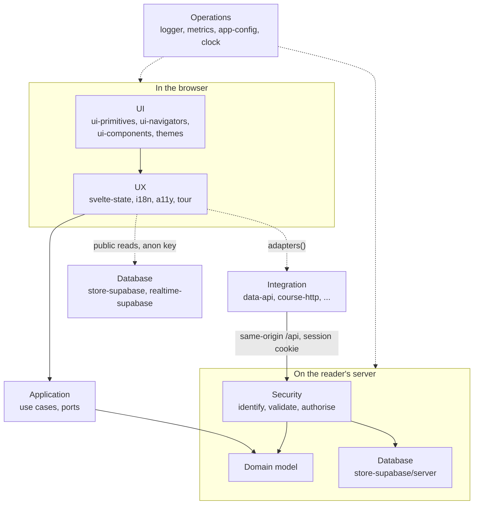

# The boundaries of Tutors

[`ARCHITECTURE.md`](../ARCHITECTURE.md) section 11 is the boundary map: every workspace package is in exactly one boundary, and a test fails when one is not (Rule 0354). This page says, for each boundary, what it owns, what it may depend on, what may cross it and in which form, and what holds the line. It is the page to read before a review, and the page to change when a boundary moves.

Each boundary has a guide for the person who works in it, from the skill to the ports and the files: [`guides/contributors/`](../guides/contributors/README.md).

A boundary is a **separation of concerns**, not a team. One person may work in several. What the boundary guarantees is that a question of one kind has one place to look:

| If the question is | Look in |
|---|---|
| Is this true of a course, a learner, a role? | [Domain model](#domain-model) |
| What happens, in what order? | [Application](#application) |
| Who is asking, and may they? | [Security](#security) |
| Where is it stored, and under which key? | [Database](#database) |
| How do we talk to that other system? | [Integration](#integration) |
| How does markdown become a page? | [Content rendering](#content-rendering) |
| What does the learner experience? | [UX](#ux) |
| What does it look like? | [UI](#ui) |
| How is it built, run and observed? | [Operations](#operations) |
| Which adapter is wired where? | [Composition](#composition) |
| What do lecturers run and outsiders import? | [Authoring and published API](#authoring-and-published-api) |
| How do we know? | [Testing](#testing) |

## Domain model

- **Owns:** `@tutors/domain`. The contexts, their language, their policies and value rules. Detail in [`DOMAIN-MODEL.md`](DOMAIN-MODEL.md).
- **May depend on:** nothing.
- **Crossing in:** literal values. A caller passes the time, the published course and the stored rows; the domain never fetches them.
- **Crossing out:** values, and yes-or-no answers.
- **Must not:** import, `await` the outside world, read a clock, a random source or an environment variable, write to the console (Rule 0357), cast a plain string to a `CourseId`, `LoRoute` or `LoginKey` outside the rule that checks it (Rule 0358), name a table, a status code or a component.
- **Held by:** `domain-self-contained` (Rule 0340); mutation floors on its modules.

## Application

- **Owns:** `@tutors/application`. The ports (`/ports`), the use cases (`loadCourse`, `recordLearningEvent`, `sharePresence`, `courseRoster`, `visitCourse`, `countCourseVisit`, `courseAdmission`, `loadContentLocks`, `setContentLock`, `createAuthorization`), the realtime gateway and its budget, and the test doubles (`/testing`).
- **May depend on:** the domain.
- **Crossing in:** a use case receives its ports as an argument (`loadCourse({ source, renderer, clock })`). It never reaches for a global.
- **Crossing out:** domain values, and application events on `EventPublisher`.
- **Must not:** import an adapter, a vendor library, Svelte or SvelteKit. A port must not grow a method because a technology offers it; it grows when a use case needs it.
- **Held by:** `application-imports-domain-only` (Rule 0341); `etc/application-ports.api.md`, the reviewed surface of the ports.

## Security

Security is three things in three places, and the separation is the control.

| Part | Where | What it is |
|---|---|---|
| The rules | `@tutors/domain/access`, `@tutors/domain/input` | Pure functions: `permits`, `roleInCourse`, `sameLogin`, `whitelistAdmits`, `courseJsonUrl`, and one function per accepted input |
| The decision | `createAuthorization` in `@tutors/application` | Reads the course's facts through `CourseFactsSource`, caches them, asks `permits`, and distinguishes "no" from "could not find out" |
| The enforcement | `apps/reader/src/hooks.server.ts`, `apps/reader/src/lib/server/`, every `+server.ts` under `apps/reader/src/routes/api` | Identify (the session's actor), validate (the input rules), authorise (`authorize(...)`), then act |

- **Owns as packages:** `@tutors/identity-better-auth` (sign-in, the session cookie, the actor) and `@tutors/privacy` (consent categories and the inventory of personal data Tutors holds).
- **The trust line.** Everything in a browser is untrusted, including Tutors' own code. The browser's role check (`rbacService`) decides what to *show*. The server decides what to *do*, from `locals.actor` and nothing in the request body. A learner's login in a stored row is always the session's.
- **Secrets.** Only the reader's server holds any: the session secret, the GitHub OAuth pair, the Supabase service key, the Moodle token. They are read from `$app/env/private` in the reader's `hooks.server.ts`, its `/healthz` route and `apps/reader/src/lib/server`, and nowhere else, and `identity-no-server-in-browser` stops a browser entry point from reaching a module that reads them.
- **Server-side requests.** The server fetches a course only from a host `courseJsonUrl` accepts (a Netlify site or a host in `PRIVATE_COURSE_HOSTS`) and follows a redirect only where `redirectTarget` allows. A course id from a request can therefore not point the server at an internal address.
- **Headers and origins.** `hooks.server.ts` sets the security headers on every response; `tests/security/header-contract.json` is their contract. `/api/time` answers other origins only from `PRIVATE_API_ALLOWED_ORIGINS`.
- **Must not:** compare logins with `===`; check an educator list in a route; authorise from a value the browser sent; answer 403 when the truth is "the course host is down" (that is 503, Rule 0073); add a mutating route without a line in `tests/security/mutating-routes.txt`.
- **Held by:** `identity-provider-only-in-adapter`, `identity-no-server-in-browser`; `tests/security/security.test.ts` (the response-header contract, cookie flags, the CSRF origin check, the inventory of mutating routes, the dependency audit); the authorisation matrix (`developer/authorisation-matrix.feature`); `shared/server-data-access.feature` (Rules 0065 to 0075); `tests/unit/domain/access-policy.test.ts`; `tests/unit/application/authorization.test.ts`.
- **Reporting a vulnerability:** [`SECURITY.md`](../SECURITY.md).

## Database

- **Owns:** `@tutors/store-supabase` (anon client: public reads, the error transport, the health check), its `/server` entry (service client: every personal read and write) and `@tutors/realtime-supabase` (channels, the presence feed, the live-activity publisher). Also `supabase/migrations` and the two guides, [`guides/MIGRATIONS.md`](../guides/MIGRATIONS.md) and [`guides/SERVER-WRITES.md`](../guides/SERVER-WRITES.md).
- **May depend on:** the ports, the domain (for row shapes and value rules), `@supabase/supabase-js`, the logger.
- **Two keys, two entry points.**

  | Entry | Key | Runs | May do |
  |---|---|---|---|
  | `@tutors/store-supabase` | anon (shipped in every page) | Browser and server | Read locks, the roster, the catalogue; insert an error row |
  | `@tutors/store-supabase/server` | service | The reader's server only | Everything personal, after the route has authorised the caller |
  | `@tutors/realtime-supabase` | anon to subscribe, service to send | Live subscribes; the reader's server sends | Channels, within the gateway's budget |

- **Crossing in:** a function of `/server` takes the client as its first argument (`setLock(db, login, courseId, route, locked)`), so the route that authorised the request is visibly the one that passes the key.
- **Crossing out:** domain values and row shapes named in `@tutors/domain/learning`. No Supabase type leaves the adapter except `ServiceDb`, an opaque handle.
- **Must not:** be imported for its client by an app (`no-database-client-in-apps`); have a table or database function named anywhere else (Rule 0355); contract a table in the same release as the code that stops using it.
- **Held by:** `vendor-only-in-its-adapter` (Rule 0342), `no-database-client-in-apps`, Rule 0355 and `tests/architecture/database-boundary.test.ts`, `tests/architecture/browser-data-access.test.ts` (what the anon client is used for), `tests/architecture/realtime-boundary.test.ts`, `pnpm check:migrations`, `tests/contract/supabase`.
- **Why it matters:** leaving Supabase, or changing a table, is a change to these packages and the migrations. No route, service or component names a table.

## Integration

- **Owns:** `@tutors/data-api` (the browser's side of the reader's `/api`: the typed contract, the one client, the port adapters over it), `@tutors/course-http` (a published course over HTTP, for the browser and for the server's facts), `@tutors/course-archive` (a course as a zip or a set of files, checked against the course rules), `@tutors/moodle`, `@tutors/profile-localstorage`, `@tutors/bus-inprocess`.
- **May depend on:** the ports, the domain, one technology each, the logger.
- **Crossing in and out:** each implements a port, so what crosses is whatever the port says. The data API's contract (`packages/adapters/driven/data-api/src/contract.ts`) is the single description of what each route takes and returns; the routes and the client both follow it.
- **Must not:** import another adapter (`no-adapter-to-adapter`, Rule 0343); be called with `fetch("/api/...")` from a service or a component instead of through its port.
- **Held by:** the contract suites in `@tutors/application/testing`, run by `tests/unit/application/port-contracts.test.ts`; `tests/unit/adapters`.

## Content rendering

- **Owns:** `@tutors/render-markdown`: markdown-it and its plugins, Shiki, KaTeX, behind `ContentRenderer`.
- **Must not:** be bypassed. No other package imports a markdown, highlighting or maths library (`vendor-only-in-its-adapter`).
- **Known debt:** the reader's on-demand code highlighting, Marp slides and Mermaid diagrams still live in `svelte-state/src/markdown`. They are the lines in `tests/architecture/known-violations.txt`, which may only shrink.

## UX

UX is **behaviour**: what state exists, what happens when a learner acts, in which language, with which assistance.

- **Owns:** `@tutors/svelte-state` (the runes the UI reads and the services that call use cases), `@tutors/i18n` (language), `@tutors/a11y` (reduced motion), `@tutors/tour` (guided tours). The personas in [`guides/PERSONAS.md`](../guides/PERSONAS.md) and the journeys under `tests/bdd/features/ui` and `tests/bdd/features/student`.
- **May depend on:** the application ring, the domain, the logger.
- **Crossing in:** `adapters()`, the port set the app installed. A service asks for a port; it does not know what is behind it.
- **Crossing out:** runes and service methods, read by the UI.
- **Must not:** import a driven adapter (`svelte-state-imports-no-adapter`); sequence a feature that should be a use case; hold a rule that should be in the domain. Runes in `.ts` modules live here and nowhere else (Rule 0344).
- **Held by:** `tests/unit/community`, `tests/unit/connect`, `tests/unit/course` with `configureAdapters(anonymousAdapters({ ...spies }))`; the BDD journeys.

## UI

UI is **appearance**: components, layout, themes, tokens.

- **Owns:** `@tutors/ui-primitives` → `@tutors/ui-navigators` → `@tutors/ui-components`, and `@tutors/themes`. [`DESIGN.md`](../DESIGN.md) is its contract.
- **May depend on:** the layer below it, `svelte-state`, the cross-cutting packages, the domain's types.
- **Crossing in:** props and runes. A component renders what it is given.
- **Must not:** import upward (`ui-layering`); reach a data feature from a primitive (`ui-primitives-no-data-features`); import a driven adapter or make a request (`ui-imports-no-driven-adapter`); decide who may see something (it asks `rbacService`, which asks the domain); hard-code a colour or a size.
- **Held by:** the cruiser rules above; the component tests under `tests/unit`; the accessibility and theming features.

**The UX and UI line, in one example.** "A locked lab shows a padlock and cannot be opened by a student" is three changes in three boundaries: `isLoLocked` (domain), the state that holds the course's locks and the service that refreshes them (UX), the padlock icon and the disabled card (UI). None of the three can do another's part.

## Operations

- **Owns:** `@tutors/logger-core` (the logger itself, with no dependencies, so the generator, the time library and the command-line tools use it too), `@tutors/logger` (the core plus the SvelteKit server glue), `@tutors/metrics`, `@tutors/app-config` (build configuration, the environment contract and `readinessReport`, the one decision behind every app's `/healthz`), `@tutors/clock` (the server clock and `/version`). Also `Dockerfile`, `deploy/k8s`, `.github/workflows` and `release/`.
- **May depend on:** nothing in the rings (`platform-self-contained`), and for the logger core nothing at all (`logger-core-self-contained`, Rule 0290); the clock adapter implements the `Clock` port.
- **Crossing in:** environment variables, read once at a composition root or in the reader's server library.
- **Crossing out:** one JSON log line per event with a request id, Prometheus metrics at `/metrics`, `/healthz`, `/version`.
- **Must not:** log a secret or a learner's personal data; write to `console` or `process.stderr` from a published library instead of the logger (Rule 0291); read the environment from a package that is not a composition root.
- **Held by:** `tests/conformance` (images, kustomize, migrations, release rules), `tests/observability`, `pnpm check:k8s`, the environment contract check, and the [release harness](https://github.com/tutors-sdk/tutors-release-harness), which compares production with every release candidate.

## Composition

- **Owns:** the five apps: their routes, hooks and `src/lib/compose.ts`.
- **The one job:** read the environment once and decide which adapter is behind each port. Anonymous mode is a different composition of the same code, not a branch inside it (Rule 0345).
- **Must not:** import another app (`no-app-to-app`); import a database client (`no-database-client-in-apps`); hold a product rule. A route is thin: it identifies, validates, authorises and calls.
- **Held by:** the BDD steps, which run the real composition roots and the real route handlers.

## Authoring and published API

- **Owns:** `@tutors/course-rules`, `@tutors/tutors-create`, the facades `@tutors/tutors-model-lib`, `@tutors/tutors-time-lib` and `@tutors/tutors-types`, and the Deno toolchain (`@tutors/tutors-gen-lib`, `@tutors/tutors`, `@tutors/tutors-cli`, `@tutors/tutors-lite`).
- **The promise:** what is published keeps its surface through a major version. `etc/*.api.md` is that surface, reviewed like code.
- **Must not:** let a facade import anything but the rings (`facades-import-rings-only`); let the course rules read a file directly (`course-rules-no-file-system`), because Studio, the CLI and the browser all run them; write a second message for a finding the course rules already word.

## Testing

Testing is a boundary because of one rule: **product code never contains a test double, and a test never reaches around the product's own seams.**

- **Owns:** `tests/` and `@tutors/application/testing` (the in-memory adapter of every port, and the contract suites).
- **How each boundary is tested.**

  | Boundary | Tested with | Doubles |
  |---|---|---|
  | Domain model | Unit and property tests | None |
  | Application | Use-case tests | The in-memory adapters, `FixedClock` |
  | Database, Integration | Contract suites; scripted or recorded clients | The vendor's client only |
  | Security | The authorisation matrix; the header, cookie and CSRF contracts; policy tests | The session and the course host |
  | UX | Service tests over `anonymousAdapters({ ...spies })` | Ports |
  | UI | Component tests | State |
  | The product | BDD features bound to EARS Rules, through the composition roots | The session, the database, the course host |
  | The shape | `tests/architecture`, Rules 0340 to 0358 | A fixture workspace of planted violations |

- **Must not:** import `@tutors/application/testing` from product code outside a composition root (`test-doubles-only-in-composition`); skip, disable or delete a test to get green; add a line to a baseline (`known-violations.txt`, `known-gaps.txt`, the knip and manifest baselines) instead of fixing the cause; lower a coverage or mutation floor.
- **Held by:** the ratchets in `tests/suite-health` and `tests/mutation`, `pnpm test:ears:audit`, and [`guides/testing/TESTING-OVERVIEW.md`](../guides/testing/TESTING-OVERVIEW.md).

## When a change crosses a boundary

Most real changes touch more than one boundary. That is expected; what the boundaries ask is that each part of the change is in its own place and crosses in the sanctioned form.

| Crossing | The sanctioned form |
|---|---|
| UI → UX | Read a rune, call a service method |
| UX → Application | Call a use case with ports from `adapters()` |
| Application → anything outside | A port |
| Browser → personal data | The data API (`@tutors/data-api`), never the database |
| Route → Database | A function of `@tutors/store-supabase/server`, after identify, validate, authorise |
| Anything → a decision about access | `@tutors/domain/access` |
| Anything → the environment | A composition root or the reader's server library |
| Product → test double | Only in a composition root (the anonymous reader) |

If a change needs a crossing that is not in this table, that is an architecture change: it starts with [`ARCHITECTURE.md`](../ARCHITECTURE.md), and usually with an ADR in `docs/adr`.
