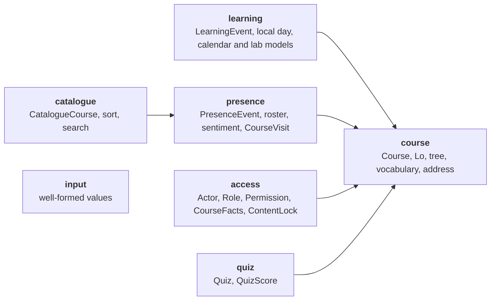

# The Tutors domain model

This page describes `@tutors/domain` (`packages/domain`): the part of Tutors that would still be true if the database, the web framework and the identity provider were all replaced. [`ARCHITECTURE.md`](../ARCHITECTURE.md) is the authority on the shape of the whole system; this page goes one level down into its centre.

The domain is plain TypeScript. It imports nothing outside itself (`domain-self-contained`, Rule 0340), reads no clock and no environment, makes no request, and holds no state. Every function in it can be called from a test with literal values.

## How the model is organised

Tutors follows the domain-driven design vocabulary, used plainly:

| Term | What it means here |
|---|---|
| **Bounded context** | A directory of `packages/domain/src` with its own import path and its own language. A word has one meaning inside it. |
| **Ubiquitous language** | The words a lecturer or a student would use, and the only words the code uses for the same thing. If the code says "educator", the documentation, the feature files and the error messages say "educator". |
| **Entity** | Something with an identity that persists while its attributes change: a course (its course id), a learner (their login), a learning object (its route). |
| **Value** | Something defined only by what it contains: a calendar day, a role, a content lock, a learning event. Values are immutable; a rule returns a new one. |
| **Policy** | A pure function that answers a yes-or-no question about the model: `permits`, `whitelistAdmits`, `keepOnRoster`. |
| **Value rule** | A function that turns untrusted input into a value or refuses it: everything in `@tutors/domain/input`, `parseSentiment`, `isLoType`. |
| **Domain event** | A fact that happened, as data: `LearningEvent`, `PresenceEvent`. The domain shapes them; the application ring publishes them. |
| **Use case** | Not in the domain. A function in `@tutors/application` that reads facts through ports, asks the domain, and writes the result through ports. |

What the domain deliberately does **not** contain: repositories, services with dependencies, anything `async` that waits on the outside world, HTTP status codes, table names, Svelte runes. If a rule needs a fact from outside (the time, a published course, a stored row), the caller passes it in.

## The contexts at a glance

An arrow means "names a type of". No context calls another context's rules to make its own decision, with one exception that is the point of the design: `access` owns login comparison, and every context that compares logins uses it.

| Context | Import path | One-line purpose |
|---|---|---|
| Course | `@tutors/domain/course`, `/course/vocabulary`, `/course/address` | What a course is and how its tree is built |
| Learning | `@tutors/domain/learning` | What a learner did, on which day, and how it adds up |
| Presence | `@tutors/domain/presence` | Who is here now, and what a learner chooses to share |
| Access | `@tutors/domain/access` | Who is asking and what they may do |
| Quiz | `@tutors/domain/quiz` | Questions, answers and scores |
| Catalogue | `@tutors/domain/catalogue` | How the public list of courses is ordered and searched |
| Input | `@tutors/domain/input` | What a well-formed request value is |

## Course

**Language.** A *course* is a tree of *learning objects* (Lo). A learning object has a *kind* (`LoType`), a *route* (its address inside the reader) and, for composite kinds, children. *Topics* and *units* group; *labs*, *notes*, *talks*, *videos* and *quizzes* are what a student opens. *Panels* are the talks, videos and notes pinned to the top of a topic. A *wall* is every learning object of one kind across the course. *Companions* are the course's external links (Slack, Moodle, YouTube and so on).

**Entities and values.**

- `Course`: the entity. Identity is `courseId`, the host name of its published site.
- `Lo` and its kinds: entities within a course, identified by `route`.
- `LO_TYPES`, `LO_SIMPLE_TYPES`, `LO_COMPOSITE_TYPES`: the closed vocabulary. `isLoType` is its value rule. Nothing outside this context defines a kind.
- `LO_TYPE_ORDER`: where each kind sorts among its siblings in a built course. It is a record over the vocabulary, so a kind without a place does not compile. The model library's `simpleTypes`, `loCompositeTypes`, `loTypes` and `preOrder` are taken from these (Rule 0356); `tests/unit/domain/lo-vocabulary.test.ts` checks the themes' icons and the static generator's palette against the same list.
- `CourseAddress`: where a course is published, from `courseAddress` and `tutorsJsonUrl`.

**Rules.**

- `decorateCourseTree(course, courseId, courseUrl, options)` turns the published JSON into the tree the reader uses: parents, breadcrumbs, routes, walls, the table of contents, companions and the calendar. Rendering is an option the caller passes in, so the tree rule does not know markdown.
- `flattenLos`, `filterByType`, `allVideoLos`, `getPanels`, `getUnits`, `crumbs`: the only sanctioned ways to walk the tree.
- `searchHits` finds text in a course's learning objects.
- `loadPropertyFlags` reads what a course switches on or off in its properties.

**Invariants.** A route is unique within a course. An unknown kind in published JSON is removed (`removeUnknownLos`), never rendered as something else.

## Learning

**Language.** A *learning event* is either a *page load* (a learner opened a learning object) or a *tick* (thirty more seconds with the page visible). A *calendar day* is a `YYYY-MM-DD` in the learner's own time zone. A *learning record* is the total for a learner and a learning object. A *lab step* is a page of a lab.

**Values and events.**

- `LearningEvent = PageLoadEvent | TickEvent`, with `courseId`, `loId`, `day` and, for a page load, the kind.
- `CalendarDay`.
- The row shapes the store keeps (`CalendarDbRow`, `LearningRecordRow`, `TimeRows`): the domain names the columns so that the adapters and the read models agree, and holds no table name.

**Rules.**

- `pageLoadEvent(course, lo, now)` and `tickEvent(...)` build the event. `learningObjectRoute` decides which route a lab step counts towards.
- `learningEventIdentity` says when two reports are the same event, so a repeat with no navigation behind it is dropped.
- `localYyyyMmDd(now)` cuts the day. Every "today", "this week" and "this month" in Tutors comes from `local-day.ts`; no other module formats a day.
- `BaseCalendarModel` and `BaseLabModel` turn rows into the per-student, per-day and per-lab tables Tutors Time shows. `filterByDateRange` bounds them.
- `pseudonymise(rows, viewer)` gives every classmate a fresh random pseudonym for one answer, keeping the asker's own name. It is the rule behind "a student sees their own engagement in the context of the class, and nobody else's name" (Rule 0075).

**Invariants.** A tick is thirty seconds. A day is the learner's local day, never UTC. Nothing is a learning event without a signed-in learner; the use case enforces that by not building one.

## Presence

**Language.** A learner is *present* in a course if their latest shared activity is inside the *roster window*. *Sharing* is the learner's choice to be seen. *Sentiment* is the mood they choose to show. A *course visit* is one entry in a learner's own history, with a count, a last-visited time and a *favourite* flag.

**Values and events.**

- `PresenceEvent`: where a sharing learner is, with the course, the learning object and a `LearnerDisplay`.
- `StoredPresence`: the latest snapshot per learner per course.
- `Sentiment` (`SENTIMENTS`), `OnlineStatus`, `CourseVisit`.

**Rules.**

- `presenceEvent(course, lo, learner)` builds the event; `learnerDisplay` decides what of a learner is shown.
- `presentLearners(rows, courseId)` and `keepOnRoster(...)` decide the roster. `ROSTER_WINDOW_MS` is five minutes; `ROSTER_REFRESH_MS` is one minute; `rosterSince(nowMs)` is the instant the window opens.
- `parseSharing`, `onlineStatusFor`, `parseSentiment`, `isSentiment`: value rules for what a learner may set.
- `recordCourseVisit`, `favouriteCourseVisit`, `forgetCourseVisit`: how a visit history changes. Each returns a new list.
- `catalogueRecordOf(course, now)` and `isCatalogueCourseId`: what of a visit the public catalogue may count. Branch and preview deploys of a course site are never counted.

**Invariants.** A learner who does not share appears as "Anon" under a per-browser id, never under their name or login. A learner's own browser keeps them on the roster even when the stored row is behind. A presence event says whether its course is private.

## Access

This context is the security model. It is small on purpose: every authorisation decision in Tutors is one of the functions below.

**Language.** An *actor* is the verified person behind a request. A *login* is their GitHub user name. A *role* in a course is *educator* or *student*. A *permission* is something a role may do. An *administrator* is a login the deployment trusts as an educator of every course. *Course facts* are what a course publishes about itself that access needs. A *whitelist* is the list of logins a private course admits. A *content lock* hides a learning object from students. A *trusted host* is one the server is willing to read a course from.

**Entities and values.**

- `Actor { subject, login, name, email, image }`: verified identity only. It carries no role; a role is always *in a course*.
- `Role = "student" | "educator"`. `Permission = "broadcast" | "quiz:manage" | "analytics:view" | "content:lock"`.
- `CourseFacts { courseId, title, educators, isPrivate, credits }`, built by `courseFactsFrom(courseId, json)`. Anything missing or of the wrong type reads as absent, never as a grant.
- `Resource { kind: "course", courseId }`: what an action is about.
- `ContentLock`, `LockWrite`, `LockChangeResult`.

**Policies.**

| Policy | Question | Notes |
|---|---|---|
| `permits(asker, action, facts, admins)` | May this person do this in this course? | The one policy. Nobody signed in may do nothing. |
| `roleInCourse(asker, facts, admins)` | What are they here? | Educator when the course lists them or the deployment's administrators do; otherwise student. |
| `sameLogin(a, b)`, `listsLogin(list, login)`, `loginKey(login)` | Is this the same account? | Logins that differ only in capital letters are one account (Rule 0353). Every login comparison in Tutors goes through these. |
| `whitelistAdmits(course, login)`, `requiresSignIn(course, login)` | May they read this course at all? | A course with no auth level or no whitelist admits everyone; an educator is always admitted. |
| `isLoLocked(lo, locks)`, `isLoRouteLocked`, `hasActiveLocks`, `showsLockedToStudents` | Is this hidden from students? | A lock on a route locks everything beneath it; the course home is never locked. |
| `courseJsonUrl(courseId, allowedHosts)`, `redirectTarget(from, location)` | May the server ask this host? | A course id comes from the caller, so it must never steer a server-side request at an internal address. |

**What this context does not do.** It does not read the session (that is `SessionPort`), fetch the course (`CourseFactsSource`), cache anything or choose a status code. `createAuthorization` in the application ring sequences those; the route enforces the answer. The split is what makes the policy testable with literal values and the enforcement auditable route by route. See [`BOUNDARIES.md`](BOUNDARIES.md#security).

**Invariants.** An absent fact is never a grant. "Could not find out" is not "no": the use case raises `AuthorizationUnavailableError` and the route answers 503. `lockedBy` is the session's login, never a value from a request.

## Quiz

**Language.** A *quiz* is a learning object with *questions*; a question has a *type*, options and an answer. A *score* is how many were right.

**Rules.** `scoreQuiz(quiz, answers)` and `isQuizComplete(quiz, answers)`.

## Catalogue

**Language.** The *catalogue* is the public list of courses students have visited. A *sort* is one of `CATALOGUE_SORTS` (visits, recent, title, credits).

**Rules.** `arrangeCatalogue(courses, sort, search)` orders and filters; `matchesCatalogueSearch` decides what a search term matches; `isCatalogueSort` is the value rule for a sort in a URL.

## Input

`@tutors/domain/input` holds one function per kind of value the server accepts from a request: `courseId`, `loRoute`, `text`, `loType`, `sentiment`, `onlineStatus`, `imageUrl`, `icon`, `calendarDay`. Each takes `unknown` and returns the accepted value or `null`. A route writes `valid(check.courseId(body.courseId), "courseId is required")` and cannot half-validate.

They live in the domain, not in the reader, because what a well-formed course id is is a fact about Tutors, not about one server: every route, and any future service, refuses the same things.

## How the contexts meet

1. **By naming a type.** A learning event carries a `LoType`; a presence event carries a `LearnerDisplay`.
2. **In a use case.** `visitCourse` (application) records the visit with `recordCourseVisit` (presence); `countCourseVisit` turns it into a catalogue record. The domain functions do not know about each other.
3. **Through an application event.** `learning`, `presence` and `course-visit` are published on the `EventPublisher` port. The catalogue counts a visit because it subscribed in the composition root, not because the visit code calls it.

## Adding to the model

| You are adding | It goes | And it needs |
|---|---|---|
| A new fact about what something *is* | A type in the context that owns the word | A line in this page's language section |
| A decision | A pure function (a policy) in that context | A unit test with literal values; an EARS Rule if a user could observe it |
| A new kind of learning object | `course/vocabulary.ts` and the tree rules | The generator, the renderer and a UI view; see [`HOW-TO-CONTRIBUTE.md`](../HOW-TO-CONTRIBUTE.md) |
| A new permission | `Permission` and `ROLE_PERMISSIONS` in `access/roles.ts` | `tests/unit/domain/access-policy.test.ts`, and the route that asks for it |
| A new accepted input | A function in `input.ts` | A test of what it refuses |
| A new word | Check this page first | If it is a synonym of an existing word, use the existing word |

Signs a change is in the wrong place: it needs `await`, it needs `Date.now()`, it imports anything, or it mentions a table, a status code or a component. Those belong in a use case, an adapter, a route or the UI.

## Where the tests are

| Context | Tests |
|---|---|
| Course | `tests/unit/course`, `tests/unit/model`, `tests/contract/course`, `tests/fuzz` |
| Learning | `tests/unit/time`, `tests/unit/domain` |
| Presence | `tests/unit/community`, `tests/unit/domain` |
| Access | `tests/unit/domain/access-policy.test.ts`, `tests/unit/rbac`, `tests/unit/application/authorization.test.ts` |
| Quiz | `tests/unit/quiz` |
| Input | `tests/unit/reader` (the routes), `tests/security` |

Domain modules have mutation floors (`tests/mutation/nightly-mutation-floors.json`): a rule that a mutant can change without a test failing is a rule nobody has stated.
