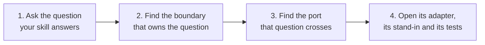

# Contributor guides: from what you know to the code that needs it

Tutors is built so that each concern lives in one place behind one interface. You do not need to understand the whole codebase to contribute. Pick the guide that matches your skill. Each one shows you the same six things:

1. **Your part of the code, in one picture.**
2. **Find it yourself:** commands that list your part of the code as it is today, so you never depend on a page being up to date.
3. **Your ports:** the interfaces you work behind, their real adapters and their stand-ins for tests.
4. **From what you want to change to the file:** the one or two files to open, and the test that proves the change.
5. **The lines you must not cross,** and what enforces each.
6. **A first change, start to finish.**

| If you are | Read | Your boundary | Ports you meet first |
|---|---|---|---|
| A security engineer | [security.md](security.md) | Security | `SessionPort`, `CourseFactsSource`, `AccessStore` |
| A database engineer | [database.md](database.md) | Database | `AccessStore`, `PresenceFeed`, the server functions behind the data API |
| A back-end developer or integrator | [backend.md](backend.md) | Application, Integration | `AssignmentSource`, `CourseSource`, `EventPublisher`, all of them |
| A UX or accessibility specialist, or a translator | [ux.md](ux.md) | UX | Called through `adapters()`: `ProfilePort`, `PresencePort`, `LearningEventSink` |
| A designer or front-end developer | [ui.md](ui.md) | UI | None: components receive props and read state |
| A tester | [testing.md](testing.md) | Testing | Every port's in-memory stand-in and contract suite |
| An operator or SRE | [operations.md](operations.md) | Operations | `Clock` |
| A teacher or learning designer | [domain.md](domain.md) | Domain model | None: values in, values out |
| A course tooling author | [authoring.md](authoring.md) | Authoring and published API | The course rules' own file-system port |

## How to find a port from a skill, in general

The same four steps work for anything these guides do not cover.

1. **Ask the question your skill answers.** "Who may do this?" "Where is it stored?" "What does it look like?" The table at the top of [`docs/BOUNDARIES.md`](../../docs/BOUNDARIES.md) maps each question to the boundary that owns it.
2. **Find the boundary's packages.** They are one row of the boundary map, section 11 of [`ARCHITECTURE.md`](../../ARCHITECTURE.md). Every package is in exactly one boundary, and a test fails if one is not.
3. **Find the port.** `ls packages/application/src/ports` lists them all; each file is short and says what the product needs. `grep -rln "<PortName>" packages/adapters` shows who implements it, and `grep -rn "<PortName>" packages/application/src` shows which use case calls it.
4. **Open the narrow part.** The adapter is one package with one dependency. Its stand-in is in `packages/application/src/testing/in-memory.ts`. Its tests are found with `grep -rln "<adapter or port name>" tests`.

Everything on the other side of the port is somebody else's concern, and you can leave it unread.

## Where these guides sit

- [`HOW-TO-CONTRIBUTE.md`](../../HOW-TO-CONTRIBUTE.md) is the one page for everybody: by who you are, by capability, port by port, and recipes.
- These guides go one level deeper, one per skill.
- [`docs/BOUNDARIES.md`](../../docs/BOUNDARIES.md) defines each boundary, and [`ARCHITECTURE.md`](../../ARCHITECTURE.md) is the authority on the shape.
- [`CONTRIBUTING.md`](../../CONTRIBUTING.md) covers setup, branches, commits and the pull request process.
