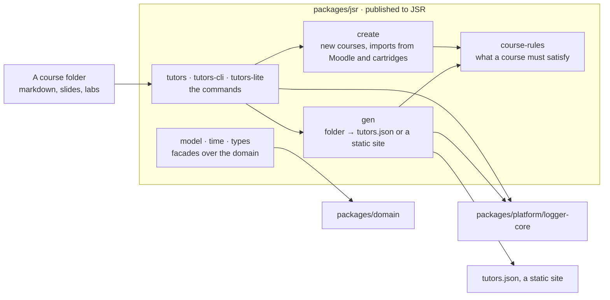

# Contributing to the course tooling

You know command-line tools, static site generation, Deno or publishing packages. You do not need the apps. The tooling a lecturer runs, and the packages people outside this repository import, live in one folder and are published to JSR.

Back to the [index of contributor guides](README.md).

## Your part of the code, in one picture



## Find it yourself

| To find | Run |
|---|---|
| The packages and what each publishes | `ls packages/jsr`, then `cat packages/jsr/<name>/deno.json` |
| Every command of the CLI | `cat packages/jsr/tutors-cli/src/commands.ts` |
| How a folder becomes a course | `ls packages/jsr/gen/src/services` |
| Every course rule and its message | `cat packages/jsr/course-rules/src/messages.ts` |
| The published surface, as reviewed | `ls etc/*.api.md` |
| The Deno workspace and its members | `cat deno.json` |
| The courses the generator is checked against every night | `ls tests/generator tests/validate-corpus` |

## Ports

The course rules define their own small ports in `packages/jsr/course-rules/src/ports.ts`, because the same rules run in the CLI, in Studio and in a browser. The rules never read a file; they ask the file system they are given. The adapters are in `packages/jsr/course-rules/src/adapters`.

The generator and the commands have no ports. They are a self-contained toolchain.

## From what you want to change to the file

| You want to | Open | Then prove it with |
|---|---|---|
| Add a generator option or fix its output | `packages/jsr/gen/src` | `tests/unit/gen`, `pnpm check:generator-diff` |
| Add or change a command | `packages/jsr/tutors-cli/src/commands.ts`, `packages/jsr/tutors/main.ts` | `tests/unit/tutors-cli` |
| Add or reword a course rule | `packages/jsr/course-rules/src` | `tests/unit/course-rules`, `pnpm check:validate-corpus` |
| Change how a course is created or imported | `packages/jsr/create/src` | `tests/unit/create` |
| Change a template of the static site | `packages/jsr/gen/src/templates` | `tests/unit/gen`, the static reader features |
| Change what a facade exports | `packages/jsr/model`, `time`, `types` | `pnpm api-report:check`, `tests/contract` |

## What you can ignore

The five apps, the database, sign-in. The tooling runs on a lecturer's machine and in their site's build.

## The lines you must not cross

| Line | What holds it |
|---|---|
| A facade imports only the rings and the logger core | `facades-import-rings-only` |
| The course rules read no file directly | `course-rules-no-file-system` |
| What is published keeps its surface through a major version | `etc/*.api.md`, `pnpm api-report:check` |
| A published library logs through the logger, not `console` | Rule 0291 |
| A finding has one message, written once | Review; `messages.ts` |
| Every workspace member the generators import is carried into the nightly comparison | `tests/architecture/workspace-wiring.test.ts` |
| A test that runs a command with `--fix` or `--out` names a temporary folder | The mutation run mutates the repository in place |

## A first change, start to finish

Suppose the generator should warn when a link file has more than one line.

1. The file is read in `packages/jsr/gen/src/utils/file-utils.ts` (`readFirstLineFromFile`), and its callers are in `lr-utils.ts`.
2. Log the warning through the logger: `log.warn("...", { path })`. Do not write to the console.
3. Add the case to `tests/unit/gen/lr-utils-mutations.test.ts`, which writes real files to a temporary folder.
4. Run `pnpm check:generator-diff`. It generates a set of courses with your branch and with `main` and shows every difference. A warning changes no output, so there should be none.

## Prove it

```bash
pnpm exec vitest run tests/unit/gen tests/unit/course-rules tests/unit/create tests/unit/tutors-cli
pnpm api-report:check
pnpm check:generator-diff      # needs Deno
```

## Read more, only if you need it

- [`ARCHITECTURE.md`](../../ARCHITECTURE.md) section 17: the authoring toolchain and the published packages.
- [`docs/BOUNDARIES.md`](../../docs/BOUNDARIES.md#authoring-and-published-api).
- [`guides/SHARED-TYPES.md`](../SHARED-TYPES.md): `@tutors/tutors-types`.
