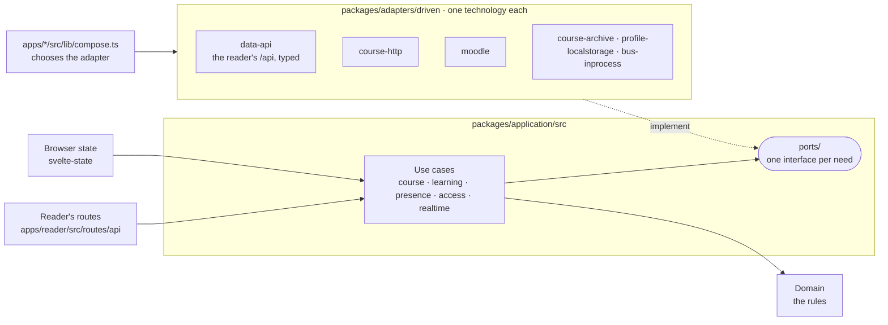

# Contributing as a back-end developer or integrator

You know services, APIs, protocols and how to make two systems talk. You do not need Svelte. This guide is for two closely related jobs: changing what the product does (a use case), and connecting it to something outside (an adapter for Moodle, another learning platform, another course host).

Back to the [index of contributor guides](README.md).

## Your part of the code, in one picture



## Find it yourself

| To find | Run |
|---|---|
| Every port | `ls packages/application/src/ports` |
| What a port asks for | `cat packages/application/src/ports/<name>.ts` |
| Who implements a port | `grep -rln "<PortName>" packages/adapters/driven` |
| Who calls a port | `grep -rn "<PortName>" packages/application/src --include=*.ts -l` |
| Every use case | `grep -n "^export" packages/application/src/index.ts` |
| Which adapter each app wires behind each port | `cat apps/reader/src/lib/compose.ts` |
| Every route of the data API, and its typed contract | `ls -R apps/reader/src/routes/api`, `cat packages/adapters/driven/data-api/src/contract.ts` |
| The reviewed surface of the ports | `cat etc/application-ports.api.md` |

The full table of ports, adapters, stand-ins and contract suites is section 6 of [`ARCHITECTURE.md`](../../ARCHITECTURE.md), and the same information by capability is in [`HOW-TO-CONTRIBUTE.md`](../../HOW-TO-CONTRIBUTE.md#start-from-what-you-want-to-change).

## The ports most integrations start from

| Port | What the application needs | Adapter today | A second adapter would be |
|---|---|---|---|
| `AssignmentSource` | Assignments and submissions from the learning platform | `moodle` | Canvas, Blackboard, Brightspace |
| `CourseSource` | The text of a published course | `course-http` | A course served from object storage or a private host |
| `CourseFactsSource` | Who teaches a course, read by the server | `course-http` (`publishedCourseFacts`) | A college's enrolment system |
| `IdentityClient`, `SessionPort` | Sign in, and the verified actor | `identity-better-auth` (GitHub) | A college's single sign-on; see the [security guide](security.md) |
| `EventPublisher` | Tell the rest of the application something happened | `bus-inprocess` | A message broker |
| `ContentRenderer` | Markdown to HTML | `render-markdown` | Another renderer, another maths engine |

## From what you want to change to the file

| You want to | Open | Then prove it with |
|---|---|---|
| Change what happens, in what order | The use case under `packages/application/src` | `tests/unit/application/use-cases.test.ts` |
| Add an adapter for an existing port | A new package under `packages/adapters/driven/<name>`; the recipe is in [`HOW-TO-CONTRIBUTE.md`](../../HOW-TO-CONTRIBUTE.md#add-an-adapter-for-an-existing-port) | The port's contract suite in `tests/unit/application/port-contracts.test.ts` |
| Add a port | `packages/application/src/ports`, its stand-in in `testing/in-memory.ts`, its row in `ARCHITECTURE.md` section 6 | `pnpm api-report`, the architecture features |
| Add a data API route | The route under `apps/reader/src/routes/api`, its entry in `data-api/src/contract.ts`, its line in `tests/security/mutating-routes.txt` | The [security guide](security.md) |
| Change the Moodle integration | `packages/adapters/driven/moodle/src`, `apps/reader/src/lib/server/moodle` | `tests/unit/adapters/moodle-assignment-source.test.ts` |
| Choose a different adapter in one deployment | `apps/<app>/src/lib/compose.ts` | The BDD steps run the real composition roots |

## What you can ignore

Svelte and the components. A use case is plain TypeScript: it receives its ports as an argument, for example `loadCourse({ source, renderer, clock })`, and never reaches for a global.

## The lines you must not cross

| Line | What holds it |
|---|---|
| The application imports only the domain | `application-imports-domain-only`, Rule 0341 |
| A vendor library is imported only by its adapter | `vendor-only-in-its-adapter`, Rule 0342 |
| An adapter never imports another adapter | `no-adapter-to-adapter`, Rule 0343 |
| A port grows when a use case needs it, not because a technology offers it | Review of `etc/application-ports.api.md` |
| Anonymous mode is a different composition, not a branch in the code | Rule 0345 |
| A new package, port or rule has its line in `ARCHITECTURE.md` | Rules 0347 to 0354 fail the build otherwise |

## A first change, start to finish

Suppose a college uses Canvas instead of Moodle.

1. Read the port: `packages/application/src/ports/assignment-source.ts`. That file is the whole specification of what you must provide.
2. Read the existing adapter as an example: `packages/adapters/driven/moodle/src`.
3. Create `packages/adapters/driven/canvas` with one dependency, the Canvas client or plain `fetch`. Implement the port.
4. Test it the way Moodle's adapter is tested, with a scripted server and no network.
5. Add the package to the boundary map and the adapter table in `ARCHITECTURE.md`. The architecture tests tell you which lines are missing.
6. Wire it in `apps/reader/src/lib/compose.ts`, chosen by an environment variable declared in the environment contract.

No use case, no component and no other adapter changes.

## Prove it

```bash
pnpm exec vitest run tests/unit/application tests/unit/adapters tests/architecture
pnpm exec vitest run tests/bdd/steps/developer/hexagonal-architecture.steps.ts
pnpm architecture-report && pnpm api-report:check
```

## Read more, only if you need it

- [`ARCHITECTURE.md`](../../ARCHITECTURE.md) sections 6 to 8: ports, adapters, composition roots.
- [`docs/BOUNDARIES.md`](../../docs/BOUNDARIES.md#integration): the integration boundary.
- [`guides/SERVER-WRITES.md`](../SERVER-WRITES.md): the data API and why it exists.
