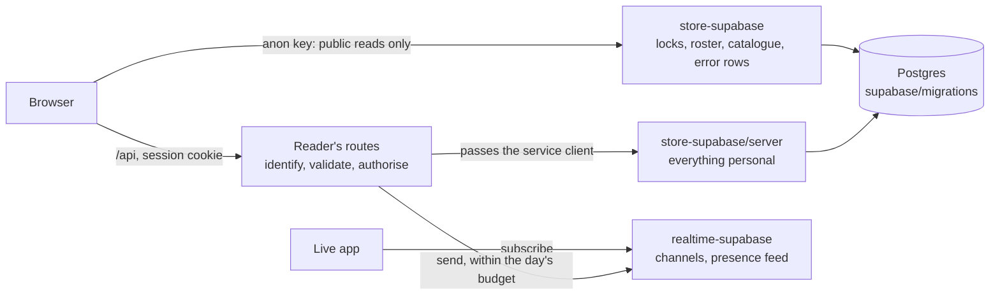

# Contributing as a database engineer

You know schemas, queries, indexes, migrations and row-level access. You do not need to know Svelte, the use cases or the user interface. In Tutors the database is behind two packages and a folder of migrations, and no table is named anywhere else.

Back to the [index of contributor guides](README.md).

## Your part of the code, in one picture



## Find it yourself

| To find | Run |
|---|---|
| Every table and function the code names | `grep -rnoE "\.(from\|rpc)\(\"[a-z_-]+\"" packages/adapters/driven/store-supabase/src packages/adapters/driven/realtime-supabase/src` |
| Proof that nothing else names one | `pnpm exec vitest run tests/architecture/database-boundary.test.ts` |
| What the browser's key is used for | `pnpm exec vitest run tests/architecture/browser-data-access.test.ts` |
| Every function the server may call | `grep -n "^export" packages/adapters/driven/store-supabase/src/server/*.ts` |
| Every migration, in order | `ls supabase/migrations` |
| Which table holds which personal data | [`docs/DATA-INVENTORY.md`](../../docs/DATA-INVENTORY.md) and section 13 of [`ARCHITECTURE.md`](../../ARCHITECTURE.md) |
| Which adapters implement which ports | `grep -rlE "AccessStore\|PresenceFeed\|ProfilePort\|LearningEventSink" packages/adapters/driven --include=*.ts` |

## The ports you implement

| Port | What the application needs | Your adapter | Stand-in | Contract suite |
|---|---|---|---|---|
| `AccessStore` | The content locks lecturers set | `store-supabase/src/access-store.ts` (reads) | `InMemoryAccessStore` | `accessStoreContract` |
| `PresenceFeed` | Watch a course; read who was active since | `realtime-supabase/src/presence.ts` | `InMemoryPresence` | `presenceContract` |
| `LearningEventSink`, `ProfilePort`, `CourseCatalogue`, `WhiteboardStore` | Personal reads and writes | The browser side is `data-api`; your side is the function each route calls in `store-supabase/src/server` | The in-memory adapters | `learningEventSinkContract`, `profileContract` |

A contract suite is a set of tests every adapter of a port must pass. They are in `packages/application/src/testing/contracts.ts` and run from `tests/unit/application/port-contracts.test.ts`. A second store (plain Postgres, SQLite for a workshop) is done when it passes them.

## From what you want to change to the file

| You want to | Open | Then prove it with |
|---|---|---|
| Speed up or fix a personal read or write | `packages/adapters/driven/store-supabase/src/server/learner-store.ts`, `time-rows.ts`, `enrolment.ts` | `tests/unit/adapters/store-supabase-server.test.ts` |
| Change a public read | `store-supabase/src/access-store.ts`, `catalogue.ts`, `presence-rows.ts` | `tests/unit/adapters/store-supabase-reads.test.ts` |
| Add a table, column or index | A new file in `supabase/migrations`, following [`guides/MIGRATIONS.md`](../MIGRATIONS.md) | `pnpm check:migrations`, `tests/conformance/migrations.test.ts` |
| Change what is broadcast, or the budget | `packages/adapters/driven/realtime-supabase/src`, `packages/application/src/realtime` | `tests/unit/adapters/realtime-supabase-presence.test.ts`, `tests/unit/application/realtime-gateway.test.ts` |
| Change a row's shape | The type in `packages/domain/src/learning/rows.ts` or `time-rows.ts`, then the adapter | `tests/contract/supabase` |
| Put a different store behind the same ports | A new package under `packages/adapters/driven`, wired in `apps/*/src/lib/compose.ts` | The contract suites |

## What you can ignore

Everything above the ports. A use case asks for "the locks of this course" and does not know there is a table. A route authorises the caller and then calls one of your functions with the service client as its first argument, for example `setLock(db, login, courseId, route, locked)`. You never decide who may call it. You do decide that the login written to a row is the one you were handed.

## The lines you must not cross

| Line | What holds it |
|---|---|
| A table or database function is named only in the two database packages | Rule 0355, `tests/architecture/database-boundary.test.ts` |
| The vendor's client is imported only by its adapter | `vendor-only-in-its-adapter` |
| No app imports a database client | `no-database-client-in-apps` |
| The browser's key reads public things only | `tests/architecture/browser-data-access.test.ts` |
| A table is not contracted in the release that stops using it | `pnpm check:migrations`, [`guides/MIGRATIONS.md`](../MIGRATIONS.md) |
| No vendor type leaves the adapter, except the opaque `ServiceDb` | `etc/` API reports, review |

## A first change, start to finish

Suppose the catalogue is slow to list courses by last visit.

1. Find the query: it is in `packages/adapters/driven/store-supabase/src/catalogue.ts`.
2. Add the index in a new migration. An index is an expand step, so it can ship in the same release as the code.
3. If the query changes, change it in `catalogue.ts` only, and extend `tests/unit/adapters/store-supabase-reads.test.ts`, which drives the adapter with a scripted client (`tests/support/scripted-supabase.ts`).
4. Run the checks below. No route, service or component changes.

## Prove it

```bash
pnpm exec vitest run tests/unit/adapters tests/architecture tests/contract/supabase
pnpm exec vitest run tests/unit/application/port-contracts.test.ts
pnpm check:migrations
```

## Read more, only if you need it

- [`docs/BOUNDARIES.md`](../../docs/BOUNDARIES.md#database): the two keys and the three entry points.
- [`guides/SERVER-WRITES.md`](../SERVER-WRITES.md): why personal writes go through the reader's server.
- [`guides/MIGRATIONS.md`](../MIGRATIONS.md): expand, migrate, contract.
