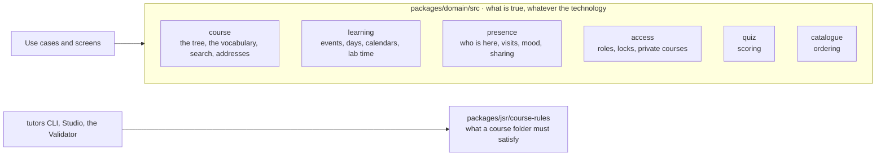

# Contributing as a teacher or learning designer

You know what a course is, how students move through one, and what a lecturer wants to know about engagement. You may not think of yourself as a programmer. The part of Tutors that holds that knowledge is written as plain functions that take values and return values. It imports nothing: no database, no browser, no framework.

Back to the [index of contributor guides](README.md).

## Your part of the code, in one picture



## Find it yourself

| To find | Run |
|---|---|
| The areas of the model | `ls packages/domain/src` |
| Every kind of learning object, named once | `cat packages/domain/src/course/vocabulary.ts` |
| The words the model uses, with their meaning | [`docs/DOMAIN-MODEL.md`](../../docs/DOMAIN-MODEL.md) |
| Every rule a course is checked against | `grep -rhoE "V0[0-9]{2}" packages/jsr/course-rules/src \| sort -u`, then `cat packages/jsr/course-rules/src/messages.ts` |
| How a quiz is scored | `cat packages/domain/src/quiz/services/quiz-score.ts` |
| How engagement is summarised | `ls packages/domain/src/learning/services` |
| Every requirement about courses, as sentences | `grep -rh "Rule:" tests/bdd/features/course tests/bdd/features/student` |

## Ports

None. The domain has no port because it needs nothing from outside: a caller hands it the time, the published course and the stored rows. That is what makes it the easiest part of Tutors to change safely, and the reason its tests use no stand-ins at all.

## From what you want to change to the file

| You want to | Open | Then prove it with |
|---|---|---|
| Change how a course tree is arranged or ordered | `packages/domain/src/course/services/lo-tree.ts`, `course/utils/lo-utils.ts` | `tests/unit/model` |
| Add a kind of learning object | `packages/domain/src/course/vocabulary.ts` first; the recipe is in [`HOW-TO-CONTRIBUTE.md`](../../HOW-TO-CONTRIBUTE.md#add-a-kind-of-learning-object) | `tests/unit/domain/lo-vocabulary.test.ts` |
| Change what search finds | `packages/domain/src/course/services/search.ts` | `tests/unit/model/search.test.ts` |
| Change how a quiz is scored | `packages/domain/src/quiz/services/quiz-score.ts` | `tests/unit/quiz/quiz-score.test.ts` |
| Change how time on a lab or a day is counted | `packages/domain/src/learning` | `tests/unit/time` |
| Change who counts as present | `packages/domain/src/presence/roster.ts` | `tests/unit/community` |
| Add or reword a rule a course must satisfy | `packages/jsr/course-rules/src` (`shape.ts`, `warnings.ts`, `messages.ts`) | `tests/unit/course-rules` |

## What you can ignore

Every technology. Svelte, Supabase, sign-in, containers, pipelines. If a change seems to need one of them, the rule you are writing probably belongs in the domain and the technology part is someone else's follow-up.

## The lines you must not cross

| Line | What holds it |
|---|---|
| The domain imports nothing outside itself | `domain-self-contained`, Rule 0340 |
| It never reads a clock or the environment; the caller passes the time | Review; the tests pass fixed dates |
| Each kind of learning object is named once, in the vocabulary | Rule 0356 |
| A course rule's message is written once, in `messages.ts`, in a lecturer's words | Review; Studio, the CLI and the Validator all show the same sentence |
| The course rules never read a file directly | `course-rules-no-file-system` |

## A first change, start to finish

Suppose a lecturer should be warned when a topic has no summary.

1. Write the sentence: "If a topic has no summary, then tutors shall warn the lecturer." Add it as a `Rule:` with the next free id.
2. Add the check in `packages/jsr/course-rules/src/warnings.ts` and its one message in `messages.ts`.
3. Add a small course that breaks the rule and one that satisfies it to `tests/unit/course-rules/course-warnings.test.ts`.
4. Nothing else changes. The CLI, Studio and the Validator pick the rule up because they all run the same package.

## Prove it

```bash
pnpm exec vitest run tests/unit/domain tests/unit/model tests/unit/quiz tests/unit/course-rules
pnpm test:ears:audit
```

## Read more, only if you need it

- [`docs/DOMAIN-MODEL.md`](../../docs/DOMAIN-MODEL.md): the contexts and their language.
- [`docs/VALIDATOR-COURSE-CHECKS.md`](../../docs/VALIDATOR-COURSE-CHECKS.md): the course checks as a lecturer meets them.
- [`guides/specifications/course-authoring.md`](../specifications/course-authoring.md): authoring scenarios written down and not yet executed.
