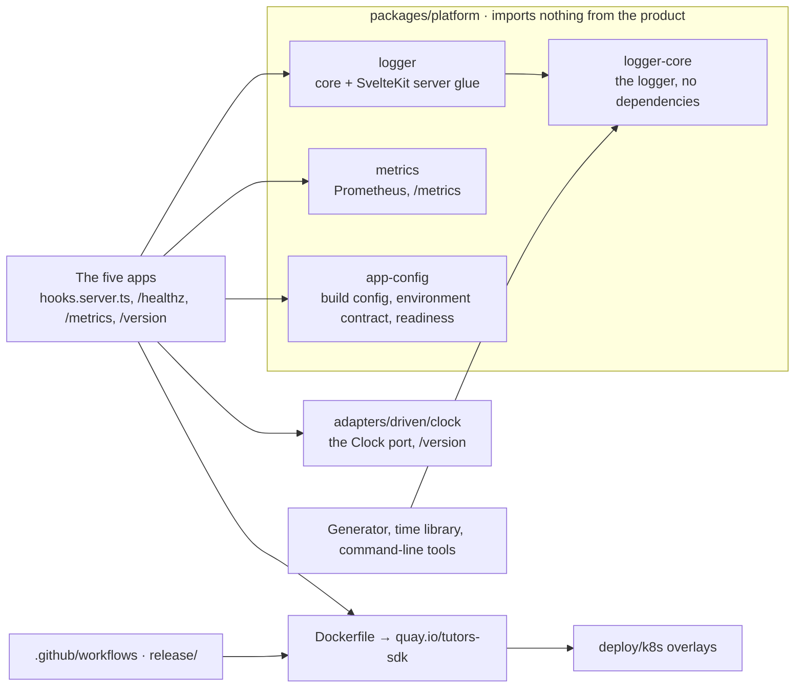

# Contributing as an operator or SRE

You know builds, containers, configuration, logs, metrics, pipelines and releases. You do not need to know the product's behaviour. Operations in Tutors is four platform packages, one adapter, and the deployment and release files.

Back to the [index of contributor guides](README.md).

## Your part of the code, in one picture



## Find it yourself

| To find | Run |
|---|---|
| Every environment variable, which app needs it, and when | `cat packages/platform/app-config/src/env-contract.js`, then `pnpm check:env` |
| What `/healthz` decides, for every app | `cat packages/platform/app-config/src/readiness.js`, `ls apps/*/src/routes/healthz` |
| The fields of a log line | `cat packages/platform/logger-core/src/types.ts` |
| Every metric | `grep -n "name:" packages/platform/metrics/src/metrics.ts` |
| Every pipeline | `ls .github/workflows` |
| What is deployed where | `ls deploy/k8s/overlays deploy/k8s/variants` |
| The service level objectives | [`docs/slo.md`](../../docs/slo.md), `pnpm check:slo` |
| What the release harness checks | `ls tests/conformance`, [`guides/Release-Strategy.md`](../Release-Strategy.md) |

## The port you implement

| Port | What the application needs | Adapter | Stand-in |
|---|---|---|---|
| `Clock` | The instant, so time can be frozen for tests and the release harness | `packages/adapters/driven/clock` (honours `HARNESS_NOW`) | `FixedClock` |

The platform packages have no port. They are imported directly, by every adapter and app, and in exchange they may import nothing from the product.

## From what you want to change to the file

| You want to | Open | Then prove it with |
|---|---|---|
| Add a log field or a transport | `packages/platform/logger-core/src` | `tests/unit/utils/logger-core.test.ts`, `tests/unit/utils/logger.test.ts`, `tests/observability` |
| Change how a request is logged | `packages/platform/logger/src/request-logger.ts` | `tests/observability/observability-contracts.test.ts` |
| Add a metric | `packages/platform/metrics/src/metrics.ts` | `tests/observability` |
| Add or change an environment variable | `packages/platform/app-config/src/env-contract.js`, `.env.example` | `pnpm check:env` |
| Change what makes an app ready | `packages/platform/app-config/src/readiness.js` | `tests/unit/platform/readiness.test.ts` |
| Change the image | `Dockerfile` | `pnpm check:container`, `tests/conformance` |
| Change a deployment | `deploy/k8s` | `pnpm check:k8s`, `pnpm check:deploy-pins` |
| Change a pipeline | `.github/workflows` | The zizmor and Scorecard checks on the pull request |
| Change how a release is cut | `release/`, [`guides/Release-Strategy.md`](../Release-Strategy.md) | `tests/conformance/release-rules.test.ts` |

## What you can ignore

Courses, learners, roles, components. A log line carries a request id and the fields the caller gave; you never need to know what the caller was doing.

## The lines you must not cross

| Line | What holds it |
|---|---|
| A platform package imports nothing from the rings | `platform-self-contained` |
| The logger core imports nothing at all | `logger-core-self-contained`, Rule 0290 |
| A published library logs through the logger, never `console` or `process.stderr` | Rule 0291, ESLint `no-console` |
| No secret and no personal data in a log line | `tests/observability`, review |
| The environment is read at a composition root or in the reader's server library, nowhere else | `pnpm check:env` |
| Actions are pinned by commit, with least privilege | zizmor on every pull request |
| Work is never pushed on a `release/*` branch by hand | It fires the release dispatch |

## A first change, start to finish

Suppose every log line should carry the image's build id.

1. The field belongs to the logger's context: `packages/platform/logger-core/src/context.ts` and `types.ts`.
2. The value comes from the environment, so it is declared in `packages/platform/app-config/src/env-contract.js` and read once, where each app starts.
3. Add the case to `tests/unit/utils/logger-core.test.ts` and the field to the log contract in `tests/observability`.
4. `pnpm check:env` tells you every place that must now provide the variable: the overlays, the compose files, the workflows.

## Prove it

```bash
pnpm exec vitest run tests/observability tests/conformance tests/unit/platform tests/unit/utils
pnpm check:env && pnpm check:k8s
pnpm architecture-report
```

`tests/conformance` needs `kustomize` on the path for three of its tests.

## Read more, only if you need it

- [`docs/BOUNDARIES.md`](../../docs/BOUNDARIES.md#operations): the operations boundary.
- [`ARCHITECTURE.md`](../../ARCHITECTURE.md) section 18: deployment.
- [`docs/LOCAL-CONTAINERS.md`](../../docs/LOCAL-CONTAINERS.md): the stack on your own machine.
