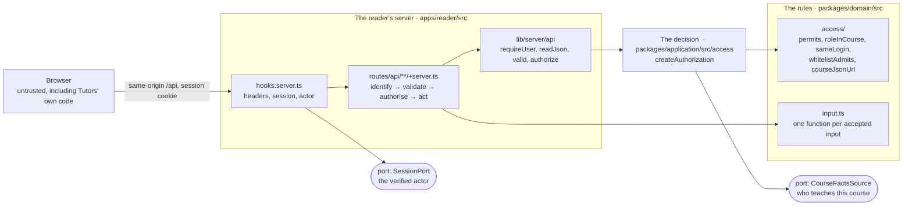

# Contributing as a security engineer

You know threat models, authentication, authorisation, input handling and HTTP. You do not need to know Svelte, the course model or the database schema. This guide takes you from that skill to the three places security lives in Tutors, the two ports behind them, and the handful of files you will actually open.

Back to the [index of contributor guides](README.md).

## Your part of the code, in one picture



Security is the rules, the decision and the enforcement, in three different places. The rules are pure functions with no dependencies. The decision is one use case. The enforcement is the reader's server and nothing else. The separation is the control: a rule cannot be skipped by a route, because a route has no rule of its own to fall back on.

## Find it yourself

You should not have to trust this page. Each command below lists one part of the security surface from the code as it is today. Run them from the repository root.

| To find | Run |
|---|---|
| Every route that changes state, and who may call it | `cat tests/security/mutating-routes.txt` |
| Every place a route asks "may they?" | `grep -rnE "authorize\(\|\.can\(\|requireEducator\(" apps/reader/src/routes` |
| Every route that requires a signed-in caller | `grep -rlE "requireUser\|requireEducator" apps/reader/src/routes` |
| Every accepted input and its rule | `grep -n "^export function" packages/domain/src/input.ts` |
| The whole access policy | `ls packages/domain/src/access` |
| Every place the private environment is read | `grep -rln "app/env/private" apps/*/src` |
| The response headers every app must send | `cat tests/security/header-contract.json` |
| The dependency rules that guard identity | `grep -n "name: \"identity" .dependency-cruiser.cjs` |
| Every requirement about access, as a sentence | `grep -rn "Rule:" tests/bdd/features/shared/server-data-access.feature tests/bdd/features/developer/authorisation-matrix.feature` |

If a command shows something this guide does not explain, the code is right and the guide is out of date. Please fix the guide in the same pull request.

## The ports you work behind

A port is an interface in `packages/application/src/ports`. It says what the product needs from outside, and each has an in-memory stand-in so you can test without GitHub, a course host or a database.

| Port | The question it answers | Defined in | Real adapter | Stand-in for tests |
|---|---|---|---|---|
| `SessionPort` | Who is the verified actor of this request? | `ports/session.ts` | `packages/adapters/driven/identity-better-auth` (`index.server.ts`) | `FixedSession` |
| `IdentityClient` | Sign in and out from the browser | `ports/session.ts` | `identity-better-auth` (`client.ts`) | `RecordingIdentityClient` |
| `CourseFactsSource` | Who teaches this course, and who may read it? | `ports/course-facts.ts` | `packages/adapters/driven/course-http` (`publishedCourseFacts`) | `InMemoryCourseFacts` |
| `AccessStore` | Which content has a lecturer locked? | `ports/access-store.ts` | `store-supabase` (read), `data-api` (write) | `InMemoryAccessStore` |

The stand-ins are in `packages/application/src/testing/in-memory.ts`.

## From what you want to change to the file

| You want to | Open | Then prove it with |
|---|---|---|
| Change who may do something | `packages/domain/src/access/roles.ts` (permissions per role) and `policy.ts` (`permits`, `roleInCourse`) | `tests/unit/domain/access-policy.test.ts` |
| Change how a decision is reached, cached or fails | `packages/application/src/access/authorization.ts` | `tests/unit/application/authorization.test.ts` |
| Tighten what an input may be | `packages/domain/src/input.ts` | `tests/unit/reader/api-validate.test.ts` |
| Change which hosts the server will fetch a course from | `packages/domain/src/access/trusted-hosts.ts` (`courseJsonUrl`, `redirectTarget`) | `tests/unit/reader/api-validate.test.ts` |
| Add or change a response header | `apps/reader/src/hooks.server.ts`, then `tests/security/header-contract.json` | `tests/security/security.test.ts` |
| Change sign-in, the cookie or the session | `packages/adapters/driven/identity-better-auth/src` | `tests/unit/identity` |
| Protect a new route | The route's `+server.ts`, `apps/reader/src/lib/server/api`, `tests/security/mutating-routes.txt` | The authorisation matrix, `tests/bdd/features/developer/authorisation-matrix.feature` |
| Change who may read a private course | `packages/domain/src/access/whitelist.ts`, `packages/application/src/access/admission.ts` | `tests/bdd/features/instructor/whitelist-management.feature` |
| Change what personal data is held, or consent | `packages/adapters/driving/privacy`, [`docs/DATA-INVENTORY.md`](../../docs/DATA-INVENTORY.md) | The inventory, updated in the same change |

## What every protected route looks like

There is one shape. `apps/reader/src/routes/api/locks/+server.ts` is the shortest complete example:

```ts
const user = await requireUser(locals);                                    // identify: the session's actor, else 401
const body = await readJson(request);                                      // a JSON object of bounded size, else 400, 413 or 415
const courseId = valid(check.courseId(body.courseId), "courseId is required");   // validate: the domain's input rules
const loRoute = valid(check.loRoute(body.loRoute), "loRoute is required");
if (!(await authorize(user, "content:lock", { kind: "course", courseId })))      // authorise: the one decision
  error(403, "Only an educator of this course can lock its content");
await setLock(requireDb(), user.login, courseId, loRoute, body.locked);    // act: the login is the session's, never the body's
```

Four things to check in any review of a route:

1. The actor comes from `locals`, which `hooks.server.ts` filled from the session. Nothing in the body or the query says who is asking.
2. Every value read from the request passes through a function of `@tutors/domain/input` before it is used.
3. `authorize` is asked, and "could not find out" is a 503, not a 403 and not a yes (Rule 0073).
4. The database function receives the service client from the route that authorised the request.

## What you can ignore

- **The browser's role checks.** `rbacService` in `packages/adapters/driving/svelte-state/src/rbac` decides what to show. It is never the control.
- **The UI and the course model.** No component makes a request, and no rule about access is in a component.
- **The schema.** Tables are named only in `packages/adapters/driven/store-supabase` and `realtime-supabase`. You need the two keys, not the tables: the anon key is in every page and may only read public things; the service key exists only on the reader's server.

## The lines you must not cross

| Line | What holds it |
|---|---|
| Logins are compared with `sameLogin`, never `===` | Rule 0353, `tests/unit/domain/access-policy.test.ts` |
| An identity provider's library is imported only by its adapter | `identity-provider-only-in-adapter` |
| No browser entry point reaches a module that reads a secret | `identity-no-server-in-browser` |
| No app imports a database client | `no-database-client-in-apps` |
| Every mutating route is listed with its callers | `tests/security/mutating-routes.txt`, checked by `tests/security/security.test.ts` |
| Every app sends the contracted headers and cookie flags | `tests/security/header-contract.json` |
| The server fetches only from a host `courseJsonUrl` accepts | `tests/unit/reader/api-validate.test.ts` |

One thing is not yet on the single path. Three course routes under `apps/reader/src/routes/api/courses/[courseid]` (enrolment export, Moodle sync and the course's locks) call `requireEducator` in `apps/reader/src/lib/server/educator.ts`, which reads the course's enrolment itself. New routes use `authorize`. Moving those three onto it is a good, contained contribution.

## A first change, start to finish

Suppose educators should be able to do a new thing, say clear a course's presence history.

1. **Write the requirement.** One EARS sentence as a `Rule:` in `tests/bdd/features/shared/server-data-access.feature`, with the next free id (`pnpm test:ears:audit --next-id`). [`guides/testing/EARS-METHODOLOGY.md`](../testing/EARS-METHODOLOGY.md) has the format.
2. **Name the permission.** Add it to `Permission` and to the educator's list in `packages/domain/src/access/roles.ts`. Add its cases to `tests/unit/domain/access-policy.test.ts`: an educator may, a student may not, a signed-out caller may not, a login in another case still may.
3. **Write the route** in the shape above. If it takes a new kind of input, add its function to `packages/domain/src/input.ts` first.
4. **List the route** in `tests/security/mutating-routes.txt` with who may call it, and add its row to the authorisation matrix feature.
5. **Leave the browser for last.** Showing a button to educators is a UX change in `svelte-state/src/rbac`. It makes the feature usable. It does not make it safe, and the server must already refuse without it.

## Prove it

```bash
pnpm exec vitest run tests/security tests/unit/domain tests/unit/application tests/unit/identity   # your boundary
pnpm exec vitest run tests/bdd/steps/developer/authorisation-matrix.steps.ts                       # every route, every kind of caller
pnpm architecture-report                                                                           # the dependency rules
pnpm test:ears:audit                                                                               # every Rule is bound to a test
```

Then the checklist in [`HOW-TO-CONTRIBUTE.md`](../../HOW-TO-CONTRIBUTE.md#before-you-open-the-pull-request).

## Read more, only if you need it

- [`docs/BOUNDARIES.md`](../../docs/BOUNDARIES.md#security): the security boundary in full, with what may cross it.
- [`ARCHITECTURE.md`](../../ARCHITECTURE.md) sections 10.4 (signing in and the actor) and 10.6 (a protected action), as sequence diagrams.
- [`guides/SERVER-WRITES.md`](../SERVER-WRITES.md): why every personal write goes through the reader's server.
- [`guides/RBAC.md`](../RBAC.md): how a lecturer declares educators in `enrollment.yaml`.
- [`SECURITY.md`](../../SECURITY.md): how to report a vulnerability. Please do not open a public issue for one.
