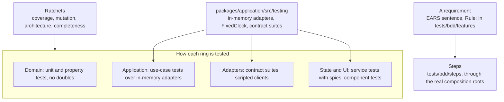

# Contributing as a tester

You know how to specify behaviour, find the gap in a suite and make a failure reproducible. You do not need a database, a network or a browser for most of it. Every port has an in-memory stand-in, so almost anything in Tutors can be tested in a process that starts in a second.

Back to the [index of contributor guides](README.md).

## Your part of the code, in one picture



## Find it yourself

| To find | Run |
|---|---|
| Which tier a `tests/` folder is, and what runs it | [`tests/TESTING.md`](../../tests/TESTING.md) |
| The stand-in for every port | `grep -n "^export class" packages/application/src/testing/in-memory.ts` |
| The contract every adapter of a port must pass | `grep -n "^export function" packages/application/src/testing/contracts.ts` |
| Every requirement, and whether it is bound to a test | `pnpm test:ears:audit`, or `pnpm ears:dashboard` for one page |
| The next free Rule id | `pnpm test:ears:audit --next-id` |
| The least-tested library modules | `sort -t: -k2 -n tests/mutation/nightly-mutation-floors.json \| head -30` |
| Known gaps that may only shrink | `cat tests/completeness/known-gaps.txt tests/architecture/known-violations.txt` |
| The tests of one module | `grep -rln "<module file name>" tests` |

## The ports, as a tester sees them

| Port | Stand-in | Contract suite |
|---|---|---|
| `CourseSource`, `CourseFactsSource` | `InMemoryCourseSource`, `InMemoryCourseFacts` | none yet |
| `ContentRenderer` | `PassThroughRenderer` | none yet |
| `LearningEventSink` | `InMemoryLearningEventSink` | `learningEventSinkContract` |
| `PresencePublisher`, `PresenceFeed`, `PresencePort` | `InMemoryPresence` | `presenceContract` |
| `ProfilePort` | `InMemoryProfile` | `profileContract` |
| `AccessStore` | `InMemoryAccessStore` | `accessStoreContract` |
| `EventPublisher` | `RecordingPublisher` | `eventPublisherContract` |
| `Clock` | `FixedClock` | none |
| `SessionPort`, `IdentityClient` | `FixedSession`, `RecordingIdentityClient` | none yet |
| `CourseCatalogue`, `WhiteboardStore`, `AssignmentSource` | `InMemoryCourseCatalogue`, `InMemoryWhiteboard`, `InMemoryAssignmentSource` | none yet |

A port with "none yet" is an open contribution: write the suite in `packages/application/src/testing/contracts.ts`, run it against the in-memory adapter and the real one in `tests/unit/application/port-contracts.test.ts`.

## From what you want to test to the file

| You want to test | Write it in | Using |
|---|---|---|
| A rule about a course, a role, a learner | `tests/unit/domain`, `tests/unit/model`, `tests/unit/quiz` | Values in, values out |
| A use case | `tests/unit/application/use-cases.test.ts` | The in-memory adapters and `FixedClock` |
| An adapter | `tests/unit/adapters`, `tests/unit/identity` | The contract suite, or a scripted client (`tests/support/scripted-supabase.ts`) |
| A service in the browser's state | `tests/unit/connect`, `tests/unit/community`, `tests/unit/course` | `configureAdapters(anonymousAdapters({ ...spies }))` |
| A component | A `*.component.test.ts` file | The components project of `vitest.components.config.ts` |
| A requirement, end to end in process | `tests/bdd/features` and `tests/bdd/steps` | The real composition roots and route handlers |
| The shape of the codebase | `tests/architecture` | A fixture workspace of planted violations |
| Security contracts | `tests/security` | See the [security guide](security.md) |
| The deployed stack | `tests/e2e-stack` | Built images; runs in the Nightly |

## The lines you must not cross

| Line | What holds it |
|---|---|
| Product code contains no test double outside a composition root | `test-doubles-only-in-composition` |
| A test is never skipped, disabled or deleted to get green | Review; `tests/suite-health` |
| A baseline never gains a line: fix the cause | `known-violations.txt`, `known-gaps.txt`, the knip and manifest baselines |
| A coverage or mutation floor is never lowered; it is raised from a measured score | `pnpm check:coverage-floors`, `pnpm check:mutation-floors` |
| A test that runs a command with `--fix` or `--out` names a temporary folder | The mutation run mutates the repository in place |
| A new library module gets a mutation floor from a measured run | The Nightly fails on an unfloored module |

## A first change, start to finish

Kill a surviving mutant. It is the most direct way to find behaviour nobody has specified.

1. Pick a module with a low floor in `tests/mutation/nightly-mutation-floors.json`.
2. Run the mutation tool on that one file: copy `stryker.nightly.config.json`, set `mutate` to the file and the JSON reporter to a folder of your own, and run `pnpm exec stryker run <your config>`. A single module takes about a minute. [`guides/testing/MUTATION-TESTING.md`](../testing/MUTATION-TESTING.md) shows how to read a survivor.
3. For each survivor ask what a user would notice if the code really were that way. Write the test that notices. If nobody would notice, the code may be dead: say so in the pull request.
4. Raise the module's floor to the score you measured.

## Prove it

```bash
pnpm test                       # unit, BDD, contract and component tests
pnpm test:runway                # architecture, suite health, completeness, observability, conformance, security
pnpm test:ears:audit
pnpm exec vitest run --coverage && pnpm check:coverage-floors
```

## Read more, only if you need it

- [`guides/testing/TESTING-OVERVIEW.md`](../testing/TESTING-OVERVIEW.md): the tiers on one page.
- [`guides/testing/EARS-METHODOLOGY.md`](../testing/EARS-METHODOLOGY.md): how to write a requirement.
- [`docs/BOUNDARIES.md`](../../docs/BOUNDARIES.md#testing): how each boundary is tested, and with which doubles.
