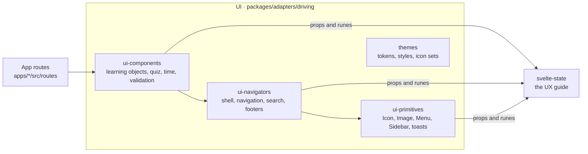

# Contributing as a designer or front-end developer

You know components, layout, CSS, tokens and themes. You do not need to know the database, sign-in or the server. In Tutors, UI is appearance: a component renders what it is given. It never fetches, never decides who may see something and never imports an adapter.

Back to the [index of contributor guides](README.md). If your change is about what happens rather than how it looks, see the [UX guide](ux.md).

## Your part of the code, in one picture



The arrows only go one way. A primitive knows nothing about a course. A navigator may use primitives. A component may use both.

## Find it yourself

| To find | Run |
|---|---|
| The component behind a kind of learning object | `ls -R packages/adapters/driving/ui-components/src/learning-objects` |
| The leaf components you can reuse | `ls packages/adapters/driving/ui-primitives/src/components` |
| The shell, the navigation bars and the footer | `ls packages/adapters/driving/ui-navigators/src` |
| Every token | `cat packages/adapters/driving/themes/src/styles/paper-tokens.css` |
| Every theme and icon set | `ls packages/adapters/driving/themes/src/styles packages/adapters/driving/themes/src/icons` |
| Which component renders a route | Open the route's `+page.svelte` under `apps/reader/src/routes` and follow its imports |
| How one course page is assembled, top to bottom | [`docs/COURSE-PAGE-WALKTHROUGH.md`](../../docs/COURSE-PAGE-WALKTHROUGH.md) |

## Ports

None, and that is the point. A UI package has no port, makes no request and knows no adapter. It receives props and reads runes from `svelte-state`. If a component needs data it does not have, the change is a new rune or service method in the [UX boundary](ux.md), which the component then reads.

## From what you want to change to the file

| You want to | Open | Then prove it with |
|---|---|---|
| Change how a card, a lab or a talk looks | `ui-components/src/learning-objects` (`content`, `layout`, `structure`) | A component test (`*.component.test.ts`) and `tests/bdd/features/ui/resource-cards.feature` |
| Change the shell, a navigation bar or search | `ui-navigators/src` | `tests/bdd/features/ui/shell-and-navigation.feature` |
| Add or change a leaf component | `ui-primitives/src/components` | A component test |
| Change a colour, a spacing or a size | `themes/src/styles/paper-tokens.css`, and [`DESIGN.md`](../../DESIGN.md) | `tests/bdd/features/ui/preferences-and-themes.feature` |
| Add a theme or an icon set | `themes/src/styles`, `themes/src/icons`, `themes/src/services/themes.svelte.ts` | `tests/unit/themes` |
| Change the engagement views | `ui-components/src/time` | `tests/unit/time` |

## What you can ignore

Where anything comes from. Stores, keys, sessions, routes under `/api`, the use cases.

## The lines you must not cross

| Line | What holds it |
|---|---|
| Primitives do not import navigators or components; navigators do not import components | `ui-layering` |
| A primitive does not reach a data feature | `ui-primitives-no-data-features` |
| No UI package imports a driven adapter or makes a request | `ui-imports-no-driven-adapter` |
| No hard-coded colour or size; use a token | [`DESIGN.md`](../../DESIGN.md), review |
| A component does not decide who may see something; it asks `rbacService` | Review; the [security guide](security.md) |

## A first change, start to finish

Suppose a locked lab's card should show a padlock.

1. The fact "this lab is locked" already exists: the domain's `isLoLocked` answers it and `rbacService` in `svelte-state` exposes it. You do not touch either.
2. Open the card under `ui-components/src/learning-objects`. Read the lock state from the service and render the icon with the `Icon` primitive.
3. Use tokens for the colour and spacing.
4. Add a component test that mounts the card with a locked and an unlocked lab.

## Prove it

```bash
pnpm dev                                         # builds the three UI packages in order, then starts the reader
pnpm exec vitest run tests/unit/themes
pnpm test:bdd                                    # the ui features
pnpm architecture-report                         # the layering rules
```

## Read more, only if you need it

- [`DESIGN.md`](../../DESIGN.md): the visual contract.
- [`docs/BOUNDARIES.md`](../../docs/BOUNDARIES.md#ui): the UI boundary.
- [`guides/specifications/responsive-layout.md`](../specifications/responsive-layout.md): layout scenarios written down and not yet executed.
