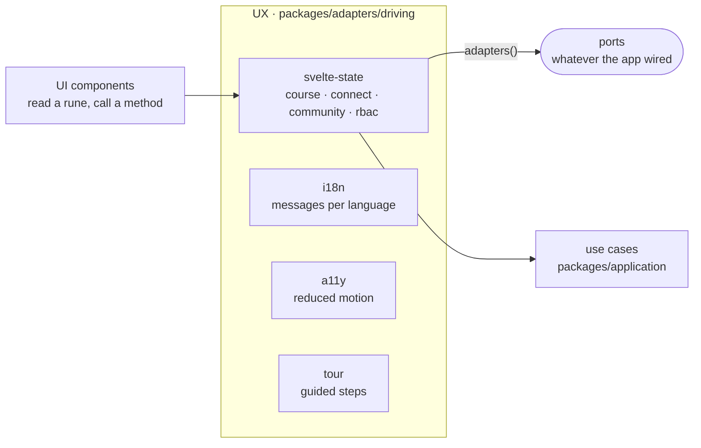

# Contributing as a UX or accessibility specialist

You know flows, states, language, keyboard paths and assistive technology. You do not need to know where data is stored or how sign-in works. In Tutors, UX is behaviour: what state exists, what happens when a learner acts, in which language and with which assistance. It lives in four packages and the journeys that specify it.

Back to the [index of contributor guides](README.md). If your change is about how something looks, see the [UI guide](ui.md).

## Your part of the code, in one picture



A service in `svelte-state` asks for a port through `adapters()`. It does not know whether a database, the browser's storage or a test stand-in is behind it. That is why you can change behaviour and test it with nothing running.

## Find it yourself

| To find | Run |
|---|---|
| Every piece of shared state the UI can read | `grep -n "rune" packages/adapters/driving/svelte-state/src/index.svelte.ts` |
| Every service and what it offers | `ls packages/adapters/driving/svelte-state/src/*/services` |
| Which ports a service uses | `grep -rn "adapters()" packages/adapters/driving/svelte-state/src` |
| Every string a learner reads, per language | `ls packages/adapters/driving/i18n/src/messages` |
| Every journey that is specified | `ls tests/bdd/features/ui tests/bdd/features/student` |
| The three people the journeys are written for | [`guides/PERSONAS.md`](../PERSONAS.md) |
| The steps of the guided tour | `cat packages/adapters/driving/tour/src/steps.ts` |

## The ports your services call

| Service (in `svelte-state/src`) | What it does for the learner | Ports it calls |
|---|---|---|
| `course/services/course.svelte.ts` | Loads a course and opens a lab, note, notebook or wall | `CourseSource`, `ContentRenderer`, `Clock` |
| `connect/services/connect.svelte.ts` | Sign-in state, sharing, mood, course visits | `IdentityClient`, `ProfilePort`, `EventPublisher`, `Clock` |
| `community/services/presence.svelte.ts`, `live.svelte.ts` | Who is on this course, who is online | `PresencePort`, `EventPublisher`, `Clock` |
| `community/services/analytics.svelte.ts` | Records what was read | `LearningEventSink`, `EventPublisher`, `Clock`, `ProfilePort` |
| `rbac/rbac-service.svelte.ts` | What to show an educator or a student; locks | `AccessStore` |

Every port has a stand-in in `packages/application/src/testing/in-memory.ts`, and `anonymousAdapters({ ...overrides })` in `svelte-state/src/adapters.ts` gives a service a full set with your spies in place.

## From what you want to change to the file

| You want to | Open | Then prove it with |
|---|---|---|
| Change what happens when a learner does something | The service above, and the use case it calls in `packages/application/src` | `tests/unit/connect`, `tests/unit/community`, `tests/unit/course` |
| Add an empty, loading or error state | The service that owns the state, then the component that shows it | A scenario in `tests/bdd/features/ui` |
| Fix a keyboard path or a focus order | The component (see the [UI guide](ui.md)), and `tests/bdd/features/ui/accessibility.feature` | The accessibility steps |
| Respect reduced motion somewhere new | `packages/adapters/driving/a11y/src/reduced-motion.svelte.ts` | `tests/bdd/features/ui/accessibility.feature` |
| Add or correct a translation | `packages/adapters/driving/i18n/src/messages/<locale>.ts` | `tests/bdd/features/developer/i18n-localisation.feature` |
| Add a tour step | `packages/adapters/driving/tour/src/steps.ts` | `tests/bdd/features/developer/guided-tour.feature` |
| Change what an educator sees that a student does not | `svelte-state/src/rbac/rbac-service.svelte.ts` | `tests/unit/rbac`, `tests/bdd/features/ui/content-locks.feature` |

## What you can ignore

Tables, keys, sign-in providers, the server. If you find yourself writing `fetch("/api/...")` in a service or a component, stop: there is a port for it, or there should be one.

## The lines you must not cross

| Line | What holds it |
|---|---|
| Runes in `.ts` modules live in `svelte-state` and nowhere else | Rule 0344, `runes-only-in-svelte-state` |
| A service never imports a driven adapter | `svelte-state-imports-no-adapter` |
| A rule about a course, a role or a learner belongs in the domain, not in a service | Review; `docs/DOMAIN-MODEL.md` |
| What an educator may do is decided on the server; the browser decides only what to show | The [security guide](security.md) |

## A first change, start to finish

Suppose turning sharing off should also clear the list of students shown on the page.

1. Write the sentence as a `Rule:` in `tests/bdd/features/student/live-presence.feature`.
2. Open `connect/services/connect.svelte.ts`. `toggleShare` already stops the roster through `presenceService.stopPresenceListener()`, and that method empties the list. So the behaviour exists and what was missing is the specification.
3. Bind the Rule to steps, or add a unit test beside `tests/unit/connect/connect-sharing.test.ts`, which shows the pattern: stand-ins for the ports, spies for the neighbouring services, no network.

## Prove it

```bash
pnpm exec vitest run tests/unit/connect tests/unit/community tests/unit/course tests/unit/rbac
pnpm test:bdd
pnpm test:ears:audit
```

## Read more, only if you need it

- [`docs/BOUNDARIES.md`](../../docs/BOUNDARIES.md#ux): the UX boundary, and the line between UX and UI in one example.
- [`guides/specifications/accessibility.md`](../specifications/accessibility.md): accessibility scenarios written down and not yet executed.
